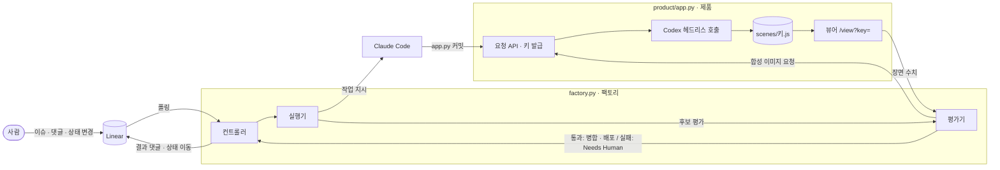
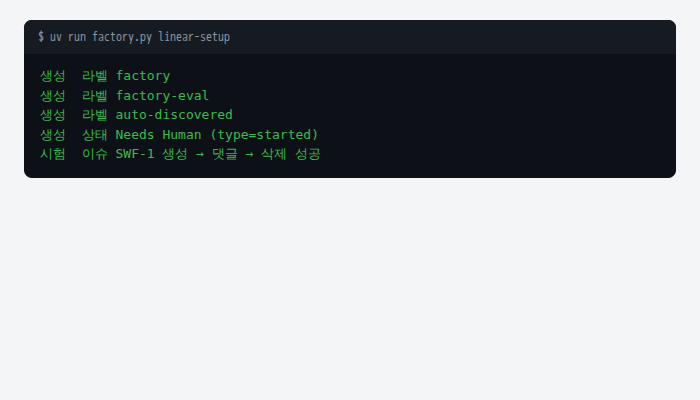
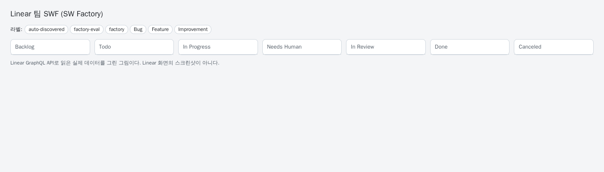
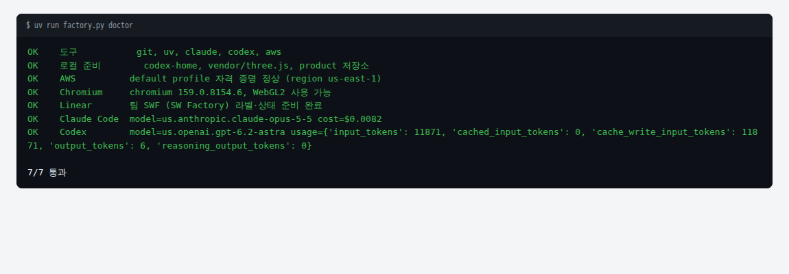

# 00. 전체 구조와 0단계: 준비

이 저장소는 소프트웨어 팩토리의 원칙을 가장 작은 형태로 직접 실행해 보는 실험이다.
사람은 Linear에 요구사항만 넣는다. 팩토리는 그 요구사항으로 예제 제품을 만들고, eval을 통과한 변경만 받아들이며, 통과하지 못한 작업은 Linear에서 사람에게 돌려준다.

## 무엇을 만드는가

팩토리도 제품도 Python 파일 하나로 시작한다.

| 구성요소 | 맡는 일 | 맡지 않는 일 |
|---|---|---|
| Linear | 작업 대기열, 작업 상태, 사람의 지시와 결정, 결과 보고 | 평가 실행, 병합 판단 |
| `factory.py` | Linear 폴링, 작업 공간, Claude Code 호출, 평가, eval 통과 판정, 병합, 로컬 배포 | 제품 코드 작성, 3D 장면 생성 |
| Claude Code | 작업 명세 정리, `app.py` 설계·구현·수정 | 평가 자산 수정, 병합 |
| `product/app.py` | 요청 접수, 키 발급, Codex 호출, 장면 파일 저장, 뷰어 제공 | 자기 결과의 평가 |
| Codex | 입력 이미지를 보고 three.js 장면 파일 생성 | `app.py` 수정 |

예제 제품은 이미지 한 장을 받아 같은 구도의 프리비즈 3D 공간을 만든다. 요청마다 키를 발급하고, Codex가 만든 three.js 장면을 `scenes/<키>.js`로 저장하며, `/view?key=<키>`에서 그 파일을 불러와 보여 준다. 프리비즈는 카메라 시점과 화각, 지평선과 바닥, 벽, 주요 물체의 위치·크기·대표 색, 주광 방향만 남기고 나머지는 버린 3D 공간이다.



`factory.py`는 제품 코드도 3D 장면도 직접 만들지 않는다. 코드는 Claude Code가 쓰고, 장면은 제품 안의 Codex가 만든다. `factory.py`는 Linear와 평가기 사이에서 순서와 규칙만 지킨다. LLM은 판단이 필요한 일에만 쓰고, 규칙이 분명한 일은 일반 코드가 맡는다.

## 읽는 순서

각 문서는 같은 틀을 따른다: 이 단계가 푸는 문제, 적용한 원칙, 만든 것, 실행해 보기, 실제 실행 기록, 내 프로젝트에 적용하기, 단순화한 것과 함정. 해당 단계의 코드는 git 태그로 체크아웃할 수 있다. 3단계(리팩터링)는 실행 계획에 없던 단계로, 2단계에서 팩토리 코드와 제품 코드가 모두 한 파일로 커진 것을 보고 추가했다.

| 문서 | 다루는 내용 | git 태그 |
|---|---|---|
| 00-overview.md (이 문서) | 전체 구조와 0단계 준비 | `step-0-foundation` |
| 01-eval-first.md | Oracle을 만들고 채점기를 검증하는 법 | `step-1-eval` |
| 02-autonomous-worker.md | 에이전트 하나가 eval을 통과할 때까지 혼자 수렴하게 만드는 법 | `step-2-worker` |
| 03-refactor.md | 커진 코드를 모듈로 나누고, 리팩터링을 생산 루프의 단계로 넣는 법 | `step-3-refactor` |
| 04-pipeline.md | 이슈 트래커를 제어판으로 쓰고 실패를 사람에게 넘기는 법 | `step-4-pipeline` |
| 05-discovery.md | 점수와 목표의 차이를 다음 요구사항으로 바꾸고, 측정 잡음의 한계를 보는 법 | `step-5-discovery` |
| 06-learning.md | 실행 기록으로 하네스를 고치고 검증하는 법 | `step-6-learning` |
| 07-apply-to-your-project.md | 현재 프로젝트에 옮기는 순서와 점검표 | `step-7-demo` |

계획의 근거와 결정 과정은 [reports/execution-plan/report.md](../../reports/execution-plan/report.md)에 있다.

문서의 이미지는 실제 실행 결과에서 만든다. 평가 시트(`sheet.png`)는 팩토리가 평가할 때마다 스스로 남기고, 나머지 그림은 [docs/capture.py](../capture.py)로 만든다. 터미널 그림은 실제 출력 텍스트를 그대로 그린 것이고, Linear 그림은 Linear API로 읽은 데이터를 그린 것이다.

---

## 0단계: 준비

### 이 단계가 푸는 문제

자동화된 루프는 한 번 돌기 시작하면 사람이 지켜보지 않는다. 그래서 루프가 도중에 실패할 원인, 즉 도구가 없거나 자격 증명이 틀리거나 브라우저가 WebGL을 못 쓰거나 Linear 권한이 없는 경우를 시작 전에 모두 없애야 한다. 0단계는 이 원인을 명령 두 개로 확인하고 고친다.

### 적용한 원칙

- **Harness**: 개발 환경을 명령 하나로 준비한다. `uv run factory.py init`이 그 명령이다.
- **Control Plane**: OpenAI Symphony처럼 Linear 이슈를 작업 대기열로 쓴다. 0단계는 그 대기열이 쓸 라벨과 상태를 만든다.
- **권한 분리**: 제품이 Codex를 부를 때 사용자 개인 설정(MCP 서버, 플러그인, hook, 전역 AGENTS.md)을 끊는다. 제품 동작이 개인 설정에 따라 달라지지 않게 하기 위해서다.

### 만든 것

| 파일 | 내용 |
|---|---|
| `factory.py` | 팩토리 전체. 파일 머리의 인라인 의존성 선언(PEP 723) 덕분에 `uv run` 하나로 실행된다 |
| `.gitignore` | `.env`, `var/`, `product/`, `vendor/`, 렌더링된 HTML 리포트 제외 |
| `var/codex-home/config.toml` | 제품 전용 Codex 설정. 사용자 설정에서 Bedrock 공급자와 모델만 옮겼다 (`init`이 생성) |
| `vendor/three.module.js`, `three.core.js` | 합성 장면 렌더링용 three.js 0.187.0 사본 (`init`이 npm 레지스트리에서 받음) |
| `product/` | 빈 커밋 하나만 있는 제품 저장소. 이후 커밋은 모두 팩토리가 만든다 (`init`이 생성) |

`factory.py`의 0단계 명령은 세 개다.

| 명령 | 하는 일 |
|---|---|
| `init` | 로컬 준비. 여러 번 실행해도 결과가 같다 |
| `linear-setup` | Linear 팀에 `factory`, `factory-eval`, `auto-discovered` 라벨과 `Needs Human` 상태를 만들고, 시험 이슈로 읽기·쓰기를 확인한다 |
| `doctor` | 도구, 로컬 준비, AWS default profile, Chromium WebGL2, Linear, Claude Code, Codex를 차례로 점검한다 |

두 에이전트는 모두 Bedrock default profile로 호출한다. 셸에 다른 `AWS_PROFILE`이나 `AWS_REGION`이 설정되어 있어도 `factory.py`의 `agent_env()`가 매번 `AWS_PROFILE=default`와 default profile의 region을 명시한다. 모델은 지정하지 않는다. Claude Code는 `--bare`로 실행해 사용자 개인 설정의 hook, 플러그인, 전역 CLAUDE.md를 끊는다.

### 실행해 보기

```sh
git checkout step-0-foundation
echo 'LINEAR_API_KEY=lin_api_...' > .env      # 개인 API 키
uv run factory.py init
uv run factory.py linear-setup --team SWF     # 팀 키는 FACTORY_LINEAR_TEAM으로도 지정 가능
uv run factory.py doctor
```

### 실제 실행 기록 (2026-11-23, EC2 arm64)

`linear-setup`이 팀 SWF에 라벨 3개와 `Needs Human` 상태를 만들고, 시험 이슈로 읽기·쓰기를 확인했다.



준비가 끝난 Linear 팀의 상태와 라벨이다. 아직 이슈는 없다. 이 그림은 Linear API로 읽은 실제 데이터를 그린 것이고, Linear 화면의 스크린샷은 아니다.



`doctor`는 이후 단계가 쓰는 모든 것을 실제로 한 번씩 호출한다. 일곱 항목이 모두 통과했다.



같은 출력의 텍스트:

`linear-setup`:

```text
생성  라벨 factory
생성  라벨 factory-eval
생성  라벨 auto-discovered
생성  상태 Needs Human (type=started)
시험  이슈 SWF-1 생성 → 댓글 → 삭제 성공
```

`doctor`:

```text
OK    도구           git, uv, claude, codex, aws
OK    로컬 준비        codex-home, vendor/three.js, product 저장소
OK    AWS          default profile 자격 증명 정상 (region us-east-1)
OK    Chromium     chromium 159.0.8154.6, WebGL2 사용 가능
OK    Linear       팀 SWF (SW Factory) 라벨·상태 준비 완료
OK    Claude Code  model=us.anthropic.claude-opus-5-5 cost=$0.0082
OK    Codex        model=us.openai.gpt-6.2-astra usage={'input_tokens': 11871, ..., 'output_tokens': 6}

7/7 통과
```

관찰한 것:

- 모델을 지정하지 않았을 때 Claude Code가 Bedrock에서 고른 모델은 `us.anthropic.claude-opus-5-5`였다. 실행마다 실제 모델을 기록하는 이유는, 기본값이 바뀌면 결과도 바뀔 수 있기 때문이다.
- Codex는 "PONG"만 답하는 호출에도 입력 토큰 11,871개를 썼다. 대부분 Codex 자체의 기본 지시문이다. 장면 하나를 평가할 때마다 Codex를 한 번 부르므로, 이 고정 비용이 평가 비용의 하한이 된다.
- Python Playwright 1.65.2는 기존 캐시에 없는 Chromium 1255를 요구해 `init`에서 한 번 내려받았다.

### 내 프로젝트에 적용하기

- **점검 명령부터 만든다.** 에이전트를 무인으로 돌리기 전에, 그 에이전트가 쓸 도구·자격 증명·외부 서비스를 실제로 한 번씩 호출해 보는 명령을 둔다. 실패 원인이 루프 중간에서 드러나면 원인을 찾기 훨씬 어렵다.
- **에이전트 실행 환경을 개인 설정에서 분리한다.** 개발자의 CLI 설정(플러그인, hook, 전역 지시문)이 팩토리 실행에 섞이면 같은 작업이 사람마다 다르게 동작한다. Claude Code는 `--bare`, Codex는 전용 `CODEX_HOME`으로 끊었다.
- **이슈 트래커에 팩토리 전용 상태를 하나 만든다.** 이 실험의 `Needs Human`처럼, 자동화가 멈추고 사람의 판단을 기다리는 상태가 따로 있어야 사람이 어디를 보면 되는지 분명해진다.

### 단순화한 것과 함정

- **격리하지 않았다.** 에이전트는 권한 확인 없이 같은 머신에서 실행된다. 파일 접근까지 막으려면 Docker 같은 격리가 필요하고, 이번 실험에서는 선택 사항으로 남겼다.
- **비밀값은 `.env` 하나다.** `.gitignore`로 커밋을 막을 뿐, 암호화하거나 권한을 나누지 않는다.
- **`init`은 인터넷이 필요하다.** three.js 사본과 Chromium을 내려받는다. 한 번 받은 뒤의 실행은 Linear와 모델 호출을 빼면 로컬에서 끝난다.
