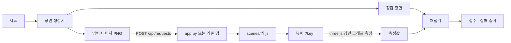
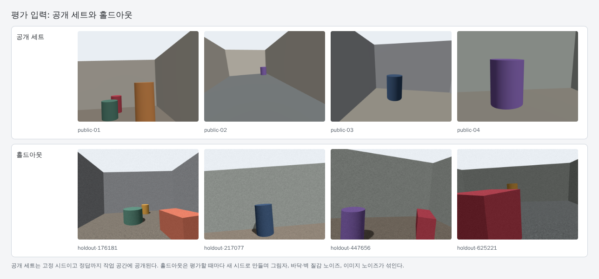
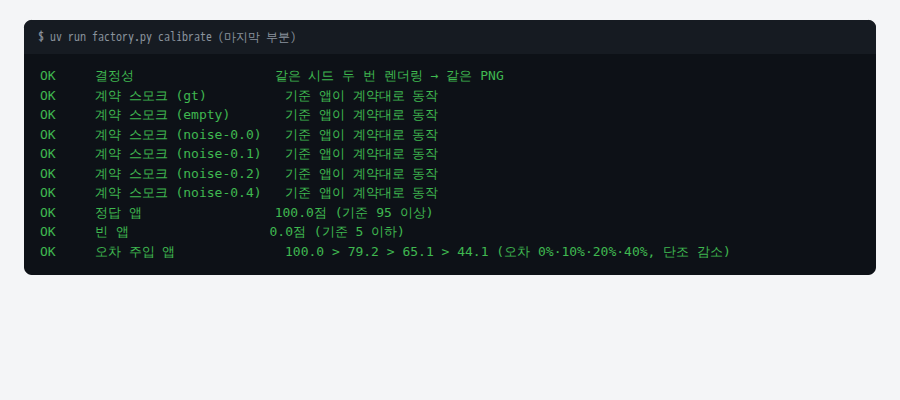
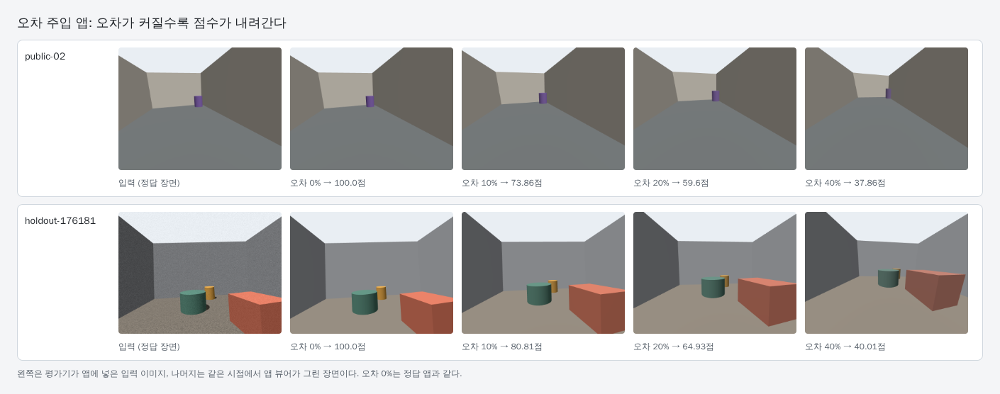
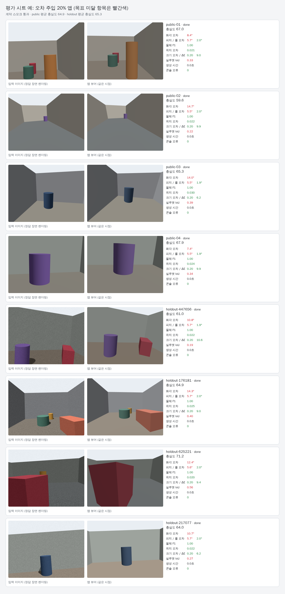

# 01. 평가 먼저: Oracle을 만들고 채점기를 검증한다

`git checkout step-1-eval`

## 이 단계가 푸는 문제

이 팩토리는 eval을 통과한 변경만 제품에 받아들인다. 그러면 eval이 틀렸을 때의 피해가 커진다. 채점기가 옳은 결과를 낮게 매기면 좋은 변경이 모두 막히고 Needs Human이 쌓인다. 반대로 나쁜 결과를 높게 매기면 제품이 망가지는데도 병합된다.

그래서 1단계는 제품을 만들지 않는다. 제품이 아직 없는 상태에서 채점기를 먼저 완성하고, 그 채점기가 좋은 결과와 나쁜 결과를 구분하는지부터 확인한다. 채점기가 없으면 그 뒤의 어떤 자동화도 제품을 좋게 만드는지 망치는지 알 수 없다.

## 적용한 원칙

- **Oracle**: 결과가 맞는지 판정할 기준이 먼저 있어야 한다. 사진에서 3D를 복원하는 문제에는 보통 정답이 없다. 이 팩토리는 정답 장면을 먼저 만들고, 그 장면을 렌더링한 이미지를 입력으로 써서 정답을 만든다.
- **Holdout**: 공개한 테스트로만 평가하면 외운 결과도 통과한다. 이 팩토리의 홀드아웃은 고정된 목록이 아니라 평가할 때마다 새로 뽑는 시드다. 그래서 외울 수 없다.
- **구조화된 실패 증거**: 실패한 장면마다 정답 JSON, 입력 이미지, 측정값, 뷰어 화면 캡처를 남긴다.
- **긴장 관계 지표**: 한 지표만 보지 않고 화각, 기울기, 검출, 배치, 크기·색, 실루엣 일치를 함께 묶어 충실도 점수를 만든다.

## 만든 것



| 구성요소 | 위치 | 하는 일 |
|---|---|---|
| 앱 계약 | `CONTRACT.md` | 평가기가 제품을 관찰하는 방법을 고정한다. 실행 명령, HTTP 주소, 장면 파일 형식, `window.__PREVIZ__`, 메시 역할 표시 |
| 장면 생성기 | `factory.py` `generate_scene()` | 시드 하나로 방, 카메라, 물체 1~4개, 조명을 정한다 |
| 브라우저 실험실 | `factory.py` `BUILDER_JS`, `LAB_JS` | 헤드리스 Chromium 안의 three.js로 정답 이미지를 렌더링하고, 장면 그래프를 측정하고, 물체 실루엣을 160×120으로 다시 그린다 |
| 측정기 | `factory.py` `EXTRACT_JS` | 제품 뷰어에 주입해 `role`이 붙은 메시와 카메라를 그대로 읽어 온다 |
| 채점기 | `factory.py` `compare()`, `score_metrics()` | 정답과 측정값을 카메라 기준 좌표로 바꿔 비교하고 충실도 점수를 낸다 |
| 기준 앱 | `factory.py` `calibration_app()` | 계약만 구현한 작은 HTTP 서버. 정답·빈 장면·오차 주입 세 종류 |
| 명령 | `eval`, `calibrate` | 제품 평가와 채점기 검증 |

평가기가 앱에 넣는 입력은 두 종류다. 공개 세트는 고정된 장면이고, 홀드아웃은 평가할 때마다 새로 만들어지며 그림자와 노이즈가 섞인다.



### 핵심 설계 두 가지

**제품의 코드가 아니라 실제로 그려진 장면을 측정한다.** 평가기는 Codex가 쓴 `scenes/<키>.js`를 해석하지 않는다. 뷰어 페이지가 노출한 `window.__PREVIZ__.scene`과 `camera`에서 메시의 정점, 월드 행렬, 재질 색을 읽는다. 그래서 장면 파일을 어떻게 쓰든 같은 기준으로 판단할 수 있다.

**절대 크기 대신 카메라 높이로 나눈 값을 비교한다.** 사진 한 장으로는 방이 4m인지 40m인지 알 수 없다. 그래서 카메라 바로 아래 바닥점을 원점으로, 카메라가 보는 수평 방향을 +z로 하고, 모든 길이를 카메라 높이로 나눈 좌표계에서 비교한다. 제품이 어떤 단위와 어떤 월드 좌표를 쓰든 결과가 같다.

### 채점 방식

```text
fidelity = 100 × F1 × (0.20·화각 + 0.15·기울기 + 0.20·배치 + 0.15·(크기·색) + 0.30·IoU)
```

F1을 곱하는 이유는, 물체를 하나도 맞히지 못하면 카메라가 맞아도 프리비즈로 쓸 수 없기 때문이다. 각 항목의 정의와 최종 목표값은 [CONTRACT.md](../../CONTRACT.md) 6절에 있다.

### 계획에서 바뀐 것

| 계획 | 실제 | 이유 |
|---|---|---|
| 카메라 높이 오차를 채점한다 | 채점에서 뺐다 | 단일 이미지로는 절대 크기를 알 수 없다. 카메라 높이는 정규화 기준으로 쓴다 |
| 지평선 위치를 따로 채점한다 | 따로 두지 않았다 | 지평선 위치는 화각과 피치로 정해지므로 두 항목에 이미 들어 있다 |
| 홀드아웃에 렌즈 왜곡을 섞는다 | 넣지 않았다 | 왜곡을 넣으면 정답 화각의 의미가 달라진다. 그림자, 질감 노이즈, 이미지 노이즈, 더 넓은 조명·롤 범위만 섞는다 |

## 실행해 보기

```sh
git checkout step-1-eval
uv run factory.py init          # 0단계를 하지 않았다면
uv run factory.py calibrate     # 기준 앱 세 종류로 채점기 검증 (모델 호출 없음)
uv run factory.py eval --app product   # 2단계 이후: 제품 평가
```

결과는 `var/evals/<시각>-<라벨>/`에 남는다. 장면마다 `input.png`(입력), `gt.json`(정답), `viewer.png`(뷰어 캡처), `measured.json`(측정값), `result.json`(지표와 점수)이 있다.

## 실제 실행 기록 (2026-11-23)

`calibrate`는 공개 세트 4개와 새로 뽑은 홀드아웃 4개, 모두 8장면을 기준 앱 여섯 개(정답, 빈 장면, 오차 0%·10%·20%·40%)에 차례로 넣는다. 열 개 항목이 모두 통과했다.



오차 주입 앱이 그린 장면을 입력과 나란히 놓으면 점수가 무엇을 재는지 보인다. 오차가 커질수록 화각이 넓어지고, 물체가 커지고 옆으로 밀리고, 카메라가 기울어 실루엣이 어긋난다.



평가기는 평가할 때마다 장면별 입력, 뷰어 캡처, 지표를 한 장에 모은 평가 시트(`sheet.png`)를 남긴다. 최종 목표에 못 미친 항목은 빨간색이다. 아래는 오차 주입 20% 앱의 시트 앞부분이다. 2단계부터는 이 시트가 실패 증거로 에이전트와 사람에게 전달된다.



같은 결과의 텍스트:

```text
채점기 검증
  OK    결정성                  같은 시드 두 번 렌더링 → 같은 PNG
  OK    계약 스모크 (gt)          기준 앱이 계약대로 동작
  OK    계약 스모크 (empty)       기준 앱이 계약대로 동작
  OK    계약 스모크 (noise-0.0)   기준 앱이 계약대로 동작
  OK    계약 스모크 (noise-0.1)   기준 앱이 계약대로 동작
  OK    계약 스모크 (noise-0.2)   기준 앱이 계약대로 동작
  OK    계약 스모크 (noise-0.4)   기준 앱이 계약대로 동작
  OK    정답 앱                 100.0점 (기준 95 이상)
  OK    빈 앱                  0.0점 (기준 5 이하)
  OK    오차 주입 앱              100.0 > 79.2 > 65.1 > 44.1 (오차 0%·10%·20%·40%, 단조 감소)
```

오차 주입 10% 앱의 장면별 결과 일부:

```text
  fixture         status    fidelity    fov°  pitch°    f1    pos   iou
  public-01       done          79.0     4.2     2.9  1.00  0.010  0.51
  public-02       done          73.9     7.3     2.8  1.00  0.011  0.41
  holdout-625221  done          85.5     6.2     2.8  1.00  0.010  0.78
```

관찰한 것:

- **실루엣 일치(IoU)가 가장 민감하다.** 오차 10%만으로 IoU가 0.41~0.78로 떨어졌다. 화각, 기울기, 위치, 크기가 함께 틀리면 실루엣은 빠르게 어긋난다. 가중치 0.30을 준 이유다.
- **위치 오차는 관대하다.** 오차 40%에서도 위치 오차가 0.04~0.06이었다. 방 대각선으로 나누기 때문이다. 최종 목표 0.10이 너무 느슨한지는 실제 제품 결과를 보고 `factory-eval` 이슈로 조정할 수 있다.
- 기준 앱 세 개는 Codex를 부르지 않으므로 이 검증의 모델 비용은 0이다.

## 내 프로젝트에 적용하기

- **정답을 만들 수 있는 방향을 찾는다.** "입력 → 정답"이 어렵다면 "정답 → 입력"을 만들 수 있는지 본다. 이 실험에서는 장면을 먼저 만들고 이미지를 나중에 만들었다. API 서비스라면 기존 시스템의 응답을 기록해 정답으로 쓰고, 문서 처리라면 정답 구조를 먼저 만들고 문서를 생성하는 식이다.
- **제품의 출력을 관찰하는 계약을 정한다.** 평가기가 제품 내부 구현에 의존하면 제품이 바뀔 때마다 평가기도 바뀐다. 이 실험의 `window.__PREVIZ__`처럼, 평가 전용으로 노출할 최소한의 관찰 지점을 계약으로 고정한다.
- **채점기를 먼저 검증한다.** 정답을 그대로 돌려주는 기준, 아무것도 하지 않는 기준, 정해진 만큼 틀리는 기준을 만들어 점수가 의도대로 나오는지 확인한다. 특히 오차에 따라 점수가 매끄럽게 변해야 에이전트가 조금 나아진 시도를 구분할 수 있다.

## 단순화한 것과 함정

- **합성 장면에만 맞춰질 위험이 있다.** 단색 도형으로 이루어진 방은 실제 사진보다 훨씬 쉽다. 홀드아웃 변형이 일부를 막지만 실제 사진과의 차이는 남는다. 실제 사진을 넣었을 때의 참고 점수는 이후 단계에서 다룬다.
- **물체 짝짓기는 완전 탐색이다.** 정답 물체가 4개 이하라서 가능하다. 물체가 많아지면 헝가리안 알고리즘 같은 방법으로 바꿔야 한다.
- **물체 하나는 메시 하나다.** 여러 메시로 된 물체는 각각 다른 물체로 센다. 계약에 적었지만, 제품이 이 규칙을 모르면 F1이 떨어진다.
- **채점 코드가 공개되어 있다.** 에이전트는 같은 머신의 `factory.py`를 읽을 수 있다. 채점 방식을 아는 것 자체는 괜찮다. 홀드아웃 시드는 평가할 때마다 새로 뽑으므로 정답을 미리 알 수는 없다.
