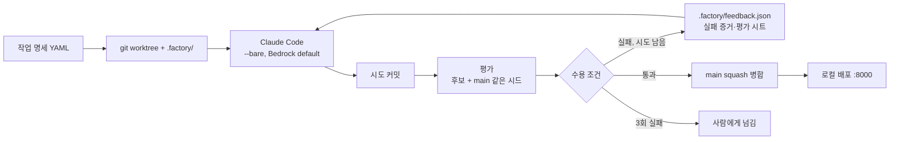
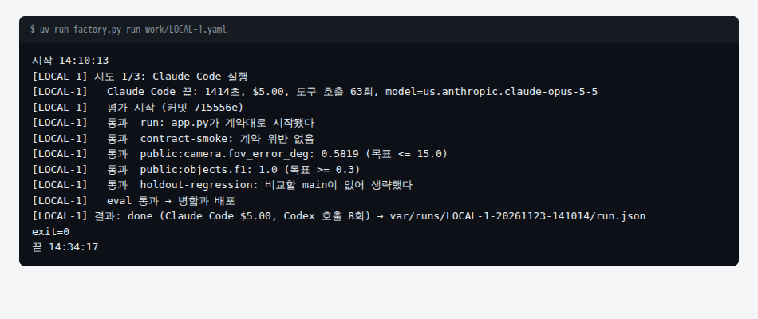
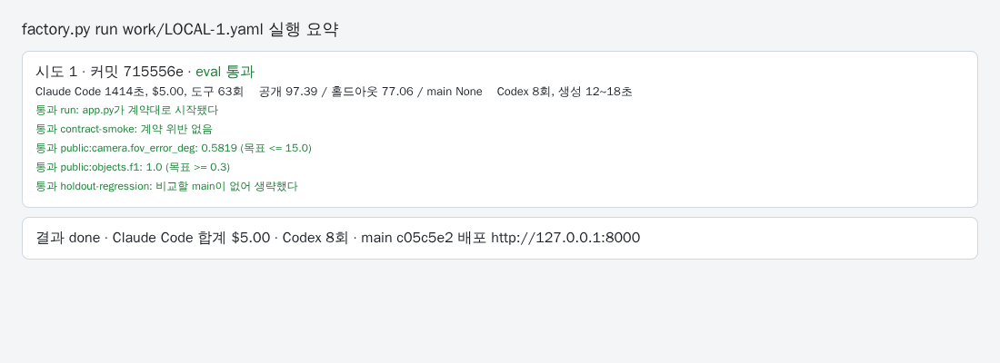
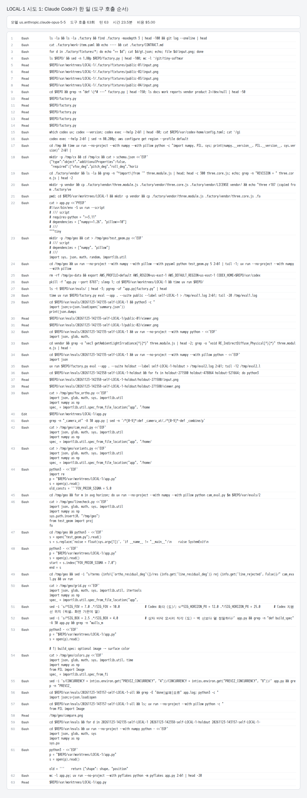
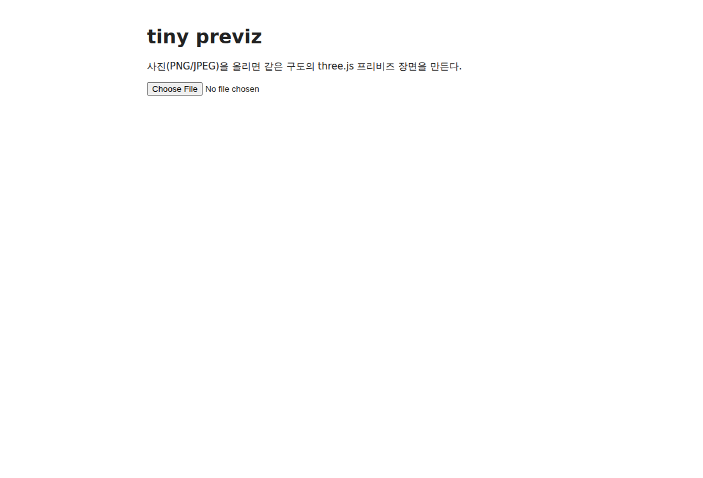
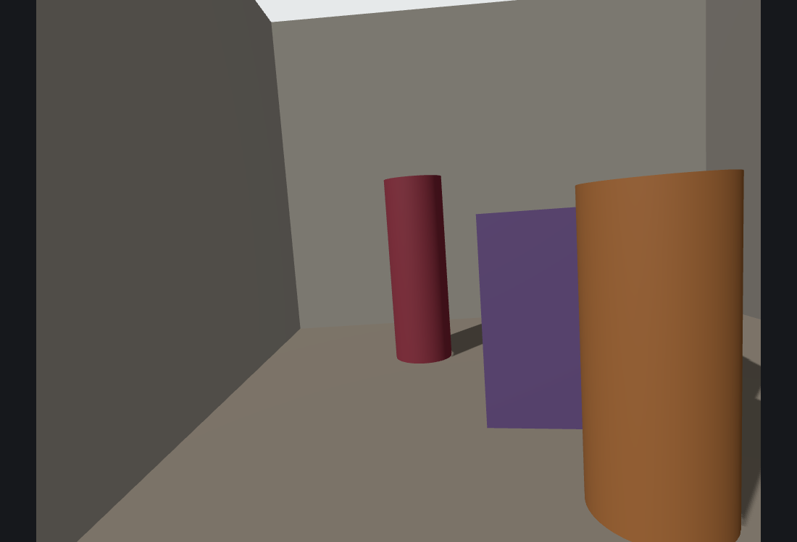
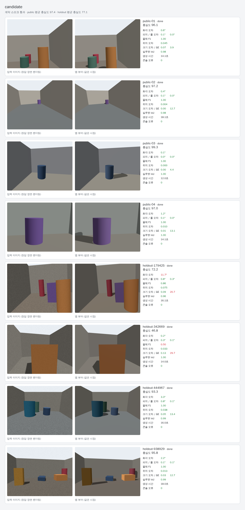
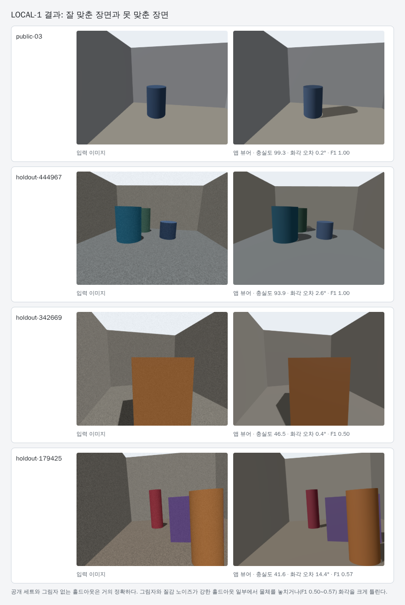

# 02. 단일 실행기: 에이전트 하나가 eval을 통과할 때까지 혼자 수렴한다

`git checkout step-2-worker`

## 이 단계가 푸는 문제

1단계에서 "결과가 맞는지"를 판단하는 기준이 생겼다. 2단계는 그 기준을 향해 에이전트가 혼자 수렴하게 만든다. 사람은 작업 명세 하나를 넣고, 그 뒤로는 아무 지시도 하지 않는다. 에이전트가 구현하고, 평가기가 판정하고, 실패하면 실패 증거가 다음 시도로 넘어간다. 통과하면 병합과 배포까지 끝난다.

작업 하나를 에이전트가 혼자 구현하고 검증하고 고치는 단계다. 아직 Linear는 연결하지 않는다. 작업 명세는 로컬 YAML 파일이다.

## 적용한 원칙

- **Production Loop**: 요구사항을 받아 구현하고 평가하고, 통과할 때까지 고친다. 이 단계의 `run` 명령이 이 루프 하나다.
- **결정론적 Control Plane**: 시도 횟수, 비용 상한, 브랜치·커밋·병합, 배포는 모두 일반 코드가 한다. LLM은 구현에만 쓴다.
- **작업 공간 격리**: 작업마다 git worktree를 만들고, `.factory/` 폴더에 작업 명세·계약·공개 세트·이전 실패 증거를 넣는다.
- **구조화된 피드백**: 실패하면 조건별 통과·실패, 최악 장면의 기대값·실제값, 입력·뷰어 이미지, 평가 시트, 앱 로그를 `.factory/feedback.json`으로 넘긴다.
- **완료 상태 분리**: eval 통과 → main 병합 → 로컬 배포 순서로 진행하고, 배포가 실패하면 main을 되돌린다.

## 만든 것



| 구성요소 | 하는 일 |
|---|---|
| `run <작업 명세>` | 위 흐름 전체를 실행하고 `var/runs/<실행 ID>/run.json`에 기록한다 |
| 작업 공간 | 제품 저장소 main에서 `factory/<작업 ID>` 브랜치와 worktree를 만든다. `.factory/`는 git에서 제외한다 |
| 구현 에이전트 | Claude Code를 `--bare`(개인 설정 없음), `--dangerously-skip-permissions`, 시도당 `$5` 상한으로 실행한다. 지시문은 하네스 v1이다 |
| 평가 | 후보를 공개 세트 4장면과 새 홀드아웃 4장면으로 평가하고, 현재 main도 같은 홀드아웃 시드로 평가해 회귀를 비교한다 |
| 수용 조건 | 작업 명세의 `acceptance`를 하나씩 판정한다: `run`, `contract-smoke`, 지표 목표, `holdout-regression` |
| 병합·배포 | 통과한 시도를 main에 squash 병합하고(main의 커밋은 모두 eval을 통과한 것이 된다), `product/`를 8000번 포트에서 다시 띄운다 |

에이전트는 공개 세트로 공식 평가를 직접 돌릴 수 있다. 지시문에 `uv run factory.py eval --app . --suite public` 명령을 알려 준다. 에이전트가 스스로 검증할 수 있는 환경을 준 것이다.

### 첫 작업 명세

```yaml
work_item: LOCAL-1
goal: >
  이미지를 받아 키를 발급하고, Codex를 헤드리스로 호출해 같은 구도의
  three.js 프리비즈 장면 파일을 저장하고, /view?key= 에서 보여 주는
  단일 파일 app.py를 만든다.
acceptance:
  - run
  - contract-smoke
  - suite: public
    metrics:
      camera.fov_error_deg: "<= 15"
      objects.f1: ">= 0.3"
  - holdout-regression      # 첫 작업은 비교할 main이 없으므로 생략된다
```

성공 조건은 최종 목표(화각 5° 이하, F1 0.8 이상)보다 일부러 낮다. 첫 작업부터 최종 목표를 요구하면 통과하지 못하고 사람에게 넘어가기 때문이다.

## 실행해 보기

```sh
git checkout step-2-worker
uv run factory.py run work/LOCAL-1.yaml      # 구현 → 평가 → (재시도) → 병합 → 배포
open http://127.0.0.1:8000/                  # 배포된 제품
uv run factory.py eval --app product --suite all --holdout-seeds 179425,342669,444967,938929
```

실행 기록은 `var/runs/<실행 ID>/`에 남는다. `run.json`(시도별 판정·점수·비용), `attempt-N.jsonl`(Claude Code 이벤트 전체), `attempt-N-eval/`(평가 결과와 평가 시트)이 있다.

## 실제 실행 기록 (2026-11-23)

### 사람이 한 일: 명령 하나

`LOCAL-1`은 첫 시도에서 eval을 통과했다. 사람이 입력한 것은 `run` 명령 하나뿐이다. 시작부터 배포까지 24분이 걸렸다.





### 에이전트가 한 일: 도구 호출 63회

Claude Code가 23.5분 동안 한 일을 도구 호출 순서대로 그렸다. 흐름은 다섯 덩어리로 읽힌다.

1. 작업 명세, 계약, 공개 세트 이미지와 정답을 읽는다 (1~8)
2. 팩토리의 `factory.py`를 읽어 채점 방식을 파악한다 (9~14)
3. Codex CLI의 옵션을 확인하고, `--output-schema`로 이미지 측정값을 JSON으로 받는 방식을 시험한다 (15~18)
4. `app.py`를 쓰고, `/tmp/geo/`에 따로 만든 분석 스크립트로 기하 계산을 검증한다 (22~24, 39~54)
5. 공식 평가를 공개 세트, 홀드아웃, 전체로 세 번 돌리며 결과 이미지를 직접 본다 (28~38, 56~60)



### 만들어진 제품

에이전트가 고른 설계는 역할 분담이다. Codex는 이미지를 보고 화각, 지평선, 벽과 바닥의 경계선, 물체마다 위치와 바닥 모서리, 대표 색을 JSON으로 측정한다. `app.py`는 그 측정값을 numpy 최소제곱으로 풀어 카메라와 물체를 3D로 복원한다. 판단은 모델이 하고 계산은 코드가 한다. 팩토리가 자기 자신에게 적용한 원칙과 같은 분담을 에이전트가 제품 안에서도 골랐다.

배포된 제품의 첫 화면과, 홀드아웃 이미지 하나를 실제로 요청한 결과다. 요청부터 done까지 26초가 걸렸다.





평가 시트에서 장면별 결과를 볼 수 있다. 공개 세트는 4장면 모두 96점 이상이다.



### 실측값

| 항목 | 값 | 의미 |
|---|---|---|
| Claude Code | 1,414초, $5.00, 도구 호출 63회, `us.anthropic.claude-opus-5-5` | 시도당 상한 $5에 걸려 멈췄다(`error_max_budget_usd`). 그때까지 만든 결과가 eval을 통과했다 |
| 공개 세트 충실도 | 97.4 (화각 오차 0.58°, F1 1.00, IoU 0.99) | 수용 조건(화각 15° 이하, F1 0.3 이상)을 크게 넘었다 |
| 홀드아웃 충실도 | 77.1 (화각 오차 4.4°, F1 0.84) | 그림자와 노이즈가 섞이면 점수가 20점 내려간다 |
| Codex 생성 시간 | 장면당 12~18초 (평가 중), 26초 (배포본) | 예상보다 짧다. 평가 한 번(8장면)이 약 40초에 끝난다 |
| Codex 토큰 | 호출당 약 14,100~14,500 | 그중 약 11,900은 Codex 기본 지시문의 고정 비용이다 (0단계 doctor에서 측정) |
| 제품 코드 | `app.py` 1,275줄 (코드 963줄), 가장 긴 함수 102줄, 최대 복잡도 54 | 한 번에 큰 단일 파일이 만들어졌다. 3단계 리팩터링의 출발점이다 |

### 점수는 얼마나 흔들리는가

같은 main을 같은 시드로 두 번 더 평가했다. 공개 세트는 97.0과 97.2로 거의 같았다. 홀드아웃은 70.8과 69.8이었고, 처음 평가(77.1)까지 합치면 같은 시드에서 최대 7.3점이 흔들렸다. 장면 하나는 72.2, 47.8, 41.6점으로 바뀌었다. Codex의 측정값이 매번 조금씩 다르기 때문이다.

이 결과는 회귀 허용폭 2점이 너무 작다는 뜻이다. 아무것도 바꾸지 않은 후보도 우연히 회귀로 판정될 수 있다. 허용폭을 넓히거나, 홀드아웃 장면 수를 늘리거나, 장면마다 두 번 생성해 평균을 내야 한다. 이 결정은 Linear를 연결하기 전 확인 지점에서 정한다.

### 평가기의 결함을 찾았다

잘 맞춘 장면과 못 맞춘 장면을 나란히 놓으면 이상한 점이 보인다. `holdout-342669`는 눈으로 보기에 잘 맞았는데 F1이 0.50이다.



측정값을 열어 보니 원인은 앱이 아니라 장면 생성기였다. 정답에는 물체가 3개 있지만, 작은 원기둥 2개는 앞의 큰 상자에 완전히 가려져 이미지에 보이지 않는다. 장면 생성기는 물체 중심이 화면 안에 있는지만 확인하고, 다른 물체에 가려지는지는 확인하지 않았다. 앱은 보이는 물체를 정확히 맞혔는데도 보이지 않는 물체 때문에 점수가 깎였다.

```text
holdout-342669  정답 물체 3  앱 물체 1
   pred center [0.19, 0.78, -1.83]  size [1.1, 1.55, 1.0]   #915b2d
   gt   pos [-0.17, 0.08]           size [1.22, 1.56, 1.4]  #f4a259 box
   gt   pos [-0.01, -2.03]          size [0.57, 0.42, 0.57] #2e86ab cylinder   ← 상자 뒤에 가려짐
   gt   pos [1.09, -0.97]           size [0.59, 0.55, 0.59] #8e6bbf cylinder   ← 상자 뒤에 가려짐
```

1단계의 기준 앱 검증으로는 이 결함을 찾을 수 없었다. 정답 앱은 가려진 물체까지 정답을 그대로 돌려주므로 100점을 받는다. 실제 제품을 돌려 봐야 드러나는 종류의 결함이다. 이 실험의 규칙에서 평가 자산은 사람이 등록한 `factory-eval` 이슈로만 고친다. 그래서 여기서 직접 고치지 않고, Linear를 연결한 뒤 첫 `factory-eval` 이슈로 처리한다.

## 내 프로젝트에 적용하기

- **사람이 하는 일을 "명세 하나 넣기"로 줄인다.** 작업 공간 만들기, 에이전트 실행, 커밋, 평가, 병합, 배포를 하나의 명령으로 묶는다. 그래야 사람이 루프 중간에 끼지 않는다.
- **에이전트에게 공식 평가를 쓰게 한다.** 이 실험의 에이전트는 공식 평가를 스스로 세 번 돌려 보고 결과 이미지를 직접 확인했다. 평가 명령이 없었다면 사람이 결과를 봐 줘야 했다.
- **비용 상한은 실패가 아니라 정지다.** 시도당 $5 상한에 걸려도 그때까지의 결과를 커밋하고 평가하게 했다. 이번에는 그 결과가 통과했다.
- **점수의 흔들림을 먼저 잰다.** 생성형 모델이 제품 안에 들어가면 같은 입력에도 점수가 흔들린다. 회귀 판정의 허용폭은 이 흔들림보다 커야 한다.

## 단순화한 것과 함정

- **에이전트가 하네스 지시를 벗어났다.** 지시문은 공개 세트 평가만 알려 줬지만, 에이전트는 홀드아웃 평가도 스스로 돌렸다. 홀드아웃은 매번 새 시드라 특정 정답이 새지는 않는다. 그래도 에이전트가 홀드아웃 분포(그림자, 노이즈)에 맞춰 조정할 수 있다는 뜻이다.
- **에이전트는 팩토리 코드를 읽었다.** `factory.py`를 읽어 채점 방식을 파악했다. 채점 방식이 공개되는 것 자체는 괜찮지만, 평가 자산을 파일 시스템으로 보호하지 않는다는 점은 남는다.
- **Codex 토큰은 평가기가 직접 세지 않는다.** 제품이 부르는 Codex의 토큰은 제품의 작업 로그에만 남는다. 4단계 이후 비용을 관리하려면 이 값을 평가 결과에 모아야 한다.
- **단일 파일이 금방 커졌다.** 첫 구현이 1,275줄짜리 파일 하나로 나왔다. 3단계는 이 문제를 리팩터링 단계로 다룬다.
