# 03. 모듈화와 리팩터링 단계: 커진 코드를 나누고, 나누는 일도 루프에 넣는다

`git checkout step-3-refactor`

## 이 단계가 푸는 문제

2단계까지 마치자 두 파일이 모두 커졌다. 팩토리의 `factory.py`는 1,545줄(빈 줄·주석 제외)이 되었고, 팩토리가 만든 제품 `app.py`는 첫 구현에서 1,082줄이 되었다. 가장 긴 함수는 100줄을 넘었고, 분기가 54개인 함수도 있었다.

"파일 하나로 시작해서 확장한다"는 출발점으로는 맞지만, 확장할 때 구조를 정리하는 과정이 없으면 코드는 계속 한 파일에 쌓인다. 에이전트가 코드를 빠르게 만들수록 더 그렇다. 코드가 빨리 늘수록 유지보수는 어려워진다. 3단계는 두 가지를 한다.

1. 팩토리 코드를 책임 단위의 모듈로 나눈다. 이 일은 사람(이 세션)이 한다.
2. 같은 일을 제품에도 하도록 생산 루프에 리팩터링 단계를 넣는다. 이 일은 팩토리가 한다.

이 단계는 처음 실행 계획에 없었다. 2단계 결과를 본 사용자가 "파이썬 코드가 너무 크다, 모듈화하고 리팩터링 과정도 팩토리 과정에 넣어야 한다"고 판단해 추가했다.

## 적용한 원칙

- **긴장 관계 지표**: 기능 점수만 보면 코드가 얼마나 커지든 통과한다. 코드 지표를 함께 재야 코드가 늘어날수록 유지보수가 어려워지는 관계가 보인다.
- **정적 검증**: 타입 검사, 린트, 구조 규칙처럼 실행하지 않고 하는 검증이다. 코드 지표는 여기에 속한다.
- **개발 루프 안의 리팩터링**: 구현과 리팩터링을 하나의 루프 안에 두되, 리팩터링도 같은 eval로 검증한다.
- **권한 경계**: 평가 코드를 `tsf/oracle/`로 묶어, `factory-eval` 이슈만 고칠 수 있는 경계를 파일 구조로 드러낸다.

## 1. 팩토리 코드를 모듈로 나누다

### 나눈 기준

모듈은 책임 단위로 나눴다. 크기만 보고 나누지 않았다. 같은 이유로 바뀌는 코드끼리 묶고, 수정 권한이 다른 코드는 반드시 떼었다.

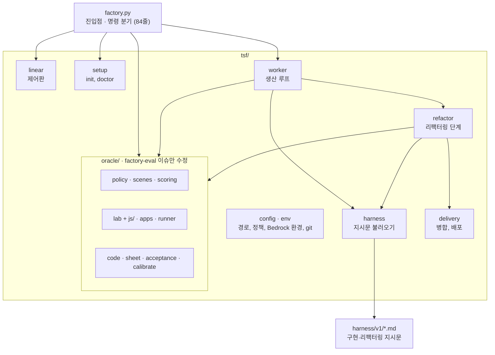

| 위치 | 책임 | 누가 고치나 |
|---|---|---|
| `factory.py` | 명령을 받아 모듈로 넘긴다. 의존성은 파일 머리의 PEP 723 선언 | 사람 |
| `tsf/config.py`, `env.py` | 경로, 실행 정책, Bedrock default profile 환경, git | 사람 |
| `tsf/linear.py` | Linear GraphQL 클라이언트, 팀 준비 | 사람 |
| `tsf/setup.py` | 0단계 `init`, `doctor` | 사람 |
| `tsf/oracle/` | 평가 전체: 정책, 장면 생성, 측정, 채점, 코드 지표, 수용 조건, 채점기 검증 | `factory-eval` 이슈 |
| `tsf/oracle/js/` | 브라우저에서 도는 three.js 코드. Python 문자열에서 실제 JS 파일로 옮겼다 | `factory-eval` 이슈 |
| `tsf/worker.py`, `refactor.py`, `delivery.py` | 생산 루프: 구현, 재시도, 리팩터링, 병합, 배포 | 사람 |
| `harness/v1/*.md` | 에이전트 지시문. Python 문자열에서 Markdown 파일로 옮겼다 | 학습 루프 (6단계) |

### 나누기 전과 후

같은 `metrics` 명령으로 쟀다. 기준은 파일 400줄, 함수 60줄, 분기 복잡도 15다.

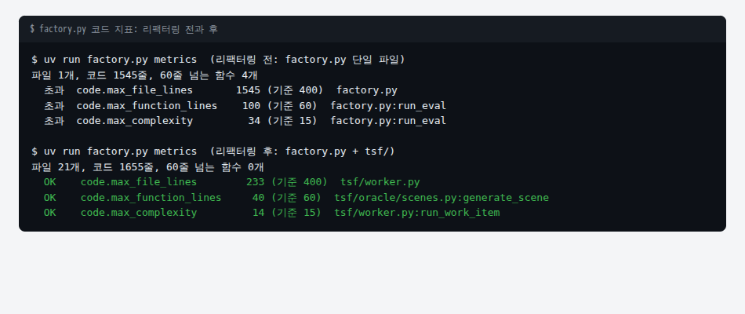

| 지표 | 전: `factory.py` 하나 | 후: `factory.py` + `tsf/` 21개 파일 |
|---|---|---|
| 가장 긴 파일 | 1,545줄 | 233줄 (`tsf/worker.py`) |
| 가장 긴 함수 | 100줄 (`run_eval`) | 40줄 (`generate_scene`) |
| 최대 분기 복잡도 | 34 (`run_eval`) | 14 (`run_work_item`) |
| 60줄 넘는 함수 | 4개 | 0개 |
| 전체 코드 | 1,545줄 | 1,655줄 |

전체 코드는 110줄 늘었다. 모듈마다 책임 설명과 import가 붙고, 긴 함수를 나누면서 함수 머리가 늘었기 때문이다. 줄 수를 줄이는 것이 목적이 아니라, 한 번에 읽어야 하는 단위를 줄이는 것이 목적이다.

한 함수는 처음 나눈 뒤에도 기준을 넘었다. 기준 앱을 만드는 `calibration_app`이 64줄이었다. 함수 안에 HTTP 처리 클래스가 통째로 들어 있었기 때문이다. 처리 클래스와 상태를 모듈 수준으로 꺼내 함수를 12줄로 줄였다.

### 동작이 그대로인지 어떻게 확인했나

리팩터링의 수용 조건은 "동작이 그대로"다. 팩토리 자신에게도 같은 조건을 적용했다.

| 확인 | 방법 | 결과 |
|---|---|---|
| 장면 생성 | 시드 7개 × 변형 2종을 전후 코드로 생성해 비교 | 모두 같다 |
| 오차 주입 | 같은 장면에 오차 20%를 넣은 결과를 비교 | 같다 |
| 채점기 검증 | `calibrate`를 새 코드로 다시 실행 | 10개 항목 모두 통과 |
| 점수 | 공개 세트(고정 시드) 24건의 점수와 지표를 전후 실행에서 비교 | 24건 모두 같다 |

홀드아웃 점수는 비교하지 않았다. 홀드아웃은 실행마다 새 시드를 뽑으므로 전후 점수가 달라지는 것이 정상이다.

## 2. 리팩터링을 생산 루프의 단계로 넣다

### 생산 루프에서 리팩터링 단계의 위치

구현이 eval을 통과하면 바로 병합하지 않는다. 먼저 코드 지표를 재고, 기준을 넘으면 리팩터링 에이전트를 한 번 실행한다. 리팩터링 결과는 다시 평가하고, 세 조건을 모두 만족할 때만 받아들인다. 받아들이지 않으면 리팩터링 전 커밋을 그대로 병합한다. 구현은 이미 eval을 통과했기 때문에 사람에게 넘길 이유가 없다.

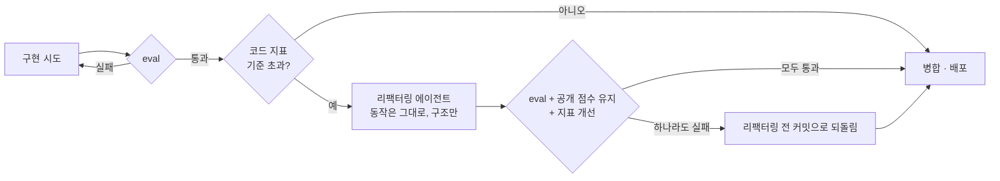

| 조건 | 확인 방법 | 기준 |
|---|---|---|
| 동작 보존 | 작업 명세의 수용 조건을 다시 판정 | 모두 통과 |
| 점수 유지 | 공개 세트 충실도를 리팩터링 전과 비교 | 2점 넘게 내려가지 않음 (`PUBLIC_TOLERANCE`) |
| 구조 개선 | 코드 지표를 리팩터링 전과 비교 | 기준을 넘은 지표가 줄고, 다른 지표는 기준을 넘지 않음 |

코드 지표는 평가 자산(`tsf/oracle/code.py`, 기준값은 `tsf/oracle/policy.py`의 `CODE_TARGETS`)에 둔다. 리팩터링 에이전트가 기준을 바꿔서 통과하는 길을 막기 위해서다. 리팩터링 지시문은 `harness/v1/refactor-system.md`와 `refactor-task.md`다. 지시문의 핵심 규칙은 "기능 추가, 성능 튜닝, 버그 수정은 하지 않는다. 고칠 것이 보이면 노트에만 적는다"이다.

이미 병합된 코드에 리팩터링 단계만 실행하는 `factory.py refactor` 명령도 만들었다. 이 실험에서는 2단계가 리팩터링 단계 없이 병합한 `app.py`에 썼다. 현재 개발 중인 프로젝트에 이 단계만 따로 붙여 볼 때도 같은 방식을 쓸 수 있다.

### 회귀 허용폭을 실측으로 정했다

리팩터링을 실행하기 전에 회귀 허용폭을 먼저 정했다. 2단계에서 같은 main을 같은 시드로 세 번 평가했을 때 홀드아웃 평균이 77.1, 70.8, 69.8로 최대 7.3점 흔들렸다. 허용폭이 2점이면 동작이 같은 리팩터링도 우연히 거부될 수 있다. 실행 계획의 규칙("2점과 실측 흔들림 중 큰 값")대로 홀드아웃 허용폭을 8점으로 올렸다. 공개 세트는 흔들림이 0.4점이라 2점으로 따로 두었다.

## 실행해 보기

```sh
git checkout step-3-refactor
uv run factory.py metrics .              # 팩토리 자신의 코드 지표
uv run factory.py metrics product        # 제품의 코드 지표
uv run factory.py refactor               # main에 리팩터링 단계만 실행
uv run factory.py run work/LOCAL-1.yaml  # 구현 → eval → (지표가 기준을 넘으면) 리팩터링 → 병합
```

## 실제 실행 기록 (2026-11-23)

### 제품 리팩터링: 수용

`factory.py refactor`가 2단계에서 병합된 `app.py`를 대상으로 리팩터링 단계를 실행했다. 세 지표가 모두 기준을 넘어 리팩터링 에이전트가 실행되었고, 세 조건을 모두 통과해 병합·배포되었다. 18분이 걸렸다.

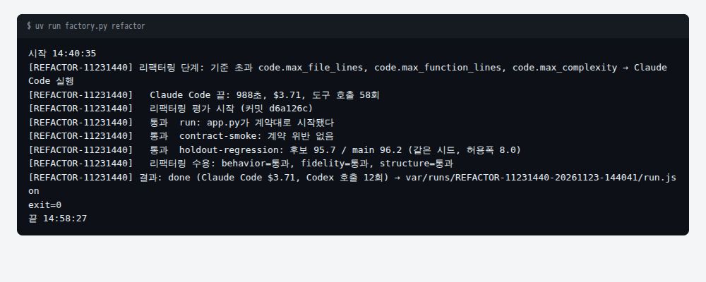

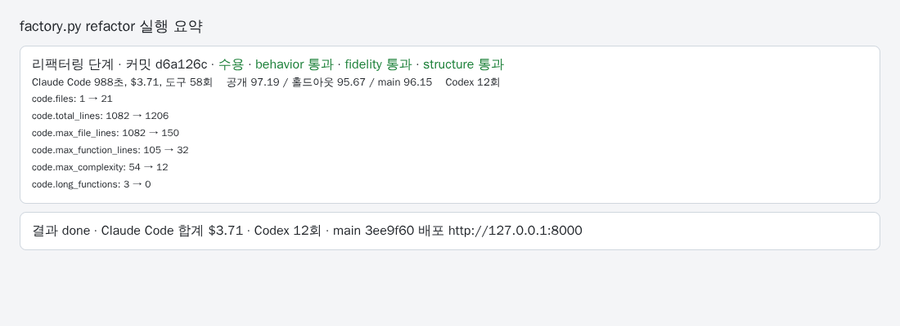

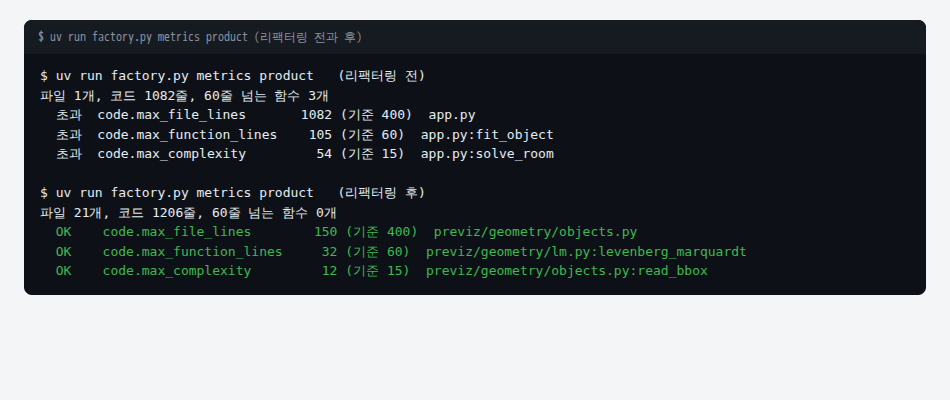

`app.py` 한 파일이 `previz/` 패키지 21개 파일로 나뉘었다. `app.py`는 16줄짜리 진입점이 되었고, 모듈마다 첫 줄에 책임이 적혀 있다. 팩토리가 지시한 규칙("모듈마다 맨 위에 그 모듈의 책임을 한 줄로 적는다")을 따른 결과다.

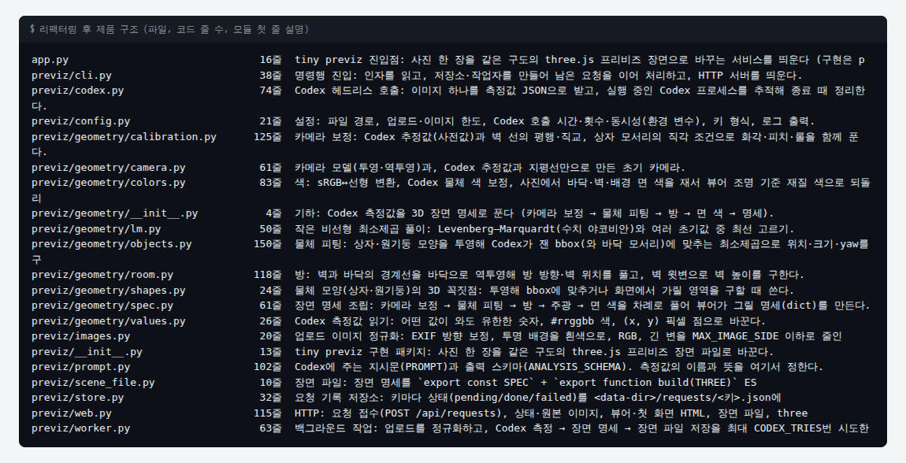

같은 입력 이미지를 리팩터링 전후의 배포본에 요청한 결과다. 같은 구조의 장면이 나온다.

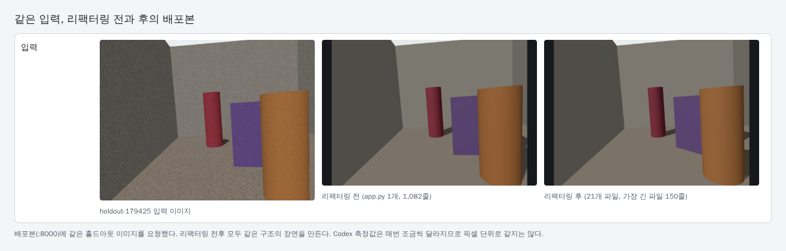

### 리팩터링 에이전트가 한 일: 스스로 만든 동작 보존 검증

리팩터링 에이전트는 코드를 옮기기 전에 "동작이 그대로인지"를 확인할 장치부터 만들었다. 팩토리는 리팩터링 결과를 eval로 판정할 뿐 그 방법을 지시하지 않았다. 도구 호출 58회를 단계별로 묶으면 다음과 같다.

| 호출 | 한 일 |
|---|---|
| 1~18 | 작업 공간, 계약, `app.py`를 읽고, 팩토리의 코드 지표 정의(`tsf/oracle/code.py`)와 리팩터링 수용 조건(`tsf/refactor.py`)을 읽는다 |
| 19~27 | 함수별 지표 스크립트를 만들고, 지난 평가에 남은 실제 Codex 측정값으로 기준값(golden master) 생성기를 만든다. 커버리지로 비교가 닿지 않는 분기를 찾는다 |
| 28~42 | `previz/` 패키지를 모듈 하나씩 쓰고, `app.py`를 진입점만 남긴다 |
| 43~49 | 전후 출력을 비교한다. 가짜 `codex` 실행 파일로 원본 앱과 새 앱을 나란히 띄워 HTTP 응답까지 비교한다 |
| 50~58 | `__pycache__`를 지우고 `.gitignore`를 추가하고, 공식 평가를 한 번 돌리고, 노트를 쓴다 |

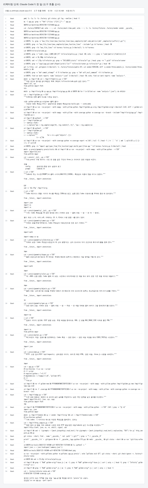

에이전트의 노트(`var/runs/REFACTOR-*/refactor-notes.md`)에 남은 검증 결과는 다음과 같다.

- 실제 Codex 측정값 41개와, 이를 결정적으로 변형한 328개(벽 없음, 지평선 없음, 잘못된 점 등)로 장면 파일 생성 결과를 비교했다. 369개 모두 바이트 단위로 같았다. 새 기하 코드의 분기 커버리지는 98%였다.
- 가짜 `codex`로 원본 앱과 새 앱을 함께 띄워 27개 HTTP 항목(정상 요청, 오류 응답, 재시도, 종료 신호 등)을 비교했다. 모두 같았다.
- 실제 Codex로 공식 평가를 돌린 공개 세트 충실도는 97.58이었다(리팩터링 전 97.39).

### 고치지 않고 기록한 문제 10개

리팩터링 지시문은 "고칠 것이 보이면 노트에만 적는다"고 했다. 에이전트는 코드를 옮기면서 본 버그 10개를 고치지 않고 적었다. 그중 몇 가지는 다음과 같다.

| 번호 | 문제 | 영향 |
|---|---|---|
| 1 | 주광 방향을 카메라 좌표계로 받는데 월드 좌표계로 그대로 쓴다 | 카메라가 기울수록 조명과 면 색 추정이 어긋난다. 홀드아웃 색 오차(ΔE 19, 목표 15 이하)의 원인 후보다 |
| 2 | Codex가 일부 값을 빼면 장면 명세에 `NaN`, `Infinity`가 들어간다 | JS로는 동작하지만 명세를 JSON으로 다시 읽는 도구는 깨진다 |
| 6 | POST의 `Content-Length`가 음수나 문자면 연결이 멈추거나 끊긴다 | 잘못된 요청 하나가 연결을 붙잡을 수 있다 |
| 7 | 이미지 파일 핸들을 닫지 않는다 | 요청이 많으면 파일 핸들이 쌓인다 |

리팩터링과 수정을 한 번에 섞지 않으면, 리팩터링의 수용 조건("동작이 그대로")을 엄격하게 지킬 수 있다. 대신 발견한 문제는 사라지지 않고 다음 작업의 입력이 된다. 5단계 발견 루프가 이 목록을 이슈로 바꾸는 입력으로 쓸 수 있다.

### 실측값

| 항목 | 값 |
|---|---|
| Claude Code | 988초, $3.71, 도구 호출 58회 (상한 $5 안에서 끝남, `success`) |
| 평가 | Codex 12회 (후보 8장면 + main 4장면) |
| 공개 세트 충실도 | 97.39 → 97.19 (허용폭 2점 안) |
| 홀드아웃 | 후보 95.7 / 같은 시드의 main 96.2 (허용폭 8점 안) |
| 코드 지표 | 가장 긴 파일 1,082 → 150줄, 가장 긴 함수 105 → 32줄, 최대 복잡도 54 → 12, 파일 1 → 21개 |

## 내 프로젝트에 적용하기

- **코드 지표를 평가에 넣는다.** 기능 평가만 있으면 코드가 얼마나 커지든 통과한다. 파일·함수 길이와 복잡도 같은 단순한 지표 세 개만 있어도, 리팩터링이 필요한 시점을 사람 대신 판단할 수 있다.
- **리팩터링을 따로 수용한다.** 구현과 리팩터링을 한 커밋에 섞지 않는다. 구현이 통과한 커밋을 안전한 기준점으로 남겨 두면, 리팩터링이 거부되어도 잃는 것이 없다.
- **리팩터링에서는 버그를 고치지 않게 한다.** 동작 보존을 수용 조건으로 삼으려면 동작을 바꾸는 변경을 함께 넣으면 안 된다. 보인 버그는 노트로 받아 다음 작업으로 넘긴다.
- **동작 보존 검증 방법은 에이전트에게 맡겨도 된다.** 이 실험의 에이전트는 기준값 비교, 커버리지, 가짜 의존성을 스스로 만들었다. 팩토리는 결과를 eval로 판정하기만 했다.
- **허용폭은 실측 흔들림으로 정한다.** 생성형 모델이 제품 안에 있으면 같은 코드도 점수가 흔들린다. 흔들림보다 작은 허용폭은 동작이 같은 변경도 거부한다.

## 단순화한 것과 함정

- **기준값 세 개는 거칠다.** 파일 400줄, 함수 60줄, 복잡도 15는 시작용 값이다. 중복 코드, 결합도, 순환 의존은 재지 않는다.
- **전체 코드 줄 수는 늘었다.** 팩토리는 1,545줄에서 1,655줄로, 제품은 1,082줄에서 1,206줄로 늘었다. 모듈 설명과 import 때문이다. 줄 수를 줄이는 것이 목적이 아니다.
- **리팩터링은 한 번만 시도한다.** 거부되면 다시 시도하지 않고 리팩터링 전 코드를 병합한다. 다음 작업에서 지표가 여전히 기준을 넘으면 그때 다시 실행된다.
- **노트가 한 번 사라졌다.** 처음 구현에서는 병합 뒤 작업 공간을 지울 때 에이전트의 노트도 함께 지워졌다. 실행 기록에서 복원한 뒤, 작업 공간을 지우기 전에 노트를 실행 폴더로 옮기도록 고쳤다.
- **팩토리 자신의 리팩터링은 사람이 했다.** 팩토리 코드에는 아직 팩토리를 평가하는 eval이 `calibrate`뿐이다. 학습 루프(6단계) 전까지 팩토리 코드는 사람이 고친다.

## 3단계 이후: 요구사항 변경 하나를 팩토리로 처리하다 (LOCAL-2)

3단계를 마친 뒤 사용자가 제품의 Codex 사용 방식을 바꾸라고 지시했다. "GPT-6.1-Sol을 codex app-server 방식으로 써야 한다." 지금까지 제품은 요청마다 `codex exec` 프로세스를 새로 띄우고, 모델은 사용자 Codex 설정에서 옮겨 온 GPT-6.2-Astra를 썼다. 이 변경은 팩토리 쪽과 제품 쪽으로 나뉜다. 제품 코드는 규칙대로 팩토리가 바꾸게 했다.

| 쪽 | 바꾼 것 | 누가 |
|---|---|---|
| 팩토리 | 제품 전용 Codex 설정의 모델을 `us.openai.gpt-6.1-sol`로 고정 (`tsf/config.py`의 `CODEX_MODEL`) | 사람 |
| 팩토리 | `doctor`가 app-server 방식(`initialize` → `thread/start` → `turn/start`)으로 Codex를 점검 (`tsf/codex.py`) | 사람 |
| 평가기 | 평가 중 앱의 프로세스 그룹을 관찰하고, 수용 조건 `process`로 판정 (`tsf/oracle/processes.py`) | 사람 (채점기 검증 재통과) |
| 제품 | `codex exec` 호출을 app-server 클라이언트로 교체 | 팩토리 (작업 명세 `work/LOCAL-2.yaml`) |

### 모델만 바꿔도 결과가 달라졌다

앱 코드는 그대로 두고 모델만 바꾼 상태를 먼저 평가했다. 같은 시드에서 홀드아웃이 70~77점에서 44.7점으로 떨어졌고, 생성 시간은 장면당 12~18초에서 18~40초로 늘었다. 앱의 지시문과 후처리가 이전 모델에 맞춰져 있기 때문이다.

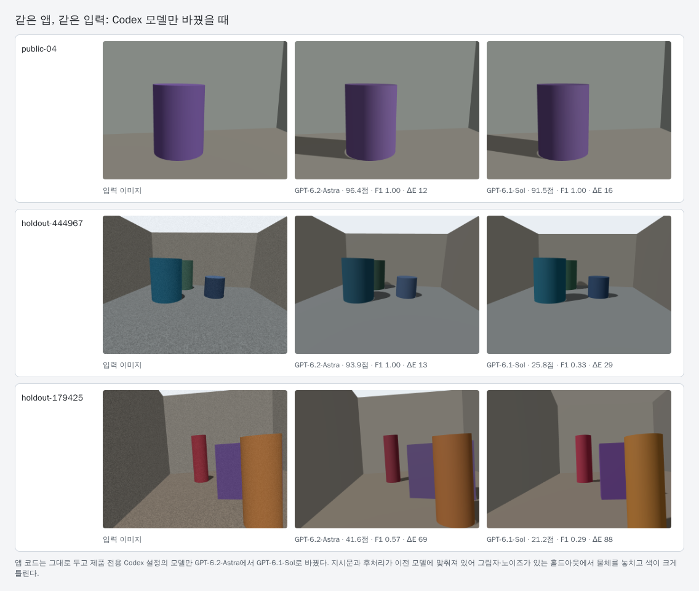

`holdout-444967`은 보기에는 비슷한데 F1이 0.33이다. GPT-6.1-Sol은 화각을 49°로 잡았고 정답은 약 62°다. 화각을 좁게 잡으면 같은 사진을 설명하려고 물체가 더 멀리 놓인다. 카메라에서 본 실루엣은 거의 같아서 IoU는 0.97로 높지만, 3D 배치는 깊이 방향으로 카메라 높이의 약 1배만큼 어긋난다. 평가기가 사진만 봐서는 구분되지 않는 3D 오차를 잡아낸 경우다.

### 평가기가 숨은 외부 접속을 찾았다

수용 조건에 "앱이 `codex app-server`를 실행하고 `codex exec`는 실행하지 않는다"를 넣으려고, 평가기가 평가 중 앱의 하위 프로세스를 관찰하게 했다. 처음 관찰에서 예상하지 못한 것이 나왔다. 제품 전용 설정을 썼는데도 Codex가 실행마다 GitHub에서 플러그인 목록을 받아 오고 있었다. 제품 런타임에 필요 없는 기능 6개(plugins, remote_plugin, plugin_sharing, apps, browser_use, hooks)를 전용 설정에서 끄자 이 접속이 사라졌다.

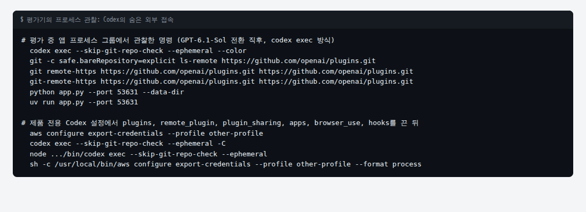

### LOCAL-2 실행 결과: 두 번째 시도에서 통과

첫 시도는 app-server로 바꾸는 데는 성공했지만 두 조건에서 떨어졌다. 공개 세트 화각 오차가 3.44°로 목표(3° 이하)를 넘었고, 홀드아웃이 같은 시드의 main보다 18점 낮았다. 두 번째 시도는 실패 증거를 받아 화각 오차를 1.94°로 낮췄고 모든 조건을 통과했다. 코드 지표가 기준 안이라 리팩터링 단계는 건너뛰었다.

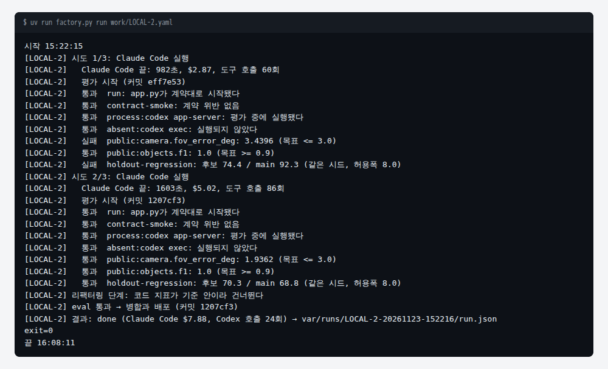

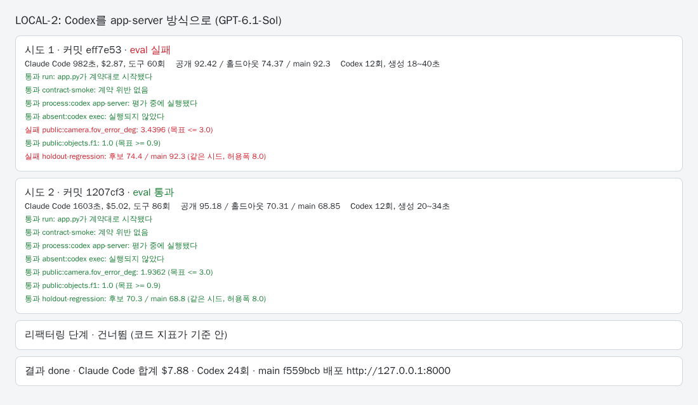

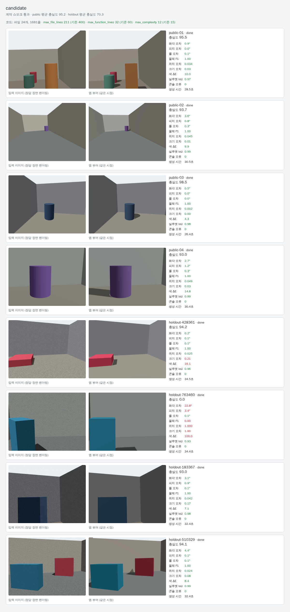

| 항목 | 값 |
|---|---|
| Claude Code | 시도 1: 982초, $2.87 / 시도 2: 1,603초, $5.02 (상한에 걸림) / 합계 $7.88 |
| Codex | 평가 24회, 생성 시간 장면당 26~35초 |
| 관찰한 프로세스 | `codex app-server`, Bedrock 자격 증명용 `aws configure export-credentials`. `codex exec`와 GitHub 접속 없음 |
| 공개 세트 | 92.4 → 95.2 (화각 오차 3.44° → 1.94°) |
| 홀드아웃 | 시도 1: 74.4 / main 92.3, 시도 2: 70.3 / main 68.8 (각각 같은 시드) |
| 제품 코드 | 파일 24개, 가장 긴 파일 211줄, 가장 긴 함수 32줄, 최대 복잡도 12 |

두 시도의 main 점수(92.3, 68.8)가 크게 다른 것은 시도마다 홀드아웃 시드를 새로 뽑기 때문이다. 쉬운 시드가 뽑히면 main도 높게 나온다. 후보와 main을 같은 시드로 함께 채점하는 이유가 이것이다.

### 관찰한 것

- **요구사항을 수용 조건으로 바꿔야 강제된다.** "app-server를 써라"는 지시만 있었다면, 에이전트가 따르지 않아도 eval은 통과했을 것이다. 평가기가 확인할 수 있는 조건(프로세스 관찰)으로 바꿔야 eval 관문이 그 요구사항을 지킨다.
- **관찰 장치는 새 결함을 함께 찾는다.** 프로세스 관찰은 app-server 확인용으로 넣었지만, 숨은 외부 접속을 먼저 찾았다.
- **모델 교체는 팩토리 설정이지만 제품 품질을 바꾼다.** 이번 변경으로 홀드아웃 품질이 떨어졌고 생성도 느려졌다. LOCAL-2는 호출 방식만 다뤘으므로, 떨어진 품질은 5단계 발견 루프가 다음 이슈로 만들 목표 미달 항목으로 남는다.
- **작업 명세 오류는 비용 없이 멈춘다.** 처음 작성한 `LOCAL-2.yaml`에 YAML 문법 오류(`{"type": ...}`가 들어간 문장)가 있었다. 팩토리는 작업 명세를 읽는 단계에서 멈췄고, 에이전트는 실행되지 않았다.
