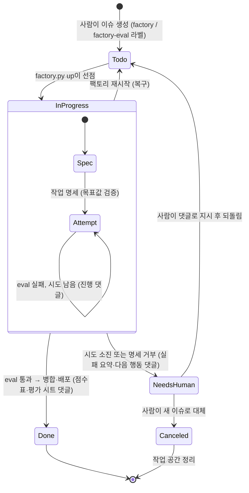

# 04. Linear 연결: 이슈 트래커를 제어판으로 쓰고, 실패를 사람에게 넘긴다

`git checkout step-4-pipeline`

## 이 단계가 푸는 문제

3단계까지 사람은 작업 명세 파일을 쓰고 명령을 입력해야 했다. 4단계는 그 일을 Linear로 옮긴다. 사람은 Linear에 이슈를 만들고, 팩토리는 이슈를 가져가 처리한 뒤 결과를 Linear에 남긴다. 사람이 Claude Code CLI에서 하던 조작(새 요청, 후속 지시, 종료)이 Linear 조작(이슈 생성, 댓글과 상태 되돌리기, Canceled)으로 바뀐다.

동시에 지켜야 할 규칙이 있다. 사용자는 "eval을 통과하지 못하면 수용하지 않는다. 통과하지 못하면 사람이 확인해서 Linear에 이슈를 새로 등록한다. eval 개선도 Linear로 처리한다"고 정했다. 그래서 Linear의 Done은 에이전트의 판단이 아니라 eval 통과를 뜻해야 하고, 평가 기준을 바꾸는 길도 Linear 이슈 하나로 좁혀야 한다.

## 적용한 원칙

- **Control Plane**: 이슈 트래커의 이슈를 작업 대기열로 쓰고, 이슈마다 따로 떨어진 에이전트 작업 공간을 준다. OpenAI Symphony의 방식이다.
- **결정론적 오케스트레이터**: 선점, 상태 이동, 재시도, 일시 정지는 모두 일반 코드가 한다. LLM은 이슈를 작업 명세로 정리하는 데만 쓴다.
- **Intent Layer**: 자연어 이슈를 성공 조건이 있는 작업 명세로 바꾼다. 무엇을 원하는지와 어떻게 만들지를 나눈다.
- **권한 분리**: 구현 에이전트는 평가 기준을 바꿀 수 없다. 평가 기준은 사람이 등록한 `factory-eval` 이슈로만 바뀐다.
- **Symphony SPEC과의 비교**: [reports/symphony-compare/report.md](../../reports/symphony-compare/report.md). 이 단계에서 Symphony의 규칙 몇 가지를 그대로 가져왔다(아래 표).

## 만든 것

| 모듈 | 하는 일 |
|---|---|
| `tsf/pipeline.py` | `factory.py up`. 30초마다 Todo 이슈를 하나 선점해 처리하고 결과를 Linear에 남긴다. 재시작 복구, Canceled 정리, 일시 정지 |
| `tsf/spec.py` | 이슈 본문과 사람 댓글 → 작업 명세. Claude Code `--json-schema`로 구조만 정리하고, 수용 조건은 프로그램이 정한다 |
| `tsf/eval_change.py` | `factory-eval` 이슈 → 팩토리 저장소의 worktree에서 평가 자산을 고친다. 변경 범위와 채점기 검증으로 수용한다 |
| `tsf/linear.py` | 이슈 조회(상태 목록, ID), 상태 이동, 댓글, 이미지 업로드, 이슈 생성. 트래커 비밀값 이름 목록도 여기에 둔다 |

### 이슈가 작업 명세가 되는 규칙

자연어 이슈를 구조로 정리하는 일은 LLM이 하지만, 수용 조건을 정하는 규칙은 프로그램이 지킨다.

| 규칙 | 이유 |
|---|---|
| 기본 조건(실행, 계약 스모크, `codex app-server` 사용·`codex exec` 미사용, 홀드아웃 회귀)은 항상 붙인다 | 이슈에 적지 않아도 지켜야 하는 계약이다 |
| 지표 목표는 이슈 원문에 그 숫자가 적혀 있고, 인용 구절이 원문에 그대로 있을 때만 받아들인다 | LLM이 목표를 지어내거나 숫자를 바꿔 기준을 낮추는 길을 막는다 |
| 부등호 방향은 최종 목표의 방향과 같아야 한다 | `F1 <= 0.9`처럼 방향을 뒤집어 기준을 무의미하게 만드는 길을 막는다 |
| 위 규칙을 어기면 실행하지 않고 Needs Human으로 보낸다 | 잘못된 명세로 비용을 쓰지 않는다 |

### Symphony에서 가져온 규칙

| 규칙 | Symphony SPEC | 이 팩토리 |
|---|---|---|
| 트래커 비밀값을 에이전트에게 넘기지 않는다 | §15.3 | `agent_env()`가 `LINEAR_API_KEY`를 지운다. `doctor`가 확인한다 |
| 작업 공간 이름 정리 | §4.2 | `[A-Za-z0-9._-]` 밖 문자는 `_`로 바꾸고 해시를 붙인다 |
| DB 없이 트래커로 재시작 복구 | §14.3 | 시작할 때 In Progress 이슈를 Todo로 되돌린다 |
| 실행 중 조정 | §8.5 | 시도 전마다 이슈 상태를 다시 읽어 In Progress가 아니면 멈춘다 |
| 종료 상태 작업 공간 정리 | §8.6 | 틱마다 Canceled 이슈의 worktree를 지운다 |
| 트래커 오류는 그 틱만 건너뛴다 | §11.4 | 조회 실패는 기록만 하고 다음 틱에 다시 시도한다 |

Symphony와 다르게 둔 것도 있다. 트래커에 쓰는 것은 에이전트가 아니라 컨트롤러이고, 완료는 eval 통과다. 실패한 시도는 백오프로 다시 하지 않고 실패 증거를 넘겨 다시 하며, 3회 뒤에는 사람에게 넘긴다. 이유는 [Symphony 비교 리포트](../../reports/symphony-compare/report.md)에 정리했다.

### 일시 정지

리뷰 게이트는 없지만 비용과 반복의 상한은 있다. 하루 Claude Code 비용이 $50에 닿거나 Needs Human이 연속 3건이면 팩토리는 새 이슈를 가져가지 않고 "[factory] 일시 정지" 이슈를 만든다. 사람이 원인을 확인하고 그 이슈를 Done으로 옮기면 다시 돈다. 일시 정지와 재개도 Linear에서 한다.
