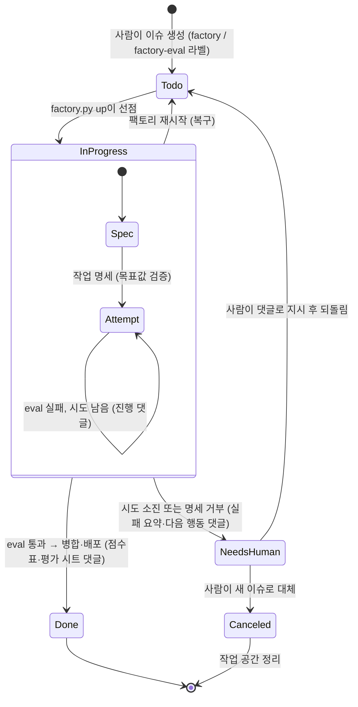
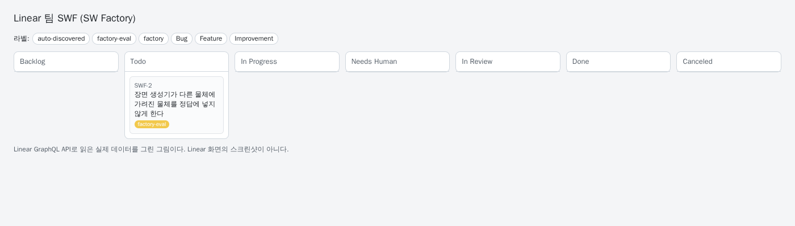
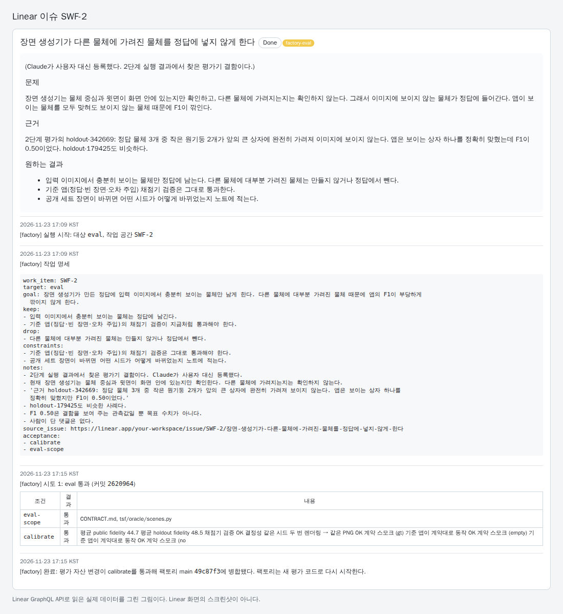
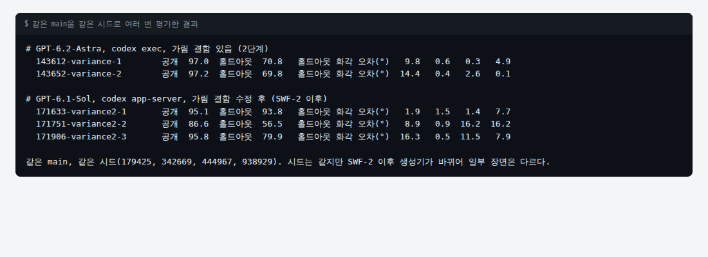
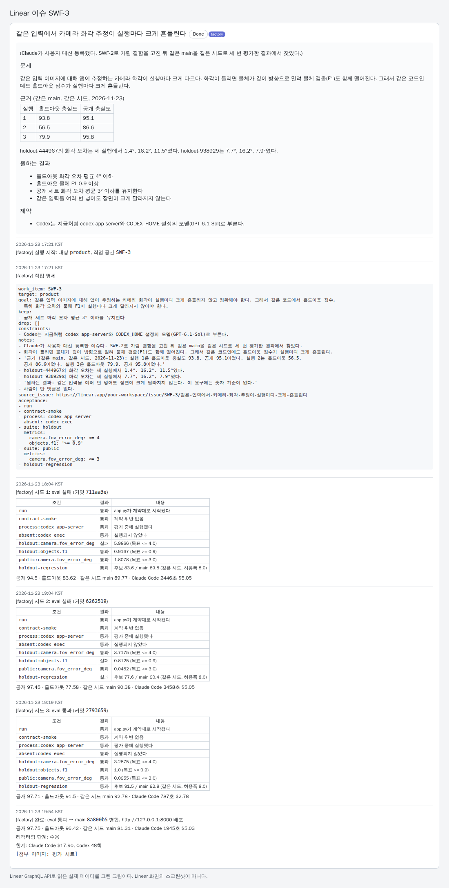
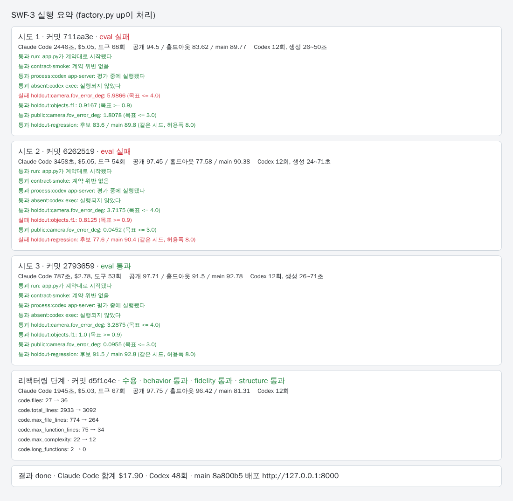
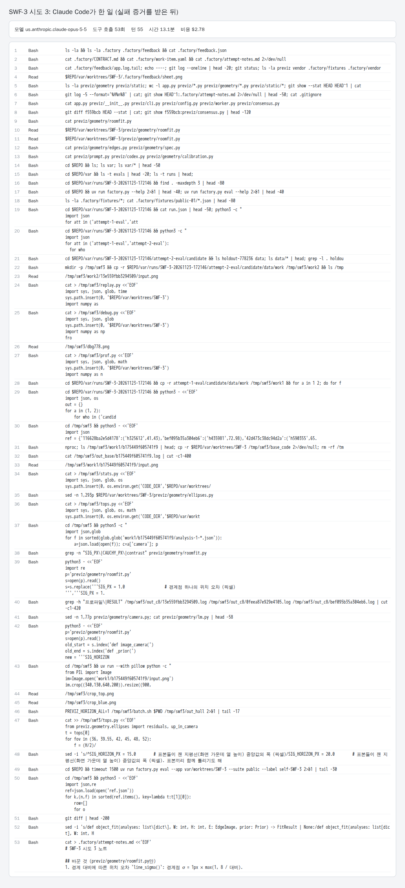
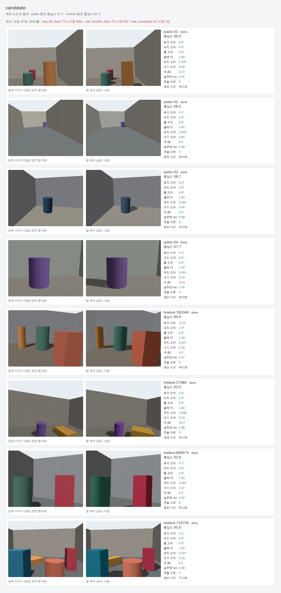
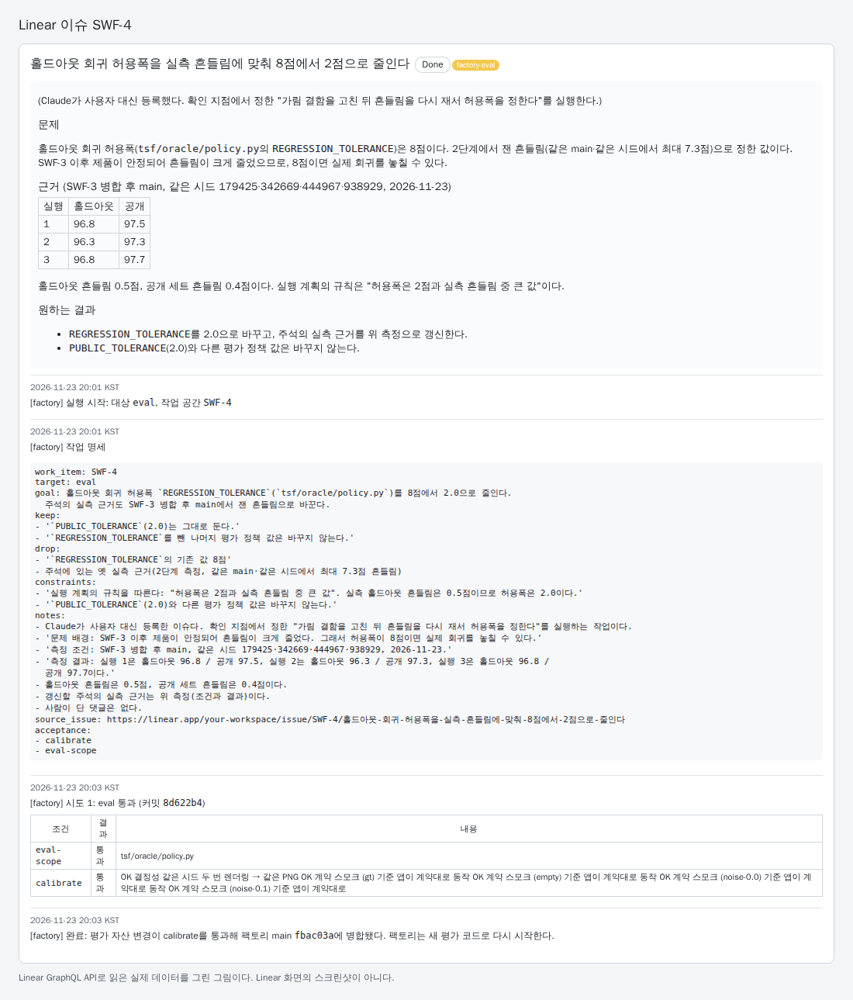
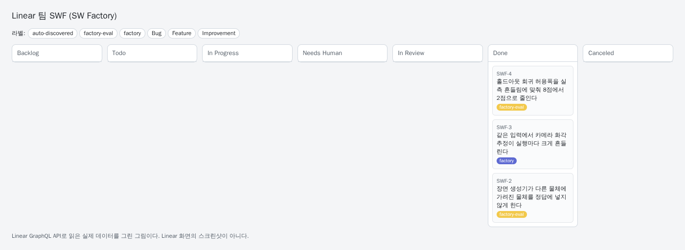

# 04. Linear 연결: 이슈 트래커를 제어판으로 쓰고, 실패를 사람에게 넘긴다

`git checkout step-4-pipeline`

## 이 단계가 푸는 문제

3단계까지 사람은 작업 명세 파일을 쓰고 명령을 입력해야 했다. 4단계는 그 일을 Linear로 옮긴다. 사람은 Linear에 이슈를 만들고, 팩토리는 이슈를 가져가 처리한 뒤 결과를 Linear에 남긴다. 사람이 Claude Code CLI에서 하던 조작(새 요청, 후속 지시, 종료)이 Linear 조작(이슈 생성, 댓글과 상태 되돌리기, Canceled)으로 바뀐다.

동시에 지켜야 할 규칙이 있다. 사용자는 "eval을 통과하지 못하면 수용하지 않는다. 통과하지 못하면 사람이 확인해서 Linear에 이슈를 새로 등록한다. eval 개선도 Linear로 처리한다"고 정했다. 그래서 Linear의 Done은 에이전트의 판단이 아니라 eval 통과를 뜻해야 하고, 평가 기준을 바꾸는 길도 Linear 이슈 하나로 좁혀야 한다.

## 적용한 원칙

- **Control Plane**: 이슈 트래커의 이슈를 작업 대기열로 쓰고, 이슈마다 따로 떨어진 에이전트 작업 공간을 준다. OpenAI Symphony의 방식이다.
- **결정론적 오케스트레이터**: 선점, 상태 이동, 재시도, 일시 정지는 모두 일반 코드가 한다. LLM은 이슈를 작업 명세로 정리하는 데만 쓴다.
- **Intent Layer**: 자연어 이슈를 성공 조건이 있는 작업 명세로 바꾼다. 무엇을 원하는지와 어떻게 만들지를 나눈다.
- **권한 분리**: 구현 에이전트는 평가 기준을 바꿀 수 없다. 평가 기준은 사람이 등록한 `factory-eval` 이슈로만 바뀐다.
- **Symphony SPEC과의 비교**: [reports/symphony-compare/report.md](../../reports/symphony-compare/report.md). 이 단계에서 Symphony의 규칙 몇 가지를 그대로 가져왔다(아래 표).

## 만든 것



| 모듈 | 하는 일 |
|---|---|
| `tsf/pipeline.py` | `factory.py up`. 30초마다 Todo 이슈를 하나 선점해 처리하고 결과를 Linear에 남긴다. 재시작 복구, Canceled 정리, 일시 정지 |
| `tsf/spec.py` | 이슈 본문과 사람 댓글 → 작업 명세. Claude Code `--json-schema`로 구조만 정리하고, 수용 조건은 프로그램이 정한다 |
| `tsf/eval_change.py` | `factory-eval` 이슈 → 팩토리 저장소의 worktree에서 평가 자산을 고친다. 변경 범위와 채점기 검증으로 수용한다 |
| `tsf/linear.py` | 이슈 조회(상태 목록, ID), 상태 이동, 댓글, 이미지 업로드, 이슈 생성. 트래커 비밀값 이름 목록도 여기에 둔다 |

### 이슈가 작업 명세가 되는 규칙

자연어 이슈를 구조로 정리하는 일은 LLM이 하지만, 수용 조건을 정하는 규칙은 프로그램이 지킨다.

| 규칙 | 이유 |
|---|---|
| 기본 조건(실행, 계약 스모크, `codex app-server` 사용·`codex exec` 미사용, 홀드아웃 회귀)은 항상 붙인다 | 이슈에 적지 않아도 지켜야 하는 계약이다 |
| 지표 목표는 이슈 원문에 그 숫자가 적혀 있고, 인용 구절이 원문에 그대로 있을 때만 받아들인다 | LLM이 목표를 지어내거나 숫자를 바꿔 기준을 낮추는 길을 막는다 |
| 부등호 방향은 최종 목표의 방향과 같아야 한다 | `F1 <= 0.9`처럼 방향을 뒤집어 기준을 무의미하게 만드는 길을 막는다 |
| 위 규칙을 어기면 실행하지 않고 Needs Human으로 보낸다 | 잘못된 명세로 비용을 쓰지 않는다 |

### Symphony에서 가져온 규칙

| 규칙 | Symphony SPEC | 이 팩토리 |
|---|---|---|
| 트래커 비밀값을 에이전트에게 넘기지 않는다 | §15.3 | `agent_env()`가 `LINEAR_API_KEY`를 지운다. `doctor`가 확인한다 |
| 작업 공간 이름 정리 | §4.2 | `[A-Za-z0-9._-]` 밖 문자는 `_`로 바꾸고 해시를 붙인다 |
| DB 없이 트래커로 재시작 복구 | §14.3 | 시작할 때 In Progress 이슈를 Todo로 되돌린다 |
| 실행 중 조정 | §8.5 | 시도 전마다 이슈 상태를 다시 읽어 In Progress가 아니면 멈춘다 |
| 종료 상태 작업 공간 정리 | §8.6 | 틱마다 Canceled 이슈의 worktree를 지운다 |
| 트래커 오류는 그 틱만 건너뛴다 | §11.4 | 조회 실패는 기록만 하고 다음 틱에 다시 시도한다 |

Symphony와 다르게 둔 것도 있다. 트래커에 쓰는 것은 에이전트가 아니라 컨트롤러이고, 완료는 eval 통과다. 실패한 시도는 백오프로 다시 하지 않고 실패 증거를 넘겨 다시 하며, 3회 뒤에는 사람에게 넘긴다. 이유는 [Symphony 비교 리포트](../../reports/symphony-compare/report.md)에 정리했다.

### 일시 정지

리뷰 게이트는 없지만 비용과 반복의 상한은 있다. 하루 Claude Code 비용이 $50에 닿거나 Needs Human이 연속 3건이면 팩토리는 새 이슈를 가져가지 않고 "[factory] 일시 정지" 이슈를 만든다. 사람이 원인을 확인하고 그 이슈를 Done으로 옮기면 다시 돈다. 일시 정지와 재개도 Linear에서 한다.

## 실행해 보기

```sh
git checkout step-4-pipeline
uv run factory.py doctor          # '비밀값 격리' 항목이 추가됐다
uv run factory.py up              # 상주 실행 (Ctrl+C로 멈춘다)
uv run factory.py up --once       # 대기열이 빌 때까지 처리하고 끝낸다
```

Linear에서는 팀에 이슈를 만들고 `factory`(제품) 또는 `factory-eval`(평가 자산) 라벨을 붙인 뒤 Todo로 둔다. 원하는 결과에 숫자 목표가 있으면 본문에 그대로 적는다. 예: "홀드아웃 화각 오차 평균 4° 이하".

## 실제 실행 기록 (2026-11-23)

이 단계에서 Linear 이슈 세 개를 처리했다. 세 이슈 모두 사용자를 대신해 Claude가 등록했고, 본문 첫 줄에 그 사실을 적었다. 이슈를 등록한 뒤 사람이 입력한 명령은 `factory.py up --once` 하나씩뿐이다.

| 이슈 | 라벨 | 내용 | 결과 |
|---|---|---|---|
| SWF-2 | `factory-eval` | 장면 생성기가 다른 물체에 가려진 물체를 정답에 넣지 않게 한다 | 시도 1에 통과, 7분, $1.21 |
| SWF-3 | `factory` | 같은 입력에서 카메라 화각 추정이 실행마다 크게 흔들린다 | 시도 3에 통과, 리팩터링 수용, 2시간 33분, $17.90 |
| SWF-4 | `factory-eval` | 홀드아웃 회귀 허용폭을 실측 흔들림에 맞춰 8점에서 2점으로 줄인다 | (아래) |

실행 전 Linear 팀의 모습이다. 그림은 Linear API로 읽은 실제 데이터를 그린 것이고, Linear 화면의 스크린샷은 아니다.



### SWF-2: eval이 틀렸을 때 Linear로 고친다

2단계에서 찾은 평가기 결함(가려진 물체가 정답에 들어간다)을 `factory-eval` 이슈로 등록했다. 팩토리는 팩토리 저장소에 worktree를 만들고, 평가 자산 담당 에이전트에게 작업을 맡겼다. 바뀐 파일이 `tsf/oracle/scenes.py`와 `CONTRACT.md`뿐이었고 새 코드로 돌린 채점기 검증도 통과해, 팩토리 main에 병합됐다. `up`은 새 평가 코드로 스스로 다시 시작했다.



에이전트는 광선 격자로 물체마다 보이는 비율을 재고, 절반 넘게 가려지는 배치는 받아들이지 않게 했다. 장면 29개를 실제 렌더링과 비교해 판정 오차가 최대 0.023임을 확인했고, 공개 세트 4장면이 바뀌지 않았다는 것과 무작위 홀드아웃 시드의 31%가 바뀐다는 것을 노트에 적었다. 채점기 검증의 판정값과 목표값은 건드리지 않았다.

### 흔들림을 다시 재니 원인이 제품에 있었다

가림 결함을 고친 뒤 회귀 허용폭을 정하려고 같은 main을 같은 시드로 세 번 평가했다. 흔들림은 오히려 커졌다. 같은 장면의 화각 오차가 실행마다 1.4°, 16.2°, 11.5°로 달랐다. GPT-6.1-Sol이 화각을 추정할 때마다 다른 값을 내기 때문이다. 화각이 틀리면 물체가 깊이 방향으로 밀려 F1도 함께 떨어진다.



이 흔들림은 평가기가 아니라 제품의 문제다. 그래서 허용폭을 키우는 대신, 흔들림을 숫자 목표로 적은 제품 이슈 SWF-3를 등록했다.

### SWF-3: 제품 이슈가 Done이 되기까지



시도 1은 홀드아웃 화각 오차가 5.99°(목표 4°)라 실패했다. 시도 2는 화각은 맞췄지만 홀드아웃 F1이 0.81(목표 0.9)이고 홀드아웃 회귀까지 걸려 실패했다. 시도 3은 모든 조건을 통과했다. 통과한 구현의 코드가 다시 기준을 넘어 리팩터링 단계가 실행됐고, 리팩터링도 수용되어 병합·배포됐다.



에이전트가 고른 해법은 합의(consensus)다. 이미지 하나에 Codex 측정을 5번 받고, 화각 중앙값과의 일치도와 기하 피팅 비용으로 그중 하나를 고른다. 시도 3의 에이전트는 Codex를 새로 부르는 대신 이전 시도의 평가 산출물에 남은 Codex 측정값을 오프라인으로 재생해 기하 계산을 고쳤다.



SWF-3 병합 뒤 같은 측정을 다시 했다. 홀드아웃 흔들림이 37점에서 0.5점으로 줄었다.

| main | 홀드아웃 (같은 시드 3회) | 공개 세트 (3회) | 홀드아웃 화각 오차 최대 |
|---|---|---|---|
| SWF-3 전 | 93.8 / 56.5 / 79.9 | 95.1 / 86.6 / 95.8 | 16.3° |
| SWF-3 후 | 96.8 / 96.3 / 96.8 | 97.5 / 97.3 / 97.7 | 2.0° |

대가도 있다. 장면 하나에 Codex를 5배로 부르므로 생성 시간이 장면당 26~95초로 늘었다.



### SWF-4: 측정한 흔들림으로 평가 정책을 바꾼다

흔들림이 0.5점으로 줄었으니, 실행 계획의 규칙("허용폭은 2점과 실측 흔들림 중 큰 값")대로 홀드아웃 회귀 허용폭을 8점에서 2점으로 줄여야 한다. 허용폭은 평가 정책이므로 직접 고치지 않고 `factory-eval` 이슈로 등록했다. 에이전트는 `tsf/oracle/policy.py`의 값과 근거 주석만 바꿨고, 채점기 검증을 통과해 2분 반 만에 병합됐다.



세 이슈를 처리한 뒤의 Linear 보드다. 세 이슈가 모두 Done에 있고, 일시 정지 이슈는 생기지 않았다.



### 실측값

| 이슈 | 시도 | 시간 | Claude Code | Codex (평가) |
|---|---|---|---|---|
| SWF-2 (`factory-eval`) | 1 | 7분 | $1.21 | 0 (기준 앱만 씀) |
| SWF-3 (`factory`) | 3 + 리팩터링 | 2시간 33분 | $17.90 (시도 1·2, 리팩터링이 $5 상한에 걸림) | 48장면 × 5회 측정 |
| SWF-4 (`factory-eval`) | 1 | 2분 반 | $0.25 | 0 |

## 드러난 한계

- **숫자가 없는 요구는 수용 조건이 되지 못한다.** SWF-3의 "같은 입력을 여러 번 넣어도 장면이 크게 달라지지 않는다"는 숫자 목표가 없었다. 작업 명세를 만든 에이전트는 이 요구에 기준이 없다고 notes에 적었고, 안정성은 사람이 따로 잰 흔들림 측정으로만 확인됐다. "같은 장면을 두 번 생성해 차이를 잰다" 같은 지표를 `factory-eval`로 평가기에 추가하면 이 요구도 eval이 확인할 수 있다.
- **홀드아웃 정답이 파일 시스템에서 보인다.** SWF-3 시도 3의 에이전트는 이전 시도의 평가 산출물(`var/runs/…/attempt-N-eval/`)을 읽어 Codex 측정값을 재생했다. 그 폴더에는 지난 홀드아웃 장면의 정답(`gt.json`)도 있다. 다음 평가는 새 시드를 쓰므로 특정 정답이 새지는 않지만, 에이전트가 홀드아웃 분포에 맞춰 조정할 수 있다. 채점 뒤 홀드아웃 정답을 지우거나 Docker로 격리해야 막힌다.
- **Codex 호출 상한이 없다.** 실행 계획의 "하루 Codex 200회"는 아직 구현하지 않았다. 평가 기록의 Codex 호출 수는 장면 수를 센 것이고, SWF-3 이후 제품은 장면마다 Codex를 5번 부른다.
- **사람이 직접 등록한 이슈가 아직 없다.** 세 이슈 모두 Claude가 사용자를 대신해 등록했다. 사용자가 Linear에서 직접 이슈를 넣는 경로도 같은 코드로 처리된다.

## 내 프로젝트에 적용하기

- **이슈 트래커를 제어판으로 쓰되, 쓰기는 프로그램만 한다.** 에이전트가 트래커 상태를 바꿀 수 있으면 Done이 에이전트의 판단이 된다. 컨트롤러만 쓰게 하면 Done은 eval 통과를 뜻한다.
- **트래커 자격 증명은 에이전트에게 넘기지 않는다.** 이슈 본문은 신뢰할 수 없는 입력이다. 에이전트가 키를 가지면 이슈에 섞인 지시로 트래커를 바꿀 수 있다.
- **이슈를 작업 명세로 바꾸는 단계에 규칙을 둔다.** LLM이 자연어를 구조로 정리하게 하되, 목표값은 원문에 있는 숫자만, 방향은 정해진 방향만 받아들인다. 기준을 낮추는 길은 사람이 등록하는 평가 변경 이슈 하나로 좁힌다.
- **평가 기준을 바꾸는 이슈에도 수용 조건을 둔다.** 이 팩토리는 변경 범위(평가 자산 파일만)와 채점기 검증으로 평가 변경을 받아들인다. 평가를 고치는 일도 같은 팩토리가 하되, 다른 관문을 통과하게 한다.
- **실측으로 정책을 정하고, 정책 변경도 기록으로 남긴다.** 회귀 허용폭처럼 판정을 좌우하는 값은 측정한 흔들림으로 정하고, 바꿀 때도 근거를 이슈에 남긴다.
