# 05. 발견 루프: 점수와 목표의 차이를 다음 요구사항으로 바꾼다

`git checkout step-5-discovery`

## 이 단계가 푸는 문제

4단계까지 팩토리는 사람이 넣은 이슈만 처리했다. 이슈가 끝나면 팩토리는 멈추고, 다음에 무엇을 고칠지는 사람이 평가 결과를 보고 정했다. SWF-3도 사람이 흔들림을 재 보고 등록한 이슈였다.

5단계는 그 판단을 팩토리 안으로 옮긴다. 대기열이 비면 팩토리가 배포된 제품을 스스로 평가하고, 최종 목표에 못 미친 지표가 있으면 다음 이슈를 만들어 다시 처리한다. 사람은 최종 목표를 정하고, 목표에 닿을 때까지의 개선은 팩토리가 이어 간다.

## 적용한 원칙

- **Discovery Loop**: 배포된 제품을 재고, 문제를 찾고, 작업을 만든다. 다음에 할 일을 팩토리가 스스로 찾는다.
- **제품 개선 루프**: 제품의 부족한 점을 팩토리가 찾아 고친다.
- **이상 탐지 후 에이전트 실행**: 기록을 전부 LLM에 넘기면 비용이 크다. 목표 미달 판정은 프로그램이 하고, 발견 에이전트는 미달 지표가 있을 때만 관찰을 쓴다.
- **같은 작업 형태**: 사람이 낸 요구사항이든 팩토리가 찾은 문제든 같은 형태의 작업이 된다. 발견 루프가 만든 이슈도 사람이 만든 이슈와 같은 Linear 이슈이고, 같은 작업 명세 규칙과 eval 관문을 거친다.
- **현재와 기대의 차이 찾기**: 지금 제품과 목표로 한 제품의 차이를 되풀이해 잰다. 이 팩토리에서 기대하는 제품은 최종 목표(`FINAL_TARGETS`)다.

## 만든 것

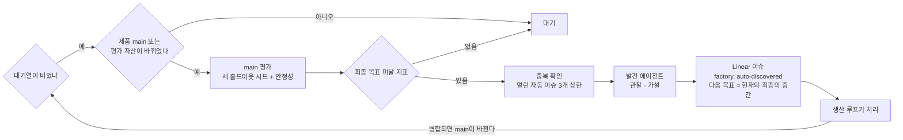

| 규칙 | 값 | 이유 |
|---|---|---|
| 언제 도는가 | 대기열이 비었고, 제품 main 커밋이나 평가 자산 커밋이 바뀌었을 때 | 같은 main을 같은 기준으로 다시 평가해 봐야 새로 알 것이 없다 |
| 무엇을 보는가 | 새 홀드아웃 시드로 평가한 공개·홀드아웃 지표와 안정성 지표 | 공개 세트만 보면 외운 결과를 놓친다 |
| 다음 목표 | 현재값과 최종 목표의 중간. 차이가 작으면 최종 목표 | 최종 목표를 한 번에 요구하면 통과하지 못하고 사람에게 넘어간다 |
| 한 번에 만드는 이슈 | 최대 2개 | 같은 원인의 이슈가 한꺼번에 쌓이지 않게 한다 |
| 열린 자동 이슈 | 최대 3개 (Todo, In Progress, Needs Human 포함) | Needs Human에 걸린 지표로 같은 이슈를 또 만들지 않는다 |
| 중복 | 이슈 본문의 `지표 키: suite:metric` 줄로 확인 | 같은 지표의 이슈는 하나만 열려 있게 한다 |

발견 에이전트는 장면별 수치를 받아 관찰 한 문장과 원인 가설 한 문장을 쓴다. 해결 방법은 쓰지 않게 한다. 이슈는 목표를 말하고, 방법은 구현 에이전트가 정한다는 원칙을 지키기 위해서다.

### 발견 루프가 만드는 이슈의 모양

```text
제목: [auto] 같은 장면 재생성 시 화각 차 개선: 홀드아웃 0.31 → 0.25 (최종 목표 0.2)
라벨: factory, auto-discovered

## 근거
홀드아웃 `stability.fov_delta_deg` 평균 0.31, 최종 목표 <= 0.2. 평가 기록: `…-discovery-8a800b5`
(장면별 최악 3개 표)

## 관찰 (발견 에이전트)
- (수치에서 보이는 사실)
- 가설: (원인 가설)

## 원하는 결과
- 홀드아웃 같은 장면 재생성 시 화각 차(`stability.fov_delta_deg`) 평균 0.25 이하

지표 키: `holdout:stability.fov_delta_deg`
```

이 이슈는 사람이 만든 이슈와 똑같이 작업 명세로 바뀐다. 목표값 0.25는 본문에 숫자로 적혀 있으므로 작업 명세 규칙(원문에 있는 숫자만 받아들인다)을 통과한다.

## 실행해 보기

```sh
git checkout step-5-discovery
uv run factory.py discover            # 발견 루프 한 번 (같은 main·같은 평가 기준이면 건너뛴다, --force로 다시)
uv run factory.py up --once           # 대기열 처리 → 비면 발견 루프 → 만든 이슈 처리 → … 더 할 일이 없으면 끝
```

## 실제 실행 기록 (2026-11-23 ~ 24)

### 첫 시도: 목표를 이미 충족해서 아무것도 만들지 않았다

사용자는 발견 루프의 새 목표로 안정성 지표를 골랐다. SWF-5로 평가기에 안정성 지표(같은 장면을 두 번 생성한 결과의 충실도 차, 화각 차)를 넣었다. 두 번째 요청에는 눈에 보이지 않는 픽셀 노이즈를 더한 다른 바이트를 보내 캐시로 통과하지 못하게 했다. 발견 루프는 main을 평가했지만 모든 최종 목표를 충족해 이슈를 만들지 않았다. 발견 루프가 멈추는 조건이 동작한 것이다.

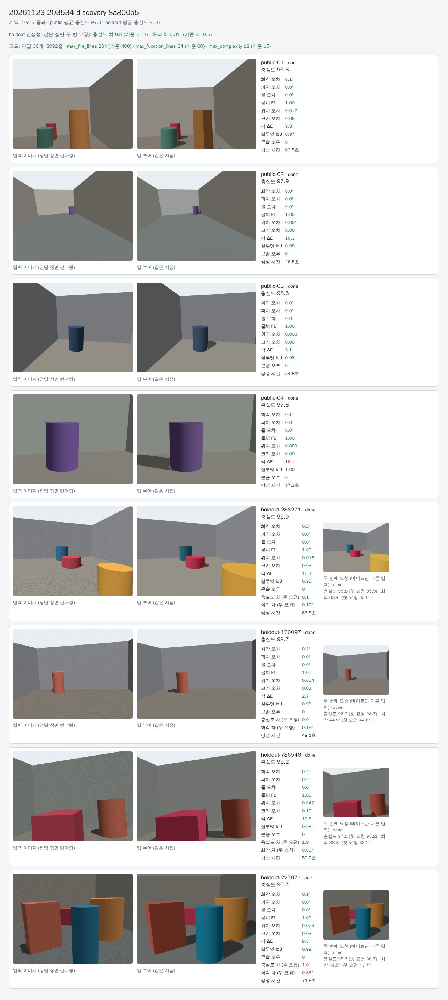

### 목표를 올리자 팩토리가 밤새 스스로 개선을 이어 갔다

사용자가 "안정성 목표를 더 엄격하게" 하라고 지시했다. 평가 정책이므로 `factory-eval` 이슈 SWF-6로 최종 목표를 충실도 차 1 → 0.5, 화각 차 0.5° → 0.2°로 바꿨다. 같은 날 하루 비용 상한도 개발 중 값인 $400로 올렸다. 그 뒤 `up --once` 하나로 5시간 15분 동안 사람 개입 없이 다음이 일어났다.

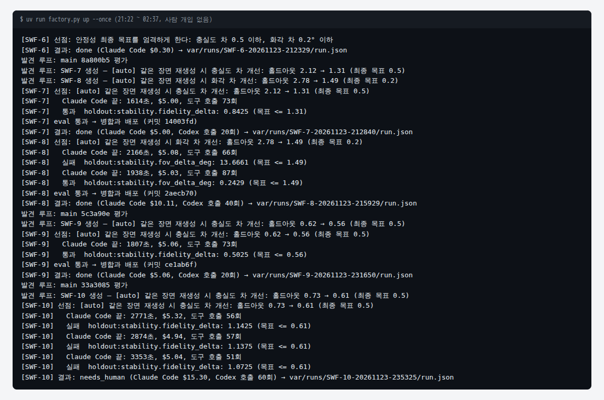

| 이슈 | 만든 주체 | 목표 | 결과 | Claude Code |
|---|---|---|---|---|
| SWF-6 | 사람 (대신 등록) | 안정성 최종 목표 강화 (`factory-eval`) | 통과, 팩토리 main 병합 | $0.30 |
| SWF-7 | 발견 루프 | 충실도 차 2.12 → 1.31 | 시도 1 통과 (0.84) | $5.00 |
| SWF-8 | 발견 루프 | 화각 차 2.78° → 1.49° | 시도 1 실패 (13.7°), 시도 2 통과 (0.24°) | $10.11 |
| SWF-9 | 발견 루프 | 충실도 차 0.62 → 0.56 | 시도 1 통과 (0.50) | $5.06 |
| SWF-10 | 발견 루프 | 충실도 차 0.73 → 0.61 | 3회 모두 실패 (1.14 / 1.14 / 1.07) → Needs Human | $15.30 |

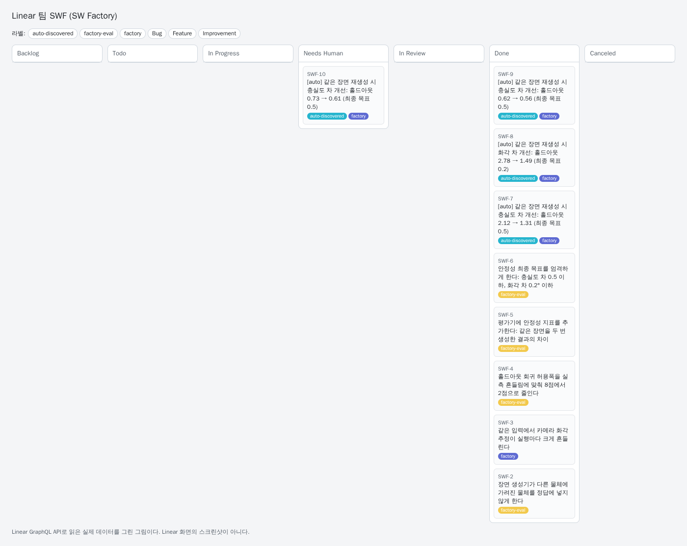

SWF-8은 발견 루프가 만든 이슈가 한 번 실패한 뒤 실패 증거를 받아 통과한 사례다.

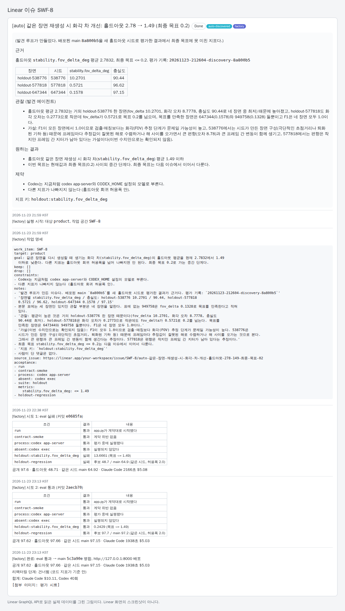

### 그런데 지표의 잡음이 목표의 차이보다 컸다

SWF-10은 코드를 바꾸지 않은 첫 시도에서도 1.14가 나왔다. 발견 루프가 같은 코드에서 잰 값은 0.73이었다. 평가 기록을 모으면 원인이 보인다.

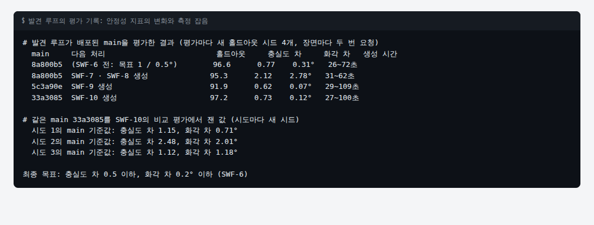

같은 main `8a800b5`의 충실도 차가 0.77과 2.12로, 같은 main `33a3085`가 0.73, 1.15, 2.48, 1.12로 나왔다. 화각 차도 같은 main에서 0.12°부터 2.01°까지 흔들렸다. 안정성 지표는 홀드아웃 4장면을 두 번씩 생성해 재는데, 이 표본으로는 어떤 시드가 뽑히느냐에 따라 값이 몇 배씩 달라진다.

그래서 이번 실행의 개선을 그대로 믿을 수는 없다. SWF-9의 0.62 → 0.50은 잡음 안의 변화이고, SWF-10은 잡음보다 작은 차이(0.73 → 0.61)를 쫓다가 $15.30을 쓰고 사람에게 넘어갔다. 화각 차가 2.78°에서 0.07~0.12°로 줄어든 측정도 있었지만, 같은 코드에서 2.01°가 나온 측정도 있어 개선을 단정할 수 없다.

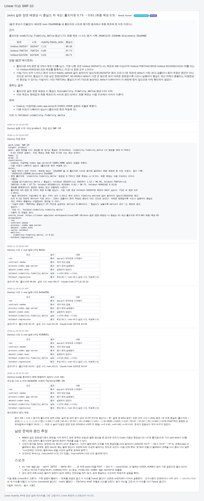

eval 관문은 제 역할을 했다. 잡음보다 작은 목표를 통과하지 못한 SWF-10은 병합되지 않았고, 사람에게 넘어갔다. 문제는 발견 루프가 측정 잡음을 모른 채 목표를 정했다는 데 있다.

### 실측값

| 항목 | 값 |
|---|---|
| 자동 실행 시간 | 5시간 15분 (21:22 ~ 02:37), 사람 개입 없음 |
| 발견 루프가 만든 이슈 | 4개 (SWF-7 ~ 10), eval 통과 3개, Needs Human 1개 |
| Claude Code | $35.77 (SWF-6 포함) |
| 생성 시간 | 요청 한 건 26~72초 → 27~109초 |
| 제품 코드 | 3,092줄 → 3,602줄 |

## 드러난 한계

- **잡음보다 작은 차이는 쫓을 수 없다.** 발견 루프는 현재값과 최종 목표의 중간을 다음 목표로 정한다. 지표의 측정 잡음이 그 차이보다 크면, 팩토리는 개선이 아니라 운을 쫓는다. 다음 목표는 측정 잡음보다 큰 차이일 때만 만들어야 하고, 지표의 잡음은 평가 정책으로 따로 재서 남겨야 한다.
- **표본이 작다.** 안정성 지표의 표본은 홀드아웃 4장면 × 2요청이다. 장면 수나 요청 수를 늘리면 잡음은 줄지만 평가 한 번의 Codex 호출이 늘어난다. 이 균형은 평가 정책의 결정이고, `factory-eval` 이슈로만 바꿀 수 있다.
- **비용과 시간의 긴장 관계는 아직 지표가 아니다.** 안정성을 높이는 동안 생성 시간이 최대 109초까지 늘었지만 생성 시간 목표가 없어서 아무도 막지 않았다.

## 내 프로젝트에 적용하기

- **목표를 사람이 정하고, 목표까지의 개선은 팩토리에 맡긴다.** 사람의 일은 최종 목표를 바꾸는 이슈 하나였다. 그 뒤 네 개의 이슈는 팩토리가 스스로 만들고 처리했다.
- **발견된 일도 같은 관문을 지나게 한다.** 발견 루프가 만든 이슈도 사람이 만든 이슈와 같은 작업 명세 규칙과 eval 관문을 거친다. 그래서 잘못된 목표를 쫓아도 망가진 코드는 병합되지 않는다.
- **목표보다 먼저 측정 잡음을 잰다.** 같은 코드를 여러 번 평가해 지표가 얼마나 흔들리는지 알아야, 의미 있는 다음 목표를 정할 수 있다.
- **멈추는 조건을 설계한다.** 목표 충족, 열린 자동 이슈 상한, 연속 Needs Human, 비용 상한이 없으면 발견 루프는 끝없이 일을 만든다.

## 측정을 먼저 고친 뒤 다시 돌리다 (SWF-11, SWF-12)

사용자는 SWF-10을 다시 시도하지 않고 측정부터 고치기로 정했다. Claude가 사용자를 대신해 SWF-10을 Canceled로 옮기고, 그 이유를 사람 댓글로 남겼다. 팩토리는 다음 틱에 SWF-10의 작업 공간을 정리했다.

측정 잡음은 사람이 먼저 쟀다. 홀드아웃 8장면을 고정 시드로 정하고 같은 main을 세 번 평가했다. 일반 지표의 잡음은 작았지만 안정성 지표의 잡음은 컸다. 충실도 차의 세 값은 0.87 / 1.22 / 1.85로 범위가 0.98이었고, 화각 차는 0.61 / 0.91 / 1.36°로 범위가 0.75°였다.

이 측정을 근거로 두 가지를 바꿨다.

| 바꾼 것 | 누가 | 내용 |
|---|---|---|
| SWF-11 (`factory-eval`) | 팩토리 (사람이 이슈 등록) | 홀드아웃 4 → 8장면, 지표별 측정 잡음을 평가 정책 `METRIC_NOISE`에 날짜·커밋·시드와 함께 기록 |
| 발견 루프 | 사람 (팩토리 코드) | 목표와의 차이가 그 지표의 잡음보다 클 때만 이슈를 만들고, 다음 목표까지의 한 단계도 잡음보다 작지 않게 정한다 |

그 뒤 `up --once` 하나로 다음이 이어졌다.

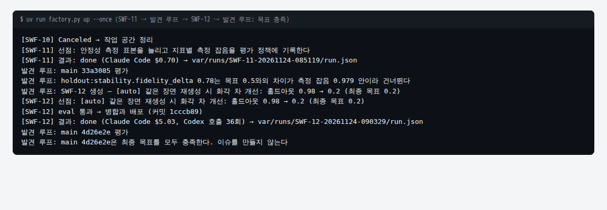

발견 루프는 충실도 차(0.78)를 건너뛰었다. 목표 0.5와의 차이(0.28)가 잡음(0.98) 안이기 때문이다. 화각 차(0.98°)는 차이(0.78°)가 잡음(0.75°)보다 커서 SWF-12를 만들었다. SWF-12는 시도 1에 통과했고(0.16°), 병합 뒤 발견 루프는 모든 최종 목표를 충족한다고 판정하고 멈췄다.

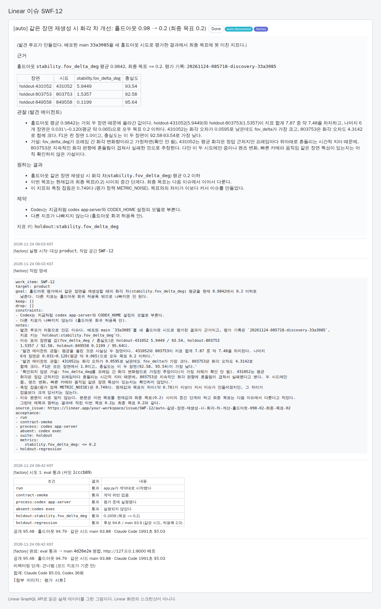

### 판정이 운이 아닌지 다시 재다

발견 루프의 판정은 평가 한 번의 결과다. 그래서 잡음을 잰 것과 같은 고정 시드 8개로 새 main을 세 번 평가해 SWF-12 전과 비교했다.

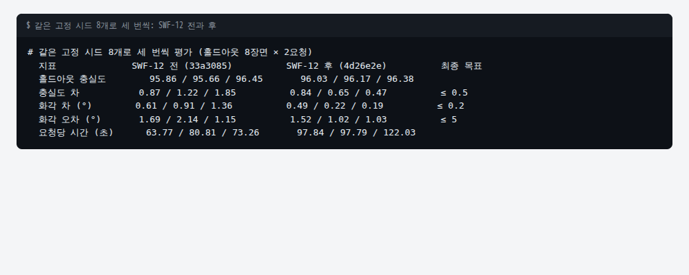

결과는 세 가지로 정리된다.

- **개선은 실제다.** 두 안정성 지표 모두 후의 세 값이 전의 세 값보다 전부 낮다. 범위가 겹치지 않는다.
- **최종 목표는 아직 안정적으로 충족하지 못한다.** 세 번 중 한 번만 두 목표를 충족했다(충실도 차 0.47, 화각 차 0.19°). 발견 루프가 멈춘 것은 그 평가에서 좋은 값이 나왔기 때문이다. 목표가 측정 잡음과 비슷한 크기라서 생기는 일이다.
- **대가가 있다.** 요청 한 건의 생성 시간이 64~81초에서 98~122초로 약 50% 늘었다. 생성 시간에는 목표가 없어 아무것도 막지 않았다. 목표 지표 하나만 올리면 다른 품질이 나빠질 수 있다는 긴장 관계가 실제로 드러났다.

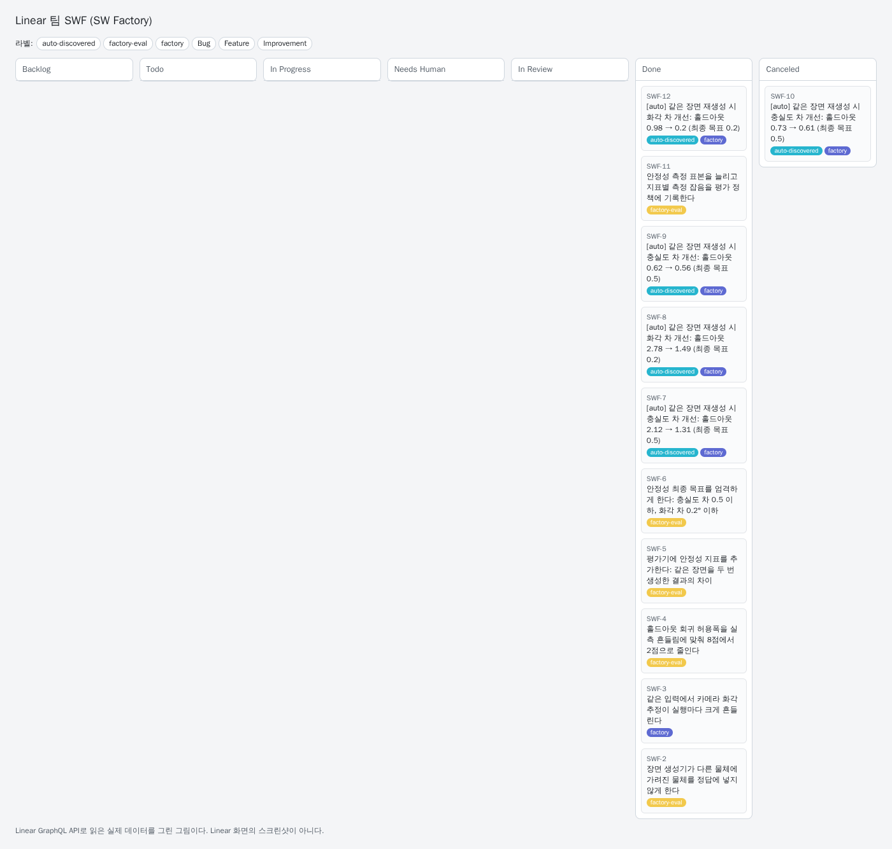

### 실측값 (SWF-11 ~ 12)

| 항목 | 값 |
|---|---|
| SWF-11 | 시도 1 통과, Claude Code $0.70 |
| SWF-12 | 시도 1 통과, Claude Code $5.03, 앱 요청 36건 |
| 자동 실행 시간 | 56분 (08:50 ~ 09:46) |
| 발견 루프 | 2번 평가, 이슈 1개 생성, 잡음 안이라 건너뛴 지표 1개 |

### 이 실험에서 얻은 것

- **잡음을 재는 일이 목표를 정하는 일보다 먼저다.** SWF-7~10은 잡음을 모르는 채 목표를 쫓았고, SWF-12는 잡음을 안 뒤 의미 있는 차이 하나만 쫓았다. 전자는 이슈 4개에 $35.47, 후자는 이슈 1개에 $5.03이 들었다.
- **멈춤 판정도 측정이다.** "목표 충족"도 평가 한 번의 결과이므로 잡음의 영향을 받는다. 멈춤을 확정하려면 같은 조건으로 여러 번 재거나, 목표를 측정 해상도보다 넉넉하게 둬야 한다.
- **긴장 관계 지표가 없으면 비용이 조용히 늘어난다.** 안정성을 높이는 동안 생성 시간이 늘었지만, 생성 시간 목표가 없어서 eval도 발견 루프도 이를 보지 않았다.
