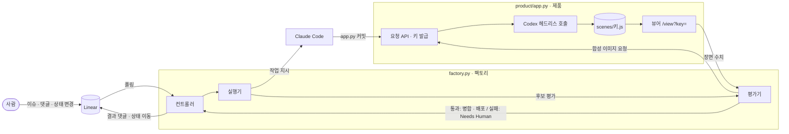
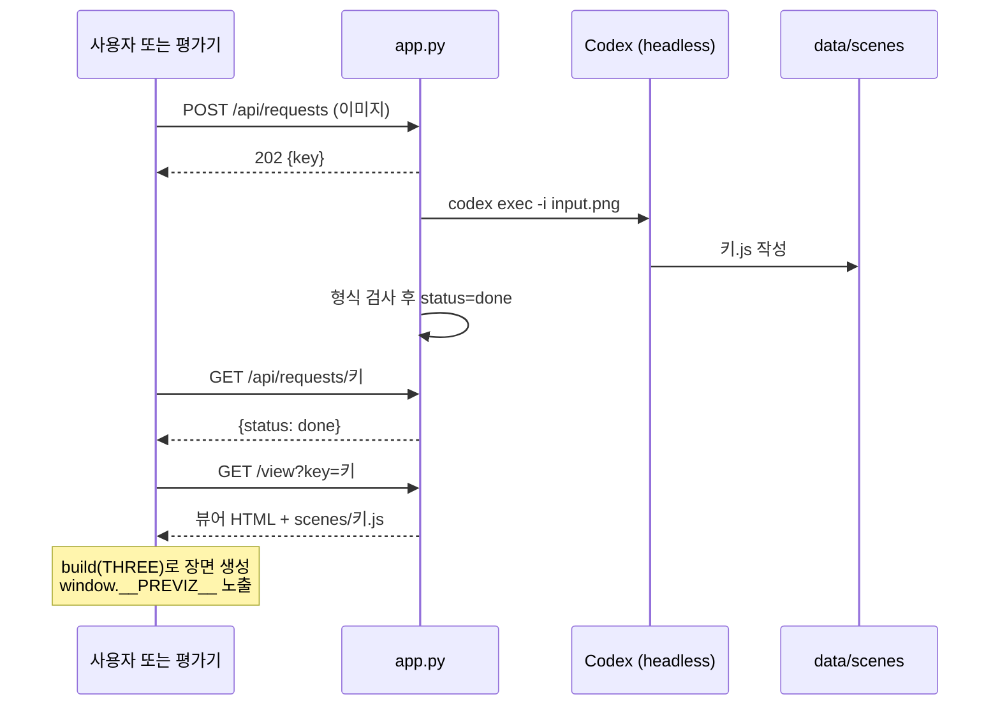
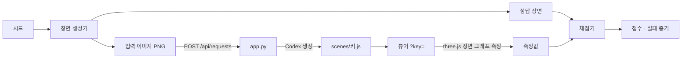
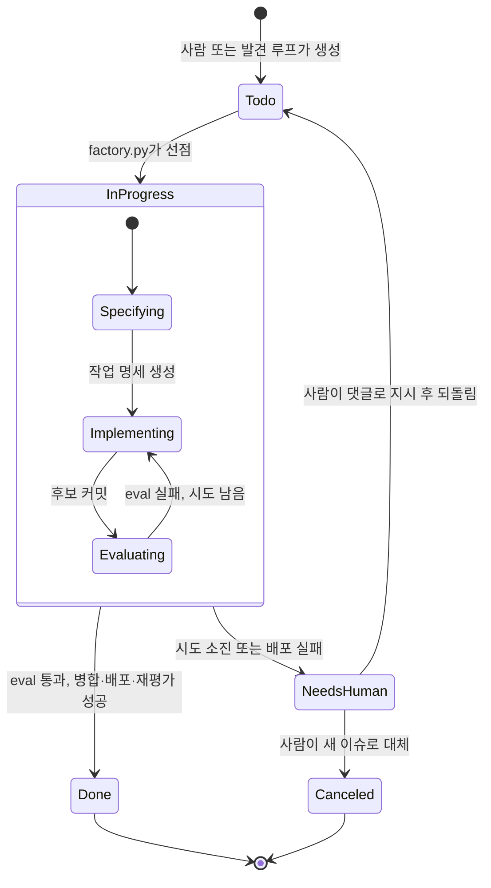

# 가장 작은 소프트웨어 팩토리 실행 계획: factory.py와 app.py, 그리고 Linear

## 목표

이 리포트는 구현을 시작하기 전에 무엇을 어떤 순서로 만들고, 각 단계를 어떻게 확인하는지 검토하게 한다. 읽고 나면 단계마다 생기는 파일, 실행할 명령, 완료 판정 기준, 사용자가 해야 할 일을 확인할 수 있다. 마지막 절의 확인 항목에 답하면 바로 0단계를 시작할 수 있다.

## 배경

이 프로젝트에서 소프트웨어 팩토리는 사람이 의도와 목표를 정하면 AI가 설계·구현·검증·수정을 되풀이해 소프트웨어를 만들어 가는 생산 시스템이다. 여기서 중요한 것은 에이전트를 여럿 엮는 구조가 아니라 분명한 성공 조건, 구현과 떨어진 평가, 끊기지 않는 피드백 루프다. 그래서 평가 장치를 가장 먼저 만든다.

요청은 이 원칙으로 가장 작은 팩토리를 로컬에 만드는 실험이다. 팩토리는 Linear로 받은 요구사항만으로 예제 제품을 만들고, 이후 스스로 개선해 나간다. 예제 제품은 이미지 한 장을 받아 three.js로 같은 구도의 프리비즈 3D 공간을 만든다. 프리비즈는 꼭 유지해야 할 특성만 남기고 나머지는 최대한 단순화한 3D 공간을 뜻한다. 인프라는 외부 의존성을 최소화하고, 각 단계를 소개하는 자료도 함께 만들어 다른 프로젝트에 적용할 때의 참고서로 삼는다.

1차 계획을 검토하면서 사용자는 세 가지를 정했다. 모델은 Bedrock default profile만 쓴다. eval을 통과하지 못한 결과는 수용하지 않고, 사람이 확인해 Linear에 이슈를 새로 등록하는 식으로 처리한다. eval 자체를 고치는 일도 Linear 이슈로 처리한다. 사용자는 이 구조에서 Linear가 전체 제어판처럼 동작한다고 보았다.

이어서 사용자는 예제 제품의 구조가 가장 작은 형태가 아니라고 판단했다. 제품은 Nuxt 프로젝트 대신 Codex를 헤드리스로 호출하는 Python 단일 파일로 시작한다. 이 파일은 요청마다 키를 만들고, Codex가 생성한 three.js 3D 공간을 정해진 위치에 파일로 저장한다. 키를 파라미터로 받는 뷰어 주소에 들어가면 그 파일을 불러와 보여 준다. 사용자는 구현 전에 구체적인 실행 계획을 리포트로 먼저 확인하기를 요청했다.

2026-11-23에 이 EC2를 확인했다. Python 3.13, uv 0.13, git, Claude Code 2.1.330, Codex 0.171.0이 설치되어 있다. Codex는 이미 Bedrock 공급자와 us.openai.gpt-6.2-astra 모델로 설정되어 있다. AWS default profile의 자격 증명은 정상 동작하지만, 현재 셸의 AWS\_PROFILE은 다른 프로필을 가리킨다. Linear API 키는 아직 없다.

---

## 결론: Python 파일 두 개와 Linear로 시작하고, 평가부터 7단계로 쌓는다

팩토리는 Python 파일 하나(factory.py)로 시작하고, 팩토리가 만드는 제품도 Python 파일 하나(app.py)로 시작한다. 사람은 Linear에 요구사항 이슈를 넣는다. factory.py는 이슈를 받아 Claude Code에게 app.py를 고치게 하고, 정답을 아는 합성 이미지로 결과를 평가한다. eval을 통과한 변경만 제품에 병합하고, 통과하지 못한 작업은 Linear에서 사람에게 넘긴다.

app.py는 이미지 요청마다 키를 만들고, Codex를 헤드리스로 실행해 three.js 장면 파일을 만든다. 뷰어 주소에 키를 넣으면 그 파일을 불러와 3D로 보여 준다. 평가기는 뷰어에 실제로 그려진 three.js 장면에서 카메라와 물체의 수치를 읽어 정답과 비교한다. 그래서 app.py의 내부가 바뀌어도 같은 기준으로 판단할 수 있다.

필요한 인프라는 없다. 작업 상태는 Linear에, 실행 기록은 파일에 둔다. 외부 의존은 Linear, Bedrock default profile로 호출하는 Claude Code와 Codex, 패키지 설치용 레지스트리뿐이고, Docker 없이 시작한다.

실행은 7단계다. 0단계 준비부터 3단계 Linear 연결까지가 '요구사항을 넣으면 만들어진다'를 보여 준다. 4~5단계는 '알아서 개선한다'를 보여 준다. 장면 하나를 평가할 때마다 Codex를 한 번 부르므로 평가 비용이 계획의 가장 큰 변수다. 그래서 첫 실측값이 나오는 2단계 뒤와, 첫 이슈가 완료되는 3단계 뒤에 사용자 확인 지점을 둔다.

시작하려면 사용자가 Linear 팀과 개인 API 키를 준비하고, 마지막 절의 확인 항목 여섯 가지에 답해야 한다. 답이 없는 항목은 적힌 권장안으로 진행한다.

<a id="overview"></a>

## 전체 그림

계획은 네 부분으로 읽는다. 첫째, 두 Python 파일과 Linear, 두 에이전트가 각각 무엇을 맡는지 본다. 둘째, eval이 무엇을 통과로 보는지 본다. 병합 여부가 여기서 정해지므로 나머지 부분은 모두 이 기준에 기댄다. 셋째, Linear 위에서 이슈가 처리되고 실패가 사람에게 돌아가며 다음 이슈가 생기는 흐름을 본다. 넷째, 이것들을 어떤 순서로 만들고 각 단계를 어떻게 확인하는지 본다.

실행 순서는 의존 관계를 거꾸로 따라간다. 평가기가 없으면 실행기는 결과가 맞는지 알 수 없다. 실행기가 없으면 Linear 연결은 일을 넘길 곳이 없다. 그래서 평가를 먼저 만들고, 실행기, Linear 연결, 개선 루프 순서로 올린다.



factory.py는 제품 코드도 3D 장면도 직접 만들지 않는다. 코드는 Claude Code가 쓰고, 장면은 제품 안의 Codex가 만든다. factory.py는 Linear와 평가기 사이에서 순서와 규칙만 지킨다. 평가기는 제품의 요청 API와 뷰어만 사용한다.

1. [무엇을 만드는가: Python 파일 두 개와 Linear](#build) — 두 단일 파일과 두 에이전트가 각각 무엇을 맡고, 파일이 언제 나뉘는지 보여 준다.
2. [eval은 무엇을 통과로 보는가](#eval) — 병합 여부를 정하는 네 조건과, 그 기준이 맞는지 먼저 검증하는 방법을 보여 준다.
3. [Linear에서 어떻게 돌아가는가](#operation) — 사람의 Linear 조작이 팩토리 동작으로 바뀌는 방식과, eval 실패가 사람에게 돌아가는 경로를 보여 준다.
4. [단계별 실행 계획](#plan) — 각 단계에서 무엇을 만들고 어떤 명령으로 완료를 판정하는지, 사용자가 언제 무엇을 해야 하는지 보여 준다.

<a id="build"></a>

## 무엇을 만드는가: Python 파일 두 개와 Linear

두 단일 파일과 두 에이전트가 각각 무엇을 맡고, 파일이 언제 나뉘는지 보여 준다.

factory.py, app.py, Linear, Claude Code, Codex의 역할 분담과 각 파일의 시작 형태. 평가 기준과 루프의 세부는 다음 절에서 다룬다.

팩토리와 제품은 각각 Python 파일 하나로 시작한다. 팩토리 파일은 이 세션에서 쓰고, 제품 파일은 처음부터 끝까지 팩토리가 쓴다. 두 파일 모두 표준 라이브러리를 중심으로 쓴다. 필요한 의존성은 파일 머리에 적어 두고, uv가 실행 시점에 설치하게 한다.

처음부터 멀티 에이전트 프레임워크를 들일 필요는 없고, 기본 루프는 단순하게 시작해도 된다. 이 계획은 그 루프를 의사코드가 아니라 실제로 실행되는 파일 하나로 만든다.

**구성요소별 역할**

| 구성요소 | 맡는 일 | 맡지 않는 일 |
| --- | --- | --- |
| Linear | 작업 대기열, 작업 상태, 사람의 지시와 결정, 결과 보고 | 평가 실행, 병합 판단 |
| factory.py | Linear 폴링, 작업 공간, Claude Code 호출, 평가, eval 통과 판정, 병합, 로컬 배포 | 제품 코드 작성, 3D 장면 생성 |
| Claude Code | 작업 명세 정리, app.py 설계·구현·수정 | 평가 자산 수정, 병합 |
| product/app.py | 요청 접수, 키 발급, Codex 호출, 장면 파일 저장, 뷰어 제공 | 자기 결과의 평가 |
| Codex | 입력 이미지를 보고 three.js 장면 파일 생성 | app.py 수정 |

개발 에이전트와 제품 안의 생성 엔진을 다른 도구로 둔 것은 두 기록을 구분하기 위해서다. Claude Code의 기록은 팩토리가 어떻게 일했는지를 보여 주고, Codex의 기록은 제품이 어떻게 동작했는지를 보여 준다. 두 도구 모두 Bedrock default profile로 호출한다. 팩토리 쪽 에이전트도 Codex로 바꾸고 싶다면 factory.py의 호출 함수 하나만 바꾸면 된다.

<a id="app-flow"></a>

### app.py가 요청 하나를 처리하는 방식

요청에서 키 발급, Codex 생성, 파일 저장, 뷰어 표시까지의 순서와, 평가기가 기대는 고정 계약을 보여 준다.

제품의 요청 처리 순서와 평가기가 기대는 고정 계약

app.py는 요청을 받으면 키를 바로 돌려주고, 장면 생성은 뒤에서 진행한다. Codex 생성 시간은 아직 재지 않았지만, HTTP 요청 하나를 붙잡아 둘 만큼 짧다고 가정할 수 없다. 호출하는 쪽은 상태 주소로 완료를 확인한 뒤 뷰어 주소로 들어간다.



키를 먼저 돌려주고 생성은 뒤에서 하므로, 평가기는 여러 이미지를 한꺼번에 요청하고 완료된 것부터 측정할 수 있다. 장면 파일은 형식 검사를 통과한 뒤에만 done이 된다.

<a id="app-contract"></a>

#### 평가기가 기대는 계약

실행 방법, 주소, 장면 파일 형식, 뷰어가 노출할 객체를 고정한 계약과 Codex 호출 환경을 보여 준다.

앱 계약과 Codex 호출 환경

평가기는 app.py의 내부를 모른 채 위 순서만 따른다. 그래서 팩토리는 아래 계약을 고정하고, CONTRACT.md로 에이전트에게 공개한다. 계약을 바꾸는 길은 factory-eval 이슈뿐이다.

```text
실행:  uv run app.py --port <port> --data-dir <dir>

POST /api/requests        본문 = 이미지 바이트 (image/png, image/jpeg)  → 202 {"key": "..."}
GET  /api/requests/<key>  → {"status": "pending" | "done" | "failed", "error": "..."}
GET  /view?key=<key>      → 뷰어 HTML

장면 파일: <data-dir>/scenes/<key>.js
  export function build(THREE) { return { scene, camera } }
뷰어:      window.__PREVIZ__ = { ready: Promise, scene: THREE.Scene, camera: THREE.PerspectiveCamera }
메시:      mesh.userData.role ∈ {"ground", "wall", "object"}
런타임:    three.js는 로컬 사본을 쓰고 외부 CDN을 쓰지 않는다
```

장면 파일을 JSON이 아니라 three.js 코드로 둔 것은 요청 원문을 따른 것이다. 대신 형식을 'build(THREE)를 내보내는 모듈'로 고정해, 뷰어가 어떤 장면 파일이든 같은 방식으로 불러오게 한다. 메시마다 역할 표시를 요구하는 이유는 평가기가 바닥, 벽, 물체를 구분해 측정해야 하기 때문이다.

Codex 호출에는 팩토리가 마련한 제품 전용 설정 폴더를 쓴다. 사용자 Codex 설정에는 MCP 서버 3개, 플러그인, hook, 전역 AGENTS.md가 들어 있다. 그대로 쓰면 제품 동작이 개인 설정에 따라 달라진다. 전용 설정 폴더에는 Bedrock 공급자와 모델 설정만 복사한다. 아래는 app.py가 하게 될 호출의 예이며, 실제 옵션과 지시문은 에이전트가 정한다.

```sh
AWS_PROFILE=default CODEX_HOME=var/codex-home \
codex exec -i data/requests/<key>/input.png \
  -C data/requests/<key> --skip-git-repo-check --ephemeral \
  --dangerously-bypass-approvals-and-sandbox --json \
  "이미지와 같은 구도의 프리비즈 장면을 scene.js로 작성하라. 형식은 CONTRACT.md를 따른다."
```

**평가기가 기대는 계약 · 이해도 확인**

**Q2. 평가기가 app.py가 만든 장면의 카메라 화각을 알아내는 방법으로 이 계획에 맞는 것은 무엇인가?**

선택지를 보기 전에 답을 떠올려 보세요.

A. Codex가 쓴 장면 파일의 코드를 문자열로 읽어 fov 값을 찾는다.

B. 뷰어 페이지가 노출한 window.\_\_PREVIZ\_\_의 카메라 객체에서 직접 읽는다.

C. app.py에 화각을 돌려주는 별도 API를 만들게 하고 그 값을 믿는다.

D. Codex에게 생성한 장면의 화각을 텍스트로 보고하게 한다.

확인하기 전에 선택 이유를 한 문장으로 설명해 보세요. 입력하거나 채점하지 않습니다.

---

**정답과 해설 — 답을 고른 뒤 확인하세요**

**Q2: B** — 평가기는 app.py의 내부를 모른 채 계약된 뷰어에서 three.js 장면 그래프를 측정한다. 그래서 장면 파일의 작성 방식이 바뀌어도 같은 기준으로 판단할 수 있다.

근거: '평가기가 기대는 계약' 절과 eval 절의 측정 흐름도

A. 평가기는 장면 파일의 코드를 해석하지 않는다. 코드 형태가 바뀌면 이 방식은 깨진다.

B. 계약은 뷰어가 실제로 만든 three.js 장면과 카메라를 노출하게 하고, 평가기는 그것을 측정한다.

C. 제품이 스스로 보고한 값은 실제로 그려진 장면과 다를 수 있다. 계약에는 그런 API가 없다.

D. 생성 엔진의 자기 보고는 독립적인 평가가 아니다.

이해를 돕기 위한 자가 확인입니다. 학습 효과를 측정하거나 보고서의 판정을 바꾸지 않습니다.

---

<a id="file-growth"></a>

### factory.py가 커지는 순서와 파일을 나누는 기준

단계마다 factory.py에 무엇이 더해지는지와, 크기가 아니라 수정 권한이 갈릴 때만 파일을 나누는 규칙을 보여 준다.

단계별 명령 추가와 파일 분리 규칙, 최종 저장소 구조

factory.py에는 단계마다 명령이 하나씩 늘어난다. 독자는 단계별 git 태그에서 이 파일이 어떻게 커지는지 차례로 볼 수 있다.

**단계별로 더해지는 명령과 파일**

| 단계 | factory.py에 더해지는 명령 | 새로 생기는 파일 |
| --- | --- | --- |
| 0 | doctor, linear-setup | factory.py, .gitignore, vendor/three.module.js |
| 1 | eval, calibrate | CONTRACT.md |
| 2 | run (로컬 작업 명세 하나 실행) | var/runs/ 실행 기록 (git 제외) |
| 3 | up (Linear 상주 실행) | oracle.py (평가 부분 분리) |
| 4 | up에 발견 루프 추가 | 없음 |
| 5 | up에 학습 루프 추가 | harness/v1/ (지시문 분리) |
| 6 | report | docs/guide/, reports/ 타임라인 |

파일은 코드가 길어져서가 아니라 수정 권한이 갈릴 때만 나눈다. 3단계에서 평가 부분을 oracle.py로 떼는 이유는 factory-eval 이슈가 평가 코드만 고치게 하기 위해서다. 이 이슈의 수용 조건에는 '변경이 oracle.py와 CONTRACT.md 밖으로 나가지 않는다'가 들어간다. 5단계에서 지시문을 harness/로 떼는 이유도 같다. 학습 루프는 harness/ 안만 고칠 수 있다.

모든 단계를 마친 저장소는 다음과 같다.

```text
tiny-software-factory/          # 팩토리 저장소
├── factory.py                  # 컨트롤러 · 실행기 · 배포 · 발견 · 학습 (uv run)
├── oracle.py                   # 평가기와 채점기 (3단계에 분리, factory-eval 이슈만 수정)
├── CONTRACT.md                 # 앱 계약 (공개)
├── harness/v1/                 # 지시문 (5단계에 분리, 학습 루프만 수정)
├── vendor/three.module.js      # 합성 장면 렌더링용 three.js 사본
├── docs/guide/                 # 단계별 소개 자료
├── reports/                    # 계획 리포트, 진행 타임라인
├── product/                    # 제품 저장소 (별도 git, eval 통과 커밋만)
│   └── app.py                  # 처음에는 이 파일 하나 (+ 로컬 three.js)
└── var/                        # worktrees/, runs/, codex-home/, prod-data/ (git 제외)
```

**factory.py가 커지는 순서와 파일을 나누는 기준 · 이해도 확인**

**Q4. 3단계에서 평가 코드를 factory.py에서 oracle.py로 떼어 내는 이유로 계획에 맞는 것은 무엇인가?**

선택지를 보기 전에 답을 떠올려 보세요.

A. factory.py가 너무 길어져 읽기 어렵기 때문이다.

B. factory-eval 이슈가 평가 코드만 고쳤는지 파일 단위로 확인하기 위해서다.

C. Claude Code가 한 번에 파일 하나만 수정할 수 있기 때문이다.

D. 평가를 별도 서버 프로세스로 실행하기 위해서다.

확인하기 전에 선택 이유를 한 문장으로 설명해 보세요. 입력하거나 채점하지 않습니다.

---

**정답과 해설 — 답을 고른 뒤 확인하세요**

**Q4: B** — 파일은 코드 길이가 아니라 수정 권한이 갈릴 때만 나눈다. oracle.py와 CONTRACT.md 밖으로 나가는 변경은 factory-eval 이슈의 수용 조건에서 거부된다.

근거: 'factory.py가 커지는 순서와 파일을 나누는 기준' 절

A. 계획은 길이를 분리 기준으로 쓰지 않는다.

B. 수정 권한이 갈리는 지점에서만 파일을 나누고, factory-eval 이슈의 수용 조건에 변경 범위 확인이 들어간다.

C. 리포트에 그런 제약은 없다.

D. 분리는 실행 방식이 아니라 수정 권한의 경계를 위한 것이다.

이해를 돕기 위한 자가 확인입니다. 학습 효과를 측정하거나 보고서의 판정을 바꾸지 않습니다.

---

<a id="eval"></a>

## eval은 무엇을 통과로 보는가

병합 여부를 정하는 네 조건과, 그 기준이 맞는지 먼저 검증하는 방법을 보여 준다.

정답 장면을 이용한 판단 기준, eval 통과의 네 조건, Codex 비용을 고려한 평가 세트 크기, 채점기 검증. 평가 결과를 받아 움직이는 루프는 다음 절에서 다룬다.

eval 통과는 네 조건을 모두 만족하는 것이다. app.py가 계약대로 실행되고, 계약 스모크 검사를 통과하고, 이슈의 성공 조건을 충족하고, 홀드아웃 점수가 현재 main보다 정해진 폭 넘게 내려가지 않아야 한다. 하나라도 실패하면 병합하지 않는다.

판단의 바탕은 정답을 아는 합성 장면이다. 결과가 맞는지 판단하는 기준을 Oracle이라 부른다. Oracle이 분명할수록 팩토리에 더 많은 일을 맡길 수 있다. 사진에서 3D를 복원하는 문제에는 보통 정답이 없다. 하지만 장면을 먼저 만들고 그 장면을 렌더링한 이미지를 입력으로 쓰면 정답이 생긴다. 평가기는 이 이미지를 app.py에 요청하고, 뷰어에 그려진 장면을 정답과 비교한다.

**eval 통과의 네 조건**

| 조건 | 확인 방법 | 실패하면 |
| --- | --- | --- |
| 실행 | uv run app.py가 정해진 포트에서 응답한다 | 병합하지 않음 |
| 계약 스모크 | 요청·상태·뷰어 주소가 계약대로 응답하고, 장면 모듈이 build(THREE)를 내보낸다 | 병합하지 않음 |
| 이슈 성공 조건 | 작업 명세에 적힌 항목별 목표값을 공개 세트에서 충족한다 | 병합하지 않음 |
| 홀드아웃 회귀 | 같은 새 시드로 채점한 후보와 main의 점수 차이가 허용폭 이내다 | 병합하지 않음 |

마지막 조건이 없으면 한 항목을 올리면서 다른 항목을 망가뜨린 결과도 통과한다. 목표 지표와 긴장 관계인 지표를 같이 보는 이유다.

평가 세트는 작게 시작한다. 장면 하나를 채점할 때마다 app.py가 Codex를 한 번 호출하기 때문이다. 공개 세트는 고정 시드 4개이고, 홀드아웃은 평가할 때마다 새로 뽑는 시드 4개다. 회귀 비교를 위해 같은 홀드아웃 시드로 main도 채점하므로, 평가 한 번에 Codex 호출은 최대 12회다. 2단계에서 호출 1회의 시간과 비용을 잰 뒤 이 크기를 다시 정한다.

Codex의 결과는 같은 입력에도 매번 다를 수 있다. 회귀 허용폭이 그 흔들림보다 작으면, 아무것도 바꾸지 않은 후보도 우연히 실패한다. 그래서 2단계에서 같은 main을 두 번 평가해 점수의 흔들림을 잰다. 허용폭은 2점과 실측 흔들림 중 큰 값으로 정한다.



정답 장면과 입력 이미지가 같은 생성기에서 나오므로, 채점기는 앱의 결과를 정답 수치와 직접 비교할 수 있다. 평가기는 장면 파일의 코드를 해석하지 않고, 뷰어가 실제로 만든 three.js 장면 그래프를 측정한다.

<a id="oracle-measure"></a>

### 정답 장면을 만들고 결과를 측정하는 방식

합성 장면이 담는 요소, 뷰어에서 읽는 수치, 채점 항목과 최종 목표값을 보여 준다.

합성 장면 생성, 측정 항목, 최종 목표값

장면 생성기는 시드 하나로 방 크기, 카메라, 물체 1~4개, 조명을 무작위로 정한다. 렌더링은 Playwright가 띄운 헤드리스 Chromium에서 three.js로 한다. 같은 시드는 항상 같은 장면과 같은 이미지를 만든다. 홀드아웃은 그림자, 질감 노이즈, 렌즈 왜곡처럼 공개 세트에 없는 변형을 섞는다. 그래서 공개 세트를 외워도 홀드아웃 점수는 오르지 않는다.

장면이 남기는 요소는 프리비즈에 꼭 필요한 것뿐이다. 카메라 시점과 화각, 지평선과 바닥, 벽, 주요 물체의 위치·크기·대표 색, 주광 방향은 남긴다. 질감, 세부 형상, 작은 물체는 버린다. 평가기는 뷰어 페이지의 window.\_\_PREVIZ\_\_에서 카메라와 역할 표시가 붙은 메시를 읽어 같은 요소를 측정한다.

**채점 항목과 최종 목표값 제안**

| 항목 | 비교 방법 | 최종 목표값 제안 |
| --- | --- | --- |
| 카메라 화각 | 수직 FOV 차이 | 5° 이하 |
| 카메라 자세 | 높이 오차, 피치·롤 각도 차이 | 높이 10% 이하, 각도 3° 이하 |
| 물체 검출 | 역할이 object인 메시와 정답 물체를 짝지은 F1 | 0.8 이상 |
| 물체 배치 | 짝지은 물체의 바닥면 위치 오차 (방 크기 대비) | 10% 이하 |
| 물체 크기·색 | 크기 비율 오차, 대표 색 차이 ΔE | 20% 이하, ΔE 15 이하 |
| 재투영 일치 | 같은 카메라로 다시 그린 물체 실루엣과 정답 실루엣의 IoU | 0.7 이상 |
| 실행 품질 | 요청부터 완료까지 시간, 뷰어 콘솔 오류 | 시간은 2단계 실측 후 결정, 오류 0개 |

각 항목은 0~100점으로 환산되고, 가중 평균이 충실도 점수가 된다. 이 표의 값은 제품 전체의 최종 목표다. 이슈 하나의 성공 조건은 이 중 일부 항목을 한 단계 끌어올리는 값으로 정한다. 실패한 항목에는 기대값, 실제값, 재현 시드, 입력 이미지와 뷰어 화면 캡처를 함께 남긴다. '실패했다'는 사실만으로는 에이전트도 사람도 원인을 추론할 수 없기 때문이다.

사용자가 실제 사진을 넣어 두면 정답 수치 없이 재투영 일치도와 Codex 비전 판정만으로 평가한다. 이 점수는 참고용으로 기록하고 eval 통과 여부에는 쓰지 않는다.

<a id="eval-calibration"></a>

### 채점기를 먼저 검증하고, eval 변경도 같은 검증으로 받는 방식

Codex를 부르지 않는 기준 앱 세 개로 채점기를 검증하고, 같은 검증을 eval 변경의 관문으로 쓰는 방식을 정한다.

기준 앱을 이용한 채점기 검증과 eval 변경의 수용 조건

채점기가 틀리면 옳은 결과도 병합되지 못하고 Needs Human이 쌓인다. 그래서 1단계의 완료 조건은 제품이 아니라 채점기 자체의 검증이다. 검증에는 계약만 구현한 작은 기준 앱 세 개를 쓴다. 기준 앱은 Codex를 부르지 않으므로 비용 없이 반복 실행할 수 있다.

**채점기 검증용 기준 앱**

| 기준 앱 | 동작 | 기대 결과 |
| --- | --- | --- |
| 정답 앱 | 평가기가 넘긴 정답 장면을 그대로 장면 파일로 돌려준다 (검증 전용) | 95점 이상 |
| 빈 앱 | 바닥만 있는 장면을 돌려준다 | 5점 이하 |
| 오차 주입 앱 | 정답에 오차를 0%, 10%, 20%, 40% 더해 돌려준다 | 오차가 커질수록 점수가 단조롭게 내려간다 |

오차 주입 앱은 점수가 오차에 따라 매끄럽게 변하는지 확인한다. 점수가 계단처럼 변하면 조금 나아진 시도와 그대로인 시도를 구분할 수 없다.

이 검증은 3단계부터 eval 변경의 관문이 된다. 사람이 factory-eval 이슈를 등록하면 팩토리는 oracle.py를 고치고, 기준 앱 검증을 다시 통과해야만 그 변경을 수용한다. 제품 변경이 eval을 통과해야 수용되듯, eval 변경은 기준 앱 검증을 통과해야 수용된다.

**eval은 무엇을 통과로 보는가 · 이해도 확인**

**Q1. 후보가 이슈의 성공 조건을 공개 세트에서 모두 충족했지만, 같은 홀드아웃 시드로 채점한 점수가 main보다 5점 낮다. 회귀 허용폭은 2점이다. 이 계획에서 일어나는 일은 무엇인가?**

선택지를 보기 전에 답을 떠올려 보세요.

A. 이슈의 성공 조건을 충족했으므로 병합한다.

B. 병합하지 않는다. 시도가 남았으면 실패 증거와 함께 다시 시도하고, 소진되면 Needs Human으로 보낸다.

C. 허용폭을 5점으로 넓혀 통과시킨다.

D. 홀드아웃 시드를 새로 뽑아 통과할 때까지 다시 평가한다.

확인하기 전에 선택 이유를 한 문장으로 설명해 보세요. 입력하거나 채점하지 않습니다.

나중에 이 보고서를 다시 열어 이 핵심 질문을 풀어보세요. 시간과 진행 상태는 저장하지 않습니다.

---

**정답과 해설 — 답을 고른 뒤 확인하세요**

**Q1: B** — eval 통과는 실행, 계약 스모크, 이슈 성공 조건, 홀드아웃 회귀 허용폭 이내를 모두 만족하는 것이다. 회귀 조건이 실패했으므로 병합하지 않는다.

근거: 'eval은 무엇을 통과로 보는가' 절의 네 조건 표

A. eval 통과는 네 조건을 모두 만족해야 한다. 홀드아웃 회귀 조건이 빠져 있다.

B. 홀드아웃 회귀가 허용폭을 넘었으므로 eval 실패이고, 실패는 재시도나 Needs Human으로 이어진다.

C. 허용폭을 바꾸는 것은 평가 기준의 변경이므로 사람이 factory-eval 이슈로만 할 수 있다.

D. 시드를 바꿔 가며 통과를 노리면 회귀 비교가 의미를 잃는다. 후보와 main은 한 번의 평가 안에서 같은 시드로 비교한다.

이해를 돕기 위한 자가 확인입니다. 학습 효과를 측정하거나 보고서의 판정을 바꾸지 않습니다.

---

<a id="operation"></a>

## Linear에서 어떻게 돌아가는가

사람의 Linear 조작이 팩토리 동작으로 바뀌는 방식과, eval 실패가 사람에게 돌아가는 경로를 보여 준다.

Linear를 제어판으로 쓰는 방식, 이슈 하나의 상태 흐름, 한 번의 실행, eval 실패의 처리, 발견·학습 루프와 상한값. 각 기능을 만드는 순서는 다음 절에서 다룬다.

사람은 Linear에서만 팩토리를 조작한다. 이슈를 만들면 작업이 시작되고, eval을 통과하면 이슈가 Done이 된다. 통과하지 못하면 이슈는 Needs Human으로 올라온다. 사람은 Needs Human을 보고 새 이슈를 등록하거나, 댓글로 지시를 더해 되돌린다.

사용자의 관찰대로 Linear는 Claude Code CLI를 대신하는 제어판이 된다. OpenAI Symphony도 프로젝트 관리 도구의 이슈를 작업 대기열로 쓴다. 다만 Linear는 평가를 실행하거나 병합을 판단하지 못한다. 그 규칙은 factory.py가 일반 코드로 지킨다. 오케스트레이터는 LLM으로 만들지 않는다. 규칙이 명확한 일은 프로그램이 맡는다.

**사람의 Linear 조작과 팩토리 동작의 대응**

| 사람의 Linear 조작 | factory.py의 동작 | CLI로 치면 |
| --- | --- | --- |
| factory 라벨 이슈를 Todo로 만든다 | 선점하고 app.py 작업을 실행한다 | 새 세션에 요구사항 입력 |
| Needs Human 이슈에 댓글을 달고 Todo로 되돌린다 | 댓글을 추가 지시로 넣어, 보존된 브랜치에서 다시 실행한다 | 같은 세션에 후속 지시 |
| factory-eval 라벨 이슈를 만든다 | oracle.py를 고치고 기준 앱 검증으로 수용 여부를 정한다 | 평가 코드를 직접 수정 |
| Needs Human 이슈를 Canceled로 옮긴다 | 보존한 브랜치와 작업 공간을 정리한다 | 세션 종료 |
| 일시 정지 이슈를 Done으로 옮긴다 | 멈췄던 팩토리를 다시 돌린다 | 프로세스 재시작 |

작업 상태의 원본은 Linear에 있다. 동시 실행은 1개이므로 Linear의 In Progress 상태가 곧 선점 기록이 된다. factory.py가 재시작되면 In Progress 이슈를 찾는다. 실행 기록이 있으면 이어 가고, 없으면 Todo로 되돌린다. 그래서 로컬 데이터베이스가 필요 없다.

이슈 하나는 아래 상태를 지난다. 바깥 상태는 Linear의 상태이고, In Progress 안쪽 단계는 factory.py의 실행 기록과 Linear 댓글에 남는다.



In Progress에서 Done으로 가는 길은 eval 통과 하나뿐이다. Needs Human에서 나가는 길은 모두 사람이 Linear에서 고른다.

<a id="single-run"></a>

### 한 번의 실행 안에서 일어나는 일

작업 명세 생성, 작업 공간 준비, Bedrock default profile로 Claude Code를 부르는 방식, 실패 증거 전달을 구체적으로 보여 준다.

작업 명세 생성, 작업 공간, Claude Code 호출, 평가, 피드백

factory.py는 이슈를 선점하면 먼저 Claude Code에게 이슈 본문과 댓글을 작업 명세로 정리하게 한다. 작업 명세에는 목표, 이번 이슈의 성공 조건, 하지 않을 일이 들어간다. 출력 형식은 JSON Schema로 강제한다. 성공 조건이 이슈 본문보다 느슨하면 실행하지 않고 Needs Human으로 보낸다. 에이전트가 기준을 스스로 낮추는 길을 막기 위해서다.

다음으로 제품 저장소의 main에서 이슈별 브랜치와 git worktree를 만든다. 작업 공간의 .factory/ 폴더에는 작업 명세, CONTRACT.md, 공개 세트의 이미지와 정답, 이전 시도의 실패 증거를 넣는다. 홀드아웃 변형 설정은 넣지 않는다. 그다음 Claude Code를 비대화식으로 실행한다.

```sh
AWS_PROFILE=default CLAUDE_CODE_USE_BEDROCK=1 AWS_REGION=us-east-1 \
claude -p "$(cat .factory/task.md)" --bare \
  --append-system-prompt "$IMPLEMENT_INSTRUCTIONS" \
  --output-format stream-json --verbose \
  --dangerously-skip-permissions --max-budget-usd 5 \
  > var/runs/PRV-3/attempt-1.jsonl
```

현재 셸의 AWS\_PROFILE은 default가 아니므로 factory.py가 매번 명시한다. --bare는 사용자 개인 설정의 hook, 플러그인, 전역 CLAUDE.md를 끊는다. 그래야 에이전트의 동작이 팩토리가 넘긴 지시문만으로 재현된다. 모델은 지정하지 않고, 실제로 쓰인 모델을 실행 기록의 첫 이벤트에서 읽어 함께 저장한다.

에이전트가 끝나면 평가기가 worktree의 app.py를 빈 포트로 띄우고 평가를 실행한다. 실패하면 아래 형식의 증거를 다음 시도의 .factory/feedback.json으로 넣는다. 수치는 형식을 보여 주는 예시다. 시도는 이슈당 최대 3회이고, 같은 worktree에서 이어서 고친다.

```json
{
  "run_id": "PRV-3-run-1",
  "attempt": 2,
  "verdict": "failed",
  "conditions": {
    "run": "pass", "contract-smoke": "pass",
    "issue-success": "fail", "holdout-regression": "pass"
  },
  "score": { "holdout": 61.4, "main_same_seeds": 60.8 },
  "failures": [
    {
      "metric": "camera.fov_error_deg", "fixture": "public-03",
      "expected": 38.0, "actual": 61.2, "threshold": 15.0,
      "evidence": ["artifacts/public-03/input.png", "artifacts/public-03/viewer.png"]
    }
  ]
}
```

**한 번의 실행 안에서 일어나는 일 · 근거**

[이 EC2의 Claude Code·Codex CLI 옵션과 AWS 프로필 확인 결과](<env-check.txt>)

```text
AWS_PROFILE (현재 셸)=other-profile
AWS default profile: sts get-caller-identity 성공
--bare  Minimal mode: skip hooks …
--dangerously-skip-permissions  Bypass all permission checks.
--max-budget-usd <amount>  Maximum dollar amount to spend on API
codex exec: -i, --image / -C, --cd / --skip-git-repo-check / --ephemeral / --json
```

<a id="needs-human"></a>

### eval을 통과하지 못한 작업이 사람에게 돌아가는 방식

Needs Human으로 넘길 때 남기는 정보와, 사람이 원인별로 고르는 다음 행동, 통과했을 때의 배포를 정리한다.

Needs Human 댓글의 내용, 사람의 선택지, 병합 뒤 배포와 완료 처리

세 번의 시도가 모두 실패하면 factory.py는 병합하지 않는다. 최고점 시도의 브랜치는 보존하고, 이슈를 Needs Human으로 옮기며 다음 내용을 댓글로 남긴다. 사람은 Linear만 보고 무엇이 실패했는지 판단할 수 있어야 한다.

- 조건별 통과·실패 표와 시도별 점수
- 실패 항목마다 기대값, 실제값, 재현 시드
- 최저 점수 장면의 입력 이미지와 뷰어 캡처 (Linear 첨부)
- 보존한 브랜치 이름과 로컬 실행 기록 경로
- 에이전트가 마지막 시도에서 남긴 원인 추정 한 문단

사람은 원인에 따라 다음 중 하나를 고르고, 행동은 모두 Linear 안에서 끝난다.

**Needs Human에서 사람이 고르는 다음 행동**

| 사람이 판단한 원인 | Linear에서 하는 일 | 팩토리 동작 |
| --- | --- | --- |
| 구현 방향이 틀렸다 | 힌트를 댓글로 달고 Todo로 되돌린다 | 댓글을 추가 지시로 넣어, 보존한 브랜치에서 시도 3회를 새로 시작한다 |
| 요구사항이 모호하거나 너무 크다 | 작게 나누거나 다시 쓴 새 이슈를 만들고, 원 이슈는 Canceled로 옮긴다 | 새 이슈를 처음부터 실행한다 |
| eval이 틀렸다 (정답, 채점, 계약) | factory-eval 이슈를 만든다 | oracle.py를 고쳐 기준 앱 검증을 통과하면 수용한다. 원 이슈의 재실행은 사람이 Todo로 정한다 |
| 목표가 지금 단계에 과하다 | 목표를 낮춘 새 제품 이슈나, 최종 목표를 바꾸는 factory-eval 이슈를 만든다 | 바뀐 기준으로 다시 평가한다 |

사람도 eval 통과 규칙을 우회하지 않는다. 결과를 그대로 받아들이고 싶다면 기준을 바꾸는 factory-eval 이슈를 등록하고, 바뀐 기준으로 다시 평가받는다. Needs Human 이슈가 있어도 다른 Todo 이슈는 계속 처리된다.

eval을 통과하면 병합한 뒤 main의 app.py를 로컬 8000번 포트에서 다시 띄운다. 이 서버가 이 실험의 프로덕션이다. 이어서 배포본을 다시 평가하고, 이전 main과 비교한 점수표를 Linear 댓글로 남긴 뒤 이슈를 Done으로 옮긴다. 배포나 재평가가 실패하면 직전 main으로 되돌리고 Needs Human으로 보낸다.

**eval을 통과하지 못한 작업이 사람에게 돌아가는 방식 · 이해도 확인**

**Q3. Needs Human 이슈를 확인한 사람이 '앱은 맞게 동작하는데 장면 생성기가 벽의 위치를 잘못 기록한다'고 판단했다. 계획에 맞는 행동은 무엇인가?**

선택지를 보기 전에 답을 떠올려 보세요.

A. 보존된 브랜치를 사람이 직접 main에 병합한다.

B. 원 이슈를 Done으로 옮겨 팩토리가 병합하게 한다.

C. factory-eval 이슈를 등록하고, oracle.py 수정이 기준 앱 검증을 통과해 수용된 뒤 원 이슈를 Todo로 되돌린다.

D. 원 이슈에 '벽 위치 항목은 무시하라'는 댓글을 달고 Todo로 되돌린다.

확인하기 전에 선택 이유를 한 문장으로 설명해 보세요. 입력하거나 채점하지 않습니다.

나중에 이 보고서를 다시 열어 이 핵심 질문을 풀어보세요. 시간과 진행 상태는 저장하지 않습니다.

---

**정답과 해설 — 답을 고른 뒤 확인하세요**

**Q3: C** — 평가 자산이 틀린 경우 사람은 factory-eval 이슈를 등록한다. 팩토리는 oracle.py를 고치고 기준 앱 검증을 통과할 때만 수용하며, 원 이슈의 재실행은 사람이 정한다.

근거: 'Needs Human에서 사람이 고르는 다음 행동' 표와 '채점기를 먼저 검증하고, eval 변경도 같은 검증으로 받는 방식' 절

A. 사람도 eval 통과 규칙을 우회하지 않는다. 기준이 틀렸다면 기준을 고치는 이슈를 등록한다.

B. Done은 eval 통과 뒤 factory.py가 옮기는 상태다. 사람이 옮긴다고 병합되지 않는다.

C. 평가 기준을 바꾸는 유일한 길은 사람이 등록한 eval 이슈이고, 그 변경도 기준 앱 검증을 통과해야 수용된다.

D. 댓글은 구현에 대한 추가 지시로 쓰인다. 평가 항목을 끄는 권한은 없다.

이해를 돕기 위한 자가 확인입니다. 학습 효과를 측정하거나 보고서의 판정을 바꾸지 않습니다.

---

<a id="loops"></a>

### 다음 이슈와 더 나은 지시문이 생기는 방식

발견 루프가 점수 차이로 이슈를 만들고, 학습 루프가 실행 기록으로 지시문을 고치며, 상한값이 폭주를 막는 방식을 보여 준다.

발견 루프, 학습 루프, 상한값

발견 루프는 배포본 점수가 최종 목표에 못 미친 항목마다 다음 이슈를 만든다. 최종 목표를 한 번에 요구하면 이슈가 통과하지 못하고 Needs Human으로 간다. 그래서 현재 점수와 최종 목표 사이를 몇 단계로 나누고, 다음 단계 값만 성공 조건으로 적는다.

모든 기록을 LLM에 넣으면 비용이 크다. 그래서 규칙으로 이상을 먼저 찾은 뒤 에이전트를 부른다. 이 계획에서도 규칙이 먼저 이슈 초안을 만들고, 목표 미달 항목이 있을 때만 발견 에이전트를 부른다. 발견 에이전트는 최저 점수 장면 3개의 입력과 뷰어 캡처를 나란히 보고, 숫자로 드러나지 않는 원인을 제안한다. 같은 항목의 열린 이슈나 Needs Human 이슈가 있으면 새로 만들지 않고, 열린 자동 이슈는 3개까지만 둔다. 모든 항목이 최종 목표에 닿으면 이슈 생성을 멈춘다. 생성되는 이슈는 다음과 같은 모양이며, 수치는 형식을 보여 주는 예시다.

```text
제목: [auto] 카메라 화각 추정 오차 줄이기 (홀드아웃 평균 11.2° → 8° 이하)
라벨: factory, auto-discovered
근거: main@a1b2c3 배포본 평가, 최저 점수 시드 9183 · 4410 · 7702
관찰: 화각 70° 이상인 광각 장면에서 Codex가 화각을 일관되게 작게 적는다.
완료: camera.fov_error_deg 공개 세트 평균 8° 이하 (최종 목표 5°의 중간 단계), 홀드아웃 회귀 허용폭 이내.
```

학습 루프는 실행 5회마다 기록을 집계한다. 집계 대상은 첫 시도 eval 통과율, 평균 시도 횟수, Needs Human 비율, 이슈당 비용, 실패 유형이다. 개선 에이전트는 이 집계를 보고 harness/의 지시문이나 보조 스크립트를 고친 후보 버전을 만든다. 지시문 한 줄보다 실행 가능한 도구를 먼저 고려하게 한다.

후보는 다음 5회 실행에 적용되고, 지표가 직전 버전보다 나빠지지 않을 때만 승격된다. 나빠지면 되돌리고 비교표를 담은 Needs Human 이슈를 만든다. 5회 비교는 통계적으로 약한 근거다. 그래서 결정과 근거를 모두 기록해, 나중에 엄격한 비교로 바꿀 수 있게 한다.

어느 루프도 oracle.py와 CONTRACT.md를 고칠 수 없다. 평가 기준을 바꾸는 권한은 factory-eval 이슈를 등록하는 사람에게만 있다. 리뷰 게이트와 별개로 비용과 반복 횟수에는 상한을 둔다.

**상한값 제안과 초과 시 동작**

| 장치 | 기본값 제안 | 넘었을 때 |
| --- | --- | --- |
| 실행당 Claude Code 비용 | $5 | 실행을 멈추고 해당 시도를 실패로 기록한다 |
| 하루 Claude Code 비용 | $50 | 새 실행을 멈추고 일시 정지 이슈를 만든다 |
| 하루 Codex 호출 | 200회 | 평가를 멈추고 일시 정지 이슈를 만든다 |
| 이슈당 시도 | 3회 | 병합하지 않고 Needs Human으로 보낸다 |
| 동시 실행 | 1개 | 다음 이슈는 대기한다 |
| 연속 Needs Human | 3건 | 팩토리를 멈추고 일시 정지 이슈를 만든다 |

Codex는 달러 대신 호출 수로 제한한다. 토큰 사용량은 실행 기록에 남기되, 달러로 바꾸려면 모델 단가를 따로 관리해야 하기 때문이다.

<a id="plan"></a>

## 단계별 실행 계획

각 단계에서 무엇을 만들고 어떤 명령으로 완료를 판정하는지, 사용자가 언제 무엇을 해야 하는지 보여 준다.

0~6단계의 작업, 산출물, 검증 방법, 완료 조건, 사용자 할 일, 확인 지점, 시작 전 확인 항목과 위험.

실행은 7단계다. 각 단계는 완료 조건을 명령 하나로 확인할 수 있는 상태로 끝내고, 그 상태를 git 태그와 소개 문서로 남긴다. 사용자의 확인이 필요한 지점은 시작 전, 2단계 뒤, 3단계 뒤 세 곳이다.

**단계 요약**

| 단계 | 만드는 것 | 완료 판정 | 사용자 할 일 |
| --- | --- | --- | --- |
| 0. 준비 | factory.py 골격, doctor, linear-setup | uv run factory.py doctor 전 항목 통과 | Linear 팀과 API 키 준비 |
| 1. 평가 먼저 | CONTRACT.md, 장면 생성기, 측정기, 채점기, 기준 앱 | uv run factory.py calibrate 통과 | 없음 |
| 2. 단일 실행기 | run 명령, Claude Code 호출, 재시도, 병합, 로컬 배포 | 로컬 작업 명세로 app.py가 생기고 eval 통과 | 실측값 검토 (확인 지점) |
| 3. Linear 연결 | up 명령, Needs Human, factory-eval, oracle.py 분리 | Linear 첫 이슈가 명령 없이 Done | 첫 이슈 등록, 결과 검토 (확인 지점) |
| 4. 발견 루프 | 목표 미달 이슈 생성, 단계적 목표, 중복 제거 | 자동 이슈 2개 이상이 eval 통과 | Needs Human 처리 |
| 5. 학습 루프 | harness/ 분리, 실행 집계, 후보 비교 | 후보 승격 또는 되돌림 1회 이상 기록 | Needs Human 처리 |
| 6. 정리 | report 명령, 소개 문서, 적용 가이드 | 새 Linear 팀에서 데모 재현 | 검토 |

이 세션은 factory.py, oracle.py, CONTRACT.md, 소개 문서를 쓴다. product/app.py는 이 세션도 사람도 쓰지 않는다. 제품 저장소는 빈 커밋 하나에서 시작하고, 이후 커밋은 모두 eval을 통과한 팩토리 실행에서 나온다. 그래야 '요구사항만 넣으면 만들어진다'를 커밋 이력으로 보여 줄 수 있다.

<a id="steps-0-1"></a>

### 0~1단계: 준비와 평가

환경 점검과 Linear 준비, 그리고 제품 없이 채점기를 완성해 검증하는 작업 목록과 명령을 보여 준다.

환경 점검, Linear 준비, 제품 없이 완성하는 평가

0단계는 이후 단계가 실패할 원인을 미리 없앤다. 특히 두 에이전트가 Bedrock default profile로 실제 호출되는지를 여기서 확인한다.

**0단계 작업**

| 작업 | 산출물 | 검증 |
| --- | --- | --- |
| 팩토리 저장소 git 초기화와 제외 목록 작성 | .gitignore (product/, var/) | git status 정상 |
| factory.py 골격과 인라인 의존성 선언 | factory.py (uv run으로 실행) | uv run factory.py --help |
| doctor 명령: 도구, AWS default profile, Claude Code·Codex 각 1회 호출, Chromium 실행, Linear 연결 점검 | doctor 출력 | 전 항목 통과, 실제 모델 이름 기록 |
| Codex 전용 설정 폴더 생성 | var/codex-home/config.toml (공급자·모델만) | doctor의 Codex 호출 통과 |
| linear-setup 명령: 라벨 3개와 Needs Human 상태 생성·확인 | Linear 팀 설정 | 테스트 이슈 생성·댓글·정리 성공 |
| three.js 로컬 사본 받기 | vendor/three.module.js | 버전 0.187.0 확인 |
| 제품 저장소 초기화 | product/ (빈 커밋 하나) | git log에 커밋 1개 |

사용자는 0단계 전에 Linear 팀 하나를 정하고 개인 API 키를 만들어야 한다. 키는 환경 변수 LINEAR\_API\_KEY로 두고 저장소에는 넣지 않는다. 팀 키(예: PRV)를 알려 주면 linear-setup이 factory, factory-eval, auto-discovered 라벨과 Needs Human 상태를 만든다.

```sh
export LINEAR_API_KEY=...            # 사용자가 설정
uv run factory.py doctor
uv run factory.py linear-setup --team PRV
```

1단계는 제품 없이 평가를 완성한다. 기준 앱은 Codex를 부르지 않으므로 이 단계의 모델 호출은 0회다.

**1단계 작업**

| 작업 | 산출물 | 검증 |
| --- | --- | --- |
| CONTRACT.md 작성 | 앱 계약 문서 | 기준 앱 세 개가 계약대로 동작 |
| 장면 생성기: 시드 → 정답 장면 → PNG | 생성 함수와 three.js 렌더링 페이지 | 같은 시드를 두 번 렌더링하면 같은 이미지 |
| 측정기: 뷰어의 three.js 장면 그래프 → 수치 | 측정 스크립트 | 정답 장면을 그대로 측정하면 오차 0 |
| 채점기: 짝짓기, 항목 점수, 충실도 점수, 실패 증거 | eval 결과 JSON과 이미지 | 항목별 단위 검사 |
| eval 명령: 앱 실행 → 요청 → 상태 확인 → 뷰어 측정 → 채점 | uv run factory.py eval --app \<dir\> | 기준 앱에 대해 끝까지 실행 |
| calibrate 명령: 기준 앱 세 개로 채점기 검증 | 검증 결과 표 | 정답 앱 95점 이상, 빈 앱 5점 이하, 오차 주입 앱 단조 감소 |

1단계가 끝나면 step-1-eval 태그와 01-eval-first.md를 남긴다. 기준 앱 검증을 통과하기 전에는 2단계로 넘어가지 않는다.

**0~1단계: 준비와 평가 · 근거**

[이 EC2의 도구 버전과 Codex 설정 확인 결과 (2026-11-23)](<env-check.txt>)

```text
python3  Python 3.13.6
uv       uv 0.13.5
claude   2.1.330 (Claude Code)
codex    codex-cli 0.171.0
model_provider = "amazon-bedrock-runtime"
model = "us.openai.gpt-6.2-astra"
MCP 서버 수: 3, 플러그인 항목 수: 3, 전역 AGENTS.md: 있음
LINEAR_API_KEY: unset
three  0.187.0
```

<a id="steps-2-3"></a>

### 2~3단계: 단일 실행기와 Linear 연결

로컬 작업 명세 하나로 app.py를 처음 만들게 하는 단계와, 같은 실행을 Linear 이슈로 시작하게 하는 단계의 작업 목록을 보여 준다.

로컬 작업 명세로 app.py를 처음 만드는 실행기와, 같은 실행을 Linear로 시작·종료하는 연결

2단계는 Linear 없이 실행기만 완성한다. 첫 이슈와 같은 내용을 로컬 작업 명세 파일로 넣고, 빈 제품 저장소에서 eval을 통과하는 app.py가 나오는지 본다.

**2단계 작업**

| 작업 | 산출물 | 검증 |
| --- | --- | --- |
| run 명령: 작업 명세 → worktree → Claude Code → 평가 → 재시도 | uv run factory.py run work/PRV-1.yaml | 실행 기록에 시도별 결과 저장 |
| 실패 증거를 다음 시도에 전달 | .factory/feedback.json | 일부러 어려운 조건으로 재시도 동작 확인 |
| eval 통과 시 병합과 로컬 배포 | product main 커밋, 8000번 포트 서버 | 브라우저에서 /view?key= 장면 확인 |
| 실측: Codex 생성 1회 시간, 같은 main을 두 번 평가한 점수 흔들림, 실행당 Claude Code 비용 | 실측 기록 표 | 확인 지점에서 사용자와 검토 |

첫 작업 명세는 다음과 같다. 성공 조건은 최종 목표보다 일부러 낮다. 첫 이슈부터 최종 목표를 요구하면 통과하지 못하고 바로 Needs Human으로 가기 때문이다.

```yaml
work_item: PRV-1
goal: >
  이미지를 받아 키를 발급하고, Codex를 헤드리스로 호출해 같은 구도의
  three.js 프리비즈 장면 파일을 저장하고, /view?key= 에서 보여 주는
  단일 파일 app.py를 만든다.
keep: [카메라 시점과 화각, 지평선과 바닥, 벽, 주요 물체의 위치·크기·대표 색, 주광 방향]
drop: [질감, 세부 형상, 작은 물체]
constraints: [Python 단일 파일, CONTRACT.md 준수, three.js 로컬 사본 사용]
acceptance:
  - run
  - contract-smoke
  - suite: public
    metrics: { camera.fov_error_deg: "<= 15", objects.f1: ">= 0.3" }
  - holdout-regression          # 첫 이슈는 비교할 main이 없으므로 생략
```

2단계가 끝나면 첫 번째 확인 지점이다. 실측값을 보고 평가 세트 크기, 회귀 허용폭, 비용 상한을 사용자와 다시 정한 뒤 3단계로 간다.

3단계는 같은 실행을 Linear에서 시작하고 끝내게 한다.

**3단계 작업**

| 작업 | 산출물 | 검증 |
| --- | --- | --- |
| up 명령: 30초 폴링, 선점, 상태·댓글 동기화, 재시작 복구 | uv run factory.py up | factory.py를 도중에 종료했다 다시 켜도 이슈가 이어진다 |
| 이슈 본문·댓글 → 작업 명세, 느슨한 성공 조건 거부 | 작업 명세 파일 | 목표를 낮춘 명세가 Needs Human으로 간다 |
| Needs Human 처리: 실패 요약 댓글, 이미지 첨부, 브랜치 보존, 되돌림·취소 | Linear 댓글과 첨부 | 달성할 수 없는 목표의 시험 이슈가 Needs Human으로 간다 |
| 평가 부분을 oracle.py로 분리하고 factory-eval 경로 추가 | oracle.py | 시험용 eval 이슈가 기준 앱 검증을 거쳐 수용 또는 거부된다 |
| 상한값과 일시 정지 이슈 | 정책 상수 | 상한을 일부러 낮춰 정지와 재개를 확인한다 |

3단계의 시연은 사용자가 Linear에 첫 이슈를 직접 등록하는 것으로 한다. 이슈가 명령 입력 없이 Done까지 가고 점수 댓글이 달리면 두 번째 확인 지점이다. 여기까지가 '요구사항을 넣으면 만들어진다'의 증명이다. 이후 단계는 비용이 계속 드는 자동 개선이므로, 진행 여부를 이 지점에서 다시 정한다.

<a id="steps-4-6"></a>

### 4~6단계: 스스로 개선하기와 정리

발견 루프와 학습 루프를 켜는 작업과, 소개 자료와 적용 가이드를 남기는 작업을 보여 준다.

발견 루프와 학습 루프를 켜는 작업, 소개 자료와 적용 가이드

4단계와 5단계는 3단계의 up 명령에 루프를 더한다. 새 명령은 생기지 않는다.

**4~5단계 작업**

| 단계 | 작업 | 검증 |
| --- | --- | --- |
| 4 | 배포본 재평가 후 최종 목표 미달 항목과 다음 단계 목표값 계산 | 자동 이슈의 성공 조건이 현재 점수와 최종 목표 사이 값이다 |
| 4 | 발견 에이전트: 최저 점수 장면 3개 분석, 이슈 최대 2개 제안 | 제안이 열린 이슈와 겹치지 않는다 |
| 4 | 중복 제거, 열린 자동 이슈 3개 제한, 목표 달성 시 정지 | 같은 항목 이슈가 두 번 생기지 않는다 |
| 5 | 지시문을 harness/v1/로 분리 | 학습 실행이 harness/ 밖을 바꾸지 않는다 |
| 5 | 실행 5회마다 집계, 개선 에이전트의 후보 버전 생성 | harness/v2/가 생긴다 |
| 5 | 후보 5회 적용 후 비교, 승격 또는 되돌림과 Needs Human 이슈 | 결정과 비교표가 기록된다 |

4단계의 완료 조건은 첫 이슈 이후 사람이 넣지 않은 이슈가 2개 이상 생겨 eval을 통과하고, 홀드아웃 점수가 오르는 것이다. 5단계의 완료 조건은 하네스 후보가 한 번 이상 비교되어 승격 또는 되돌림이 기록되는 것이다.

6단계는 결과를 남긴다. report 명령은 이슈, 시도, 점수, 비용, 하네스 버전을 시간순 HTML 하나로 만든다. 소개 문서는 단계마다 하나씩 docs/guide/에 두고, 모든 문서가 같은 틀을 따른다. 틀은 이 단계가 푸는 문제, 적용한 원칙, 만든 것, 실행해 보기, 실제 실행 기록, 내 프로젝트에 적용하기, 단순화한 것과 함정으로 이루어진다. 4단계 이후 문서의 수치는 가상 예시가 아니라 이 실험의 실제 기록에서 가져온다.

적용 가이드(06-apply-to-your-project.md)는 아래 대응표를 중심으로 쓴다. 옮기기 쉬운 부품은 factory.py의 컨트롤러와 Linear 연결이다. 제품마다 새로 설계해야 하는 부품은 Oracle과 계약이다.

**팩토리 부품과 다른 프로젝트에서의 대응**

| 팩토리 부품 | 이 실험 | 다른 프로젝트에서의 예 |
| --- | --- | --- |
| Oracle | 정답 장면을 렌더링해 입력으로 사용 | 기존 시스템 응답 재생, OpenAPI 계약 테스트, 디자인 기준 화면 비교 |
| 계약 | 요청 API, 뷰어, window.\_\_PREVIZ\_\_ | 평가 전용 API, 테스트 ID, 상태 조회 엔드포인트 |
| 제어판 | Linear 상태·라벨·댓글 | Jira 워크플로, GitHub Issues 라벨 |
| 개발 에이전트 | Claude Code 비대화식 실행 | Codex 등 다른 CLI (함수 하나 교체) |
| 수용 규칙 | eval 통과만 병합, 실패는 Needs Human | 같은 규칙에 사람 코드 리뷰 추가 |
| 발견 루프 입력 | 배포본 평가 점수 | 운영 지표, 오류 로그, 사용자 피드백 |

<a id="confirm-risks"></a>

### 시작 전에 확인할 것과 위험

답이 필요한 확인 항목 여섯 가지와 권장안, 실험 결과를 왜곡할 수 있는 위험 네 가지를 정리한다.

확정 사항, 확인 항목과 권장안, 실험 결과를 왜곡할 수 있는 위험

아래 확인 항목에 답이 없으면 권장안으로 진행한다. 확정된 항목은 다시 묻지 않는다.

**확정 사항과 확인 항목**

| 항목 | 상태 | 확정 내용 또는 권장안 |
| --- | --- | --- |
| 모델 | 확정 | Claude Code와 Codex 모두 Bedrock default profile을 쓰고 모델은 지정하지 않는다 |
| 수용 규칙 | 확정 | eval 통과만 수용하고, 실패는 Needs Human에서 사람이 Linear로 처리한다 |
| 제품 형태 | 확정 | Codex를 헤드리스로 호출하는 Python 단일 파일 app.py, 키 기반 장면 파일과 뷰어 |
| C1. 에이전트 역할 | 확인 필요 | 개발은 Claude Code가, 제품의 장면 생성은 Codex가 맡는다 |
| C2. 팩토리 형태 | 확인 필요 | factory.py 단일 파일로 시작하고, 수정 권한이 갈릴 때만 oracle.py와 harness/를 나눈다 |
| C3. eval 통과의 정의 | 확인 필요 | 실행, 계약 스모크, 이슈 성공 조건, 홀드아웃 회귀 허용폭 이내 |
| C4. 평가 세트 크기 | 확인 필요 | 공개 4개, 홀드아웃 4개로 시작하고 2단계 실측 후 조정한다 |
| C5. 하네스 변경 수용 | 확인 필요 | 후보를 5회 적용해 지표가 나빠지지 않으면 승격한다 |
| C6. 비용 상한 | 확인 필요 | Claude Code 실행당 $5·하루 $50, Codex 하루 200회 |
| Linear 준비 | 사용자 작업 | 전용 팀과 개인 API 키 (라벨과 상태는 linear-setup이 만든다) |

위험은 네 가지다. 첫째는 채점기의 결함이다. eval이 병합을 막으므로, 채점기가 틀리면 옳은 결과도 Needs Human으로 쌓인다. 기준 앱 검증을 통과하기 전에는 2단계로 가지 않는다. 둘째는 Codex 결과의 흔들림이다. 같은 입력에 다른 장면이 나오면 회귀 판정이 우연으로 갈린다. 2단계에서 흔들림을 재고 허용폭을 그보다 크게 잡는다.

셋째는 비용과 시간이다. 평가 한 번에 Codex를 최대 12회 부르므로, 시도 3회를 모두 쓰는 이슈 하나에는 최대 36회가 든다. 호출 1회의 시간과 비용은 아직 재지 않았다. 넷째는 합성 장면 과적합이다. app.py가 Codex에 주는 지시문이 단순한 합성 렌더링에만 맞춰지면, 실제 사진에서는 쓸모가 없을 수 있다. 홀드아웃 변형과, 사용자가 넣는 실제 사진의 참고 점수로 이 차이를 드러낸다.

답을 받으면 0단계부터 시작한다. 0단계의 doctor가 Claude Code와 Codex를 Bedrock default profile로 한 번씩 호출하므로, 이 두 호출이 첫 모델 비용이다.

**단계별 실행 계획 · 이해도 확인**

**Q5. 이 팩토리를 결제 API 서비스 프로젝트에 옮기려 한다. 계획에 비추어 가장 먼저 설계할 것은 무엇인가?**

선택지를 보기 전에 답을 떠올려 보세요.

A. Linear 대신 Jira를 읽는 제어판 연결

B. 여러 에이전트를 병렬로 돌리는 병합 큐

C. 결제 결과가 맞는지 판단할 Oracle, 예를 들어 기존 시스템 응답 재생이나 계약 테스트

D. 학습 루프의 개선 에이전트

확인하기 전에 선택 이유를 한 문장으로 설명해 보세요. 입력하거나 채점하지 않습니다.

---

**정답과 해설 — 답을 고른 뒤 확인하세요**

**Q5: C** — 평가가 없으면 이후의 자동화가 제품을 개선하는지 망가뜨리는지 판단할 수 없다. 그래서 다른 프로젝트에서도 Oracle을 먼저 설계하고 나머지 부품을 옮긴다.

근거: '4~6단계' 절의 대응표

A. 제어판 연결은 옮기기 쉬운 부품이다. 판단 기준이 없으면 입력을 바꿔도 결과가 맞는지 알 수 없다.

B. 이 계획은 동시 실행 1개로 시작하고, 병렬 실행은 범위 밖으로 둔다.

C. 계획은 평가부터 쌓고, 적용 대응표도 Oracle을 제품마다 새로 설계해야 할 부품으로 둔다.

D. 학습 루프는 마지막에 붙고, 개선 여부를 판단하려면 먼저 평가 기준이 있어야 한다.

이해를 돕기 위한 자가 확인입니다. 학습 효과를 측정하거나 보고서의 판정을 바꾸지 않습니다.

---

내용 검토: 이 EC2에서 Python·uv·Claude Code·Codex 버전, 두 CLI의 헤드리스 옵션, Codex의 Bedrock 설정, AWS default profile 자격 증명과 현재 셸의 AWS\_PROFILE을 직접 확인했다. 렌더러의 구조·다이어그램 문법 검사를 통과한 최종 출력을 다시 읽었다.

확인 한계: 계획 단계의 문서이며 팩토리는 아직 구현하거나 실행하지 않았다. Claude Code와 Codex를 Bedrock default profile로 실제 호출하는 것, 전용 CODEX\_HOME에서 Codex가 동작하는 것, Linear API 연결은 시험하지 않았다. Codex 생성 시간·비용·결과 흔들림, 목표값, 상한값은 측정하지 않은 제안값이다. 브라우저 화면 렌더링은 별도로 확인하지 않았다.
