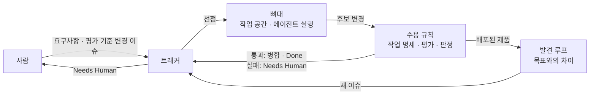
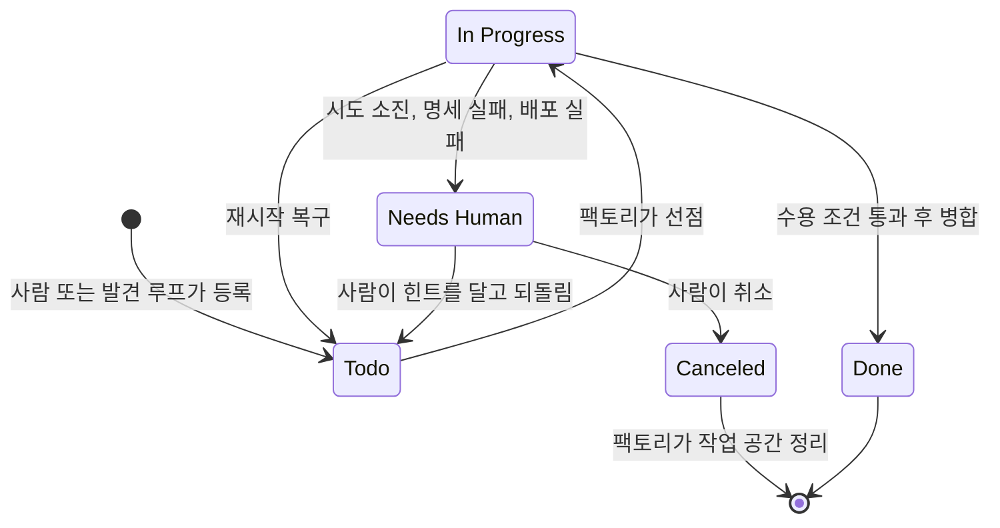
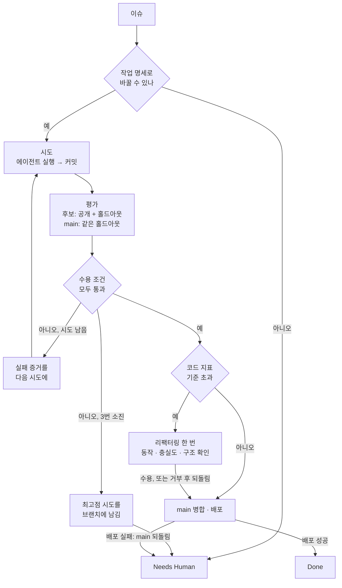
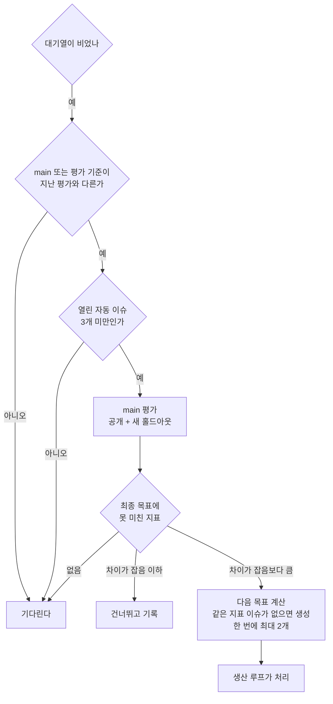

# tiny-software-factory 명세: Symphony의 뼈대 위에 eval 관문을 얹은 서비스

## 목표

이 리포트는 새로 정리한 시스템 명세(SPEC.md)를 다 읽지 않아도, 팩토리가 어떤 규칙으로 일을 받고, 변경을 받아들이고, 다음 일을 만드는지 설명할 수 있게 한다. 읽고 나면 명세의 어느 부분이 OpenAI Symphony와 같고 어디가 이 팩토리만의 규칙인지 구분할 수 있다. 명세가 스스로 밝힌 빈틈과, 다른 프로젝트에 옮길 때 새로 설계해야 할 부분도 알 수 있다.

## 배경

사용자는 현재 시스템을 OpenAI Symphony의 SPEC.md처럼 명세로 정리해 저장하고, 리포트로 설명해 달라고 했다. 명세는 한국어로 쓰라고 했다.

지금까지 시스템의 설명은 단계별 소개 자료, 처음 계획 리포트, Symphony 비교 리포트에 흩어져 있었다. 그 뒤 SWF-13까지 구현이 여러 번 바뀌었으므로, 명세는 기존 문서가 아니라 현재 코드(main 290f7ed)를 읽고 썼다. 명세는 저장소 루트의 SPEC.md이고, 21개 절과 부록 2개, 약 1,300줄이다. 절의 순서는 Symphony SPEC(18개 절과 부록 1개)을 따랐다.

---

## 명세의 요점

명세는 팩토리를 두 층으로 정의한다. 아래층은 Symphony와 같다. 트래커를 폴링해 이슈를 하나 선점하고, 이슈별 작업 공간에서 코딩 에이전트를 실행하고, 데이터베이스 없이 트래커 상태로 재시작을 복구한다. 위층은 Symphony에 없는 세 규칙이다. 정답을 아는 평가를 통과한 변경만 받아들이고, 평가 기준은 사람이 등록한 별도 경로로만 바뀌며, 대기열이 비면 평가 결과가 다음 요구사항이 된다.

명세는 이 규칙이 아직 강제되지 않는 곳 12개를 함께 적었다. 가장 큰 빈틈은 세 가지다. 평가 기준을 바꾸는 경로는 동작이 그대로인지 확인하지 않는다. 숫자로 적지 않은 요구사항은 판정에 들어가지 않는다. 에이전트는 샌드박스 없이 실행되므로 비공개 평가 기록과 비밀값 파일을 읽을 수 있다.

다른 프로젝트에 옮길 때는 아래층과 수용 규칙을 그대로 쓴다. 정답을 아는 평가와 제품 계약은 그 제품에 맞게 새로 설계하고, 허용폭과 측정 잡음 같은 값은 그 제품에서 다시 잰다. 팩토리 자체의 다음 개선으로는 평가 기준 변경 경로에 동작 보존 검사를 더하는 것을 권한다.

<a id="overview"></a>

## 전체 그림

명세의 21개 절은 네 부분으로 읽을 수 있다. 첫째는 일을 받아 실행하는 뼈대다. 트래커 상태, 폴링, 작업 공간, 에이전트 실행이 여기에 속하고 Symphony와 거의 같다. 둘째는 변경을 받아들이는 수용 규칙이다. 이슈를 작업 명세로 바꾸고, 평가기로 판정하고, 통과한 것만 병합한다. 셋째는 발견 루프다. 평가 결과를 다음 이슈로 바꿔 뼈대에 다시 넣는다. 넷째는 설정, 관측, 복구, 보안 같은 운영 규칙과, 명세가 스스로 밝힌 빈틈이다.

앞의 세 부분은 하나의 순환을 이룬다. 뼈대가 이슈를 꺼내면 수용 규칙이 그 결과를 판정하고, 판정 결과는 트래커로 돌아간다. 대기열이 비면 발견 루프가 같은 평가기로 배포된 제품을 재고, 목표에 못 미친 지표를 새 이슈로 만든다. 사람은 이 순환 밖에서 요구사항과 평가 기준을 이슈로 넣고, 실패한 일을 판단한다. 넷째 부분은 이 순환을 운영하는 규칙과, 순환이 아직 지키지 못하는 규칙을 모은다.

**명세의 절과 이 리포트의 네 부분**

| 부분 | 명세의 절 | Symphony에 대응하는 절 |
| --- | --- | --- |
| 일을 받아 실행하는 뼈대 | 3 개요, 4 도메인 모델, 7 상태 기계, 8 폴링·선점·조정, 9 작업 공간, 10 에이전트 실행, 11 트래커 연동 | §3, §4, §7~11 |
| 변경을 받아들이는 수용 규칙 | 5 저장소 계약, 12 작업 명세 변환, 13 평가 계약, 14 수용과 전달 | §5, §12 (평가·수용은 없음) |
| 평가가 다음 일이 되는 발견 루프 | 15 발견 루프 | 없음 |
| 운영 규칙과 빈틈 | 6 설정, 16 관측, 17 실패와 복구, 18 보안, 19 참조 알고리즘, 20 검증, 21 점검표, 부록 A·B | §6, §13~18, 부록 A |



사람과 발견 루프가 모두 트래커에 이슈를 넣고, 변경이 제품에 들어가는 길은 수용 규칙 하나뿐이라는 점을 보여 준다.

1. [일을 받아 실행하는 뼈대는 Symphony와 무엇이 같고 다른가](#skeleton) — 트래커 상태가 곧 선점 기록이고, 한 번에 한 이슈만 실행하며, 트래커에 쓰는 것은 팩토리뿐이다.
2. [변경은 어떤 규칙을 통과해야 제품에 들어가는가](#acceptance) — LLM은 이슈를 정리하고 코드를 쓰지만, 통과 기준은 프로그램이 정하고 정답을 아는 평가가 판정한다.
3. [평가 결과는 어떻게 다음 요구사항이 되는가](#discovery) — 목표와의 차이가 측정 잡음보다 클 때만 이슈를 만들고, 다음 목표는 현재값과 최종 목표의 중간으로 잡는다.
4. [명세는 무엇을 아직 강제하지 못하고, 다른 프로젝트에서는 무엇을 바꿔야 하는가](#gaps) — 빈틈 12개 중 셋은 수용 규칙 자체를 약하게 만들고, 옮길 때 새로 설계해야 하는 것은 평가기와 제품 계약이다.

<a id="skeleton"></a>

## 일을 받아 실행하는 뼈대는 Symphony와 무엇이 같고 다른가

트래커 상태가 곧 선점 기록이고, 한 번에 한 이슈만 실행하며, 트래커에 쓰는 것은 팩토리뿐이다.

트래커 상태, 폴링 틱, 작업 공간, 에이전트 실행 계약. 변경의 판정은 다음 절에서 다룬다.

뼈대의 구조는 Symphony와 같다. 팩토리는 일정한 간격으로 트래커를 읽어 이슈 하나를 선점하고, 그 이슈만의 작업 공간에서 코딩 에이전트를 실행하고, 결과를 트래커에 보고한다. 재시작하면 트래커 상태와 남아 있는 작업 공간에서 이어 간다. 영속 데이터베이스는 없다.

다른 점은 단순화에서 나온다. Symphony는 여러 작업을 동시에 실행하고, 메모리에 선점 상태와 재시도 타이머를 둔다. 팩토리는 한 번에 한 이슈만 실행하므로, 트래커의 In Progress 상태가 선점 기록을 대신한다. 실패한 시도는 시간을 두고 다시 하지 않고, 실패 증거를 들고 곧바로 다음 시도로 간다.

**뼈대에서 Symphony와 다른 선택**

| 항목 | Symphony SPEC | 이 명세 |
| --- | --- | --- |
| 동시 실행 | 제한된 동시 실행 (슬롯) | 1개 |
| 선점 기록 | 오케스트레이터 메모리 | 트래커의 In Progress |
| 재시도 | 지수 백오프 | 실패 증거를 넘기며 최대 3번 연속 시도, 그 뒤 사람에게 |
| 트래커 쓰기 | 보통 에이전트가 도구로 한다 | 팩토리 컨트롤러만 한다. 에이전트는 자격 증명을 받지 않는다 |
| 성공한 실행의 끝 | 워크플로가 정한 상태 (예: 사람 검토) | Done. 사람의 리뷰 게이트는 없다 |
| 실행 중 조정 | 틱마다 실행 중인 작업을 확인 | 시도를 시작하기 전마다 확인 |
| 에이전트 세션 | app-server의 연속 턴 | 시도마다 Claude Code 세션 하나 |

트래커 상태는 여섯 개이고, 상태를 옮기는 주체가 정해져 있다. 팩토리는 Todo, In Progress, Done, Needs Human 사이를 옮기고, 사람은 Needs Human에서 다음 행동을 고르거나 이슈를 취소한다.



Done으로 가는 길은 수용 조건 통과 하나뿐이고, Needs Human에서 나가는 길은 모두 사람이 고른다.

<a id="skeleton-tick"></a>

### 폴링 틱 하나에서는 무엇이 어떤 순서로 일어나는가

취소 정리 → 일시 정지 확인 → 후보 선택 → 비었으면 발견 루프 → 실행 순서이고, 비용과 연속 실패로 스스로 멈춘다.

틱의 순서, 후보 선택, 일시 정지

틱은 정해진 순서로 돈다. 먼저 Canceled 이슈의 작업 공간을 지운다. 다음으로 일시 정지가 아니면 후보 하나를 고른다. 후보가 없으면 발견 루프를 부르고, 발견 루프가 이슈를 만들었으면 기다리지 않고 다음 틱에서 그 이슈를 처리한다. 후보가 있으면 처리하고, 처리한 이슈가 평가 기준을 바꿨으면 팩토리가 자신을 새 코드로 다시 실행한다.

**후보 선택과 일시 정지 규칙**

| 규칙 | 내용 |
| --- | --- |
| 후보 | Todo 상태이고 factory 또는 factory-eval 라벨이 있다. 둘 다 있으면 평가 기준 변경으로 본다 |
| 순서 | 우선순위 1~4가 먼저 (1이 가장 급하다), 다음은 오래된 것, 다음은 식별자 사전순 |
| 일시 정지 1 | 오늘 시작한 실행의 Claude Code 비용 합이 하루 상한($400) 이상 |
| 일시 정지 2 | 끝난 실행의 마지막 3개가 모두 Needs Human |
| 해제 | 팩토리가 만든 일시 정지 이슈를 사람이 Done으로 옮긴다. 같은 이유로 곧바로 다시 멈추지 않게 해제 기록을 남긴다 |

트래커 조회가 실패하면 그 틱만 건너뛴다. 처리 도중의 트래커 쓰기 실패는 팩토리를 끝내지만, 다시 시작하면 끊긴 이슈를 Todo로 되돌려 같은 작업 공간에서 이어 간다.

<a id="skeleton-workspace"></a>

### 에이전트는 어떤 작업 공간과 권한으로 실행되는가

이슈마다 git worktree를 만들고, 에이전트는 개인 설정과 트래커 자격 증명 없이, 승인 요청 없이 실행된다.

작업 공간, 작업 공간 자료, 에이전트 실행 명령과 환경

작업 공간은 이슈마다 하나인 git worktree다. 제품 작업은 제품 저장소에, 평가 기준 변경은 팩토리 저장소에 만든다. 작업 공간은 실패해도 지우지 않고, 같은 이슈를 다시 실행하면 그대로 이어 쓴다. 병합한 작업 공간만 지우고, 브랜치는 남긴다.

팩토리는 작업 공간의 .factory 폴더에 에이전트가 읽을 자료를 둔다. 작업 명세, 제품 계약, three.js 사본, 정답이 공개된 공개 세트, 그리고 이전 시도의 실패 증거다. 홀드아웃 장면의 정답은 넣지 않는다. 커밋은 에이전트가 아니라 팩토리가 시도마다 한다.

**에이전트 실행 계약**

| 항목 | 규칙 |
| --- | --- |
| 실행 | Claude Code를 비대화식으로 시도마다 한 번. 출력은 이벤트 단위로 기록한다 |
| 개인 설정 | 끊는다 (hook, 플러그인, 자동 메모리, 개인 지시문 파일). 결과가 실행하는 사람의 설정에 따라 달라지지 않게 한다 |
| 모델과 자격 증명 | AWS default profile의 Bedrock. 모델은 지정하지 않는다 |
| 트래커 비밀값 | 환경에서 지운다. 실행 전 점검이 확인한다 |
| 상한 | 시도당 비용 $5, 시간 3,600초. 넘어도 시도 하나로 세고 평가까지 간다 |
| 승인 | 없다. 신뢰할 수 있는 단일 머신을 전제로 한다 |

**일을 받아 실행하는 뼈대는 Symphony와 무엇이 같고 다른가 · 이해도 확인**

**Q2. 팩토리가 이슈를 처리하던 중에 머신이 재부팅됐다. 팩토리를 다시 시작하면 그 이슈는 어떻게 되는가?**

선택지를 보기 전에 답을 떠올려 보세요.

A. 메모리에 있던 실행 상태를 복원해 끊긴 시도를 이어서 실행한다

B. In Progress로 남은 이슈를 Todo로 되돌리고, 남아 있는 작업 공간에서 다시 실행한다

C. 작업 공간을 지우고 main에서 새로 시작한다

D. 중단을 실패로 보고 Needs Human으로 옮긴다

확인하기 전에 선택 이유를 한 문장으로 설명해 보세요. 입력하거나 채점하지 않습니다.

---

**정답과 해설 — 답을 고른 뒤 확인하세요**

**Q2: B** — 선점의 기록이 트래커의 In Progress이므로, 재시작 복구는 그 상태를 Todo로 되돌리는 것으로 충분하다. 작업 공간은 그대로 남아 이어서 쓴다.

근거: '일을 받아 실행하는 뼈대' 절의 상태 그림과 근거 E1

A. 명세는 메모리 상태를 복원하지 않는다. 복원할 메모리 상태 자체가 없다.

B. 시작할 때 끊긴 실행을 트래커 상태로 찾아 Todo로 되돌리고, 작업 공간은 지우지 않았으므로 이어 쓴다.

C. 작업 공간은 실패나 중단으로 지우지 않는다. 병합하거나 취소된 경우에만 지운다.

D. Needs Human은 시도 소진, 명세 실패, 배포 실패일 때다. 재시작으로 끊긴 실행은 대기열로 되돌린다.

이해를 돕기 위한 자가 확인입니다. 학습 효과를 측정하거나 보고서의 판정을 바꾸지 않습니다.

---

**일을 받아 실행하는 뼈대는 Symphony와 무엇이 같고 다른가 · 근거**

[명세 7.5 멱등성과 복구 규칙](<../../SPEC.md>)

```text
- 오케스트레이터는 한 번에 이슈 하나만 실행해야 한다. 그래서 중복 선점이 생기지 않는다.
- 선점은 트래커 상태 이동(`Todo` → `In Progress`)으로 기록해야 한다.
- 재시작 복구는 트래커와 파일 시스템으로 해야 한다.
```

[Symphony SPEC §1 Problem Statement](<https://github.com/openai/symphony/blob/main/SPEC.md>)

```text
Symphony is a long-running automation service that continuously reads work from a configured issue tracker, creates an isolated workspace for each issue, and runs a coding agent session for that issue inside the workspace.
```

<a id="acceptance"></a>

## 변경은 어떤 규칙을 통과해야 제품에 들어가는가

LLM은 이슈를 정리하고 코드를 쓰지만, 통과 기준은 프로그램이 정하고 정답을 아는 평가가 판정한다.

작업 명세 변환, 평가와 수용 조건, 리팩터링 단계, 평가 기준 변경 경로

변경을 받아들이는 기준은 사람의 리뷰가 아니라 정답을 아는 평가다. 명세는 LLM이 하는 일과 프로그램이 정하는 일을 나눈다. LLM은 이슈를 작업 명세로 정리하고 코드를 쓴다. 무엇을 통과로 볼지, 판정 결과로 무엇을 할지는 프로그램이 정한다.

이 규칙은 Symphony에 없는 부분이다. Symphony는 에이전트 실행을 조율하고 실행의 성공 여부를 워크플로에 맡긴다. 이 명세는 실행 뒤에 판정 단계를 두고, 판정을 통과한 커밋만 병합하게 한다. 그림은 이슈 하나가 거치는 길이다.



병합으로 가는 화살표는 수용 조건 통과 뒤에만 있다. 리팩터링이 거부돼도 이미 통과한 구현은 병합된다.

<a id="acceptance-spec"></a>

### 이슈의 자연어는 어떻게 판정 가능한 작업 명세가 되는가

LLM이 낸 목표 숫자는 이슈 원문에 그대로 있고 방향이 맞을 때만 받아들이며, 기본 수용 조건은 항상 붙는다.

작업 명세 변환의 역할 분담과 지표 목표 검증

작업 명세 변환은 LLM에게 이슈 제목, 본문, 사람 댓글을 주고 목표, 유지할 것, 뺄 것, 제약, 메모, 지표 목표를 구조로 받는다. LLM은 코드를 읽지 않고 목표를 지어내지 않는다. 그다음 프로그램이 지표 목표를 하나씩 검증한다.

1. 부등호 방향이 그 지표의 최종 목표 방향과 같아야 한다. 기준을 거꾸로 느슨하게 만드는 길을 막는다.
2. 인용 구절이 이슈 원문에 그대로 있어야 한다.
3. 인용 구절에 목표 숫자가 들어 있어야 한다.

하나라도 어기면 에이전트를 실행하지 않고 사람에게 넘긴다. 검증을 통과한 목표 위에 기본 조건이 항상 붙는다. 제품 작업이면 앱이 계약대로 시작되는지, 계약 위반이 없는지, Codex를 app-server 방식으로만 부르는지, 홀드아웃 점수가 main보다 떨어지지 않는지를 함께 본다.

이 규칙에는 대가가 있다. 숫자로 적지 않은 요구사항은 메모로만 에이전트에게 간다. 에이전트가 그 요구사항을 지키지 않아도 eval은 통과한다. SWF-13에서 복잡도 15 이하라는 목표가 지표 키에 없어서 수용 조건에서 빠진 것이 그 예다.

<a id="acceptance-oracle"></a>

### 평가기는 무엇을 재고 어떻게 판정하는가

공개 4장면과 매번 새로 뽑는 홀드아웃 8장면을 제품에 넣고, 뷰어가 그린 장면을 정답과 비교해 조건별로 판정한다.

평가 세트, 채점, 안정성, 수용 조건 판정

평가기는 시드로 정답 장면을 만들고, 헤드리스 브라우저에서 렌더링한 이미지를 제품에 요청한다. 제품이 만든 장면을 뷰어에서 읽어 정답과 비교한다. 공개 세트는 고정 시드 4개이고 정답이 작업 공간에 공개된다. 홀드아웃은 평가마다 새로 뽑는 8개이고, 그림자와 노이즈가 섞이며 공개되지 않는다.

장면 하나의 점수는 충실도(0~100)다. 물체를 하나도 맞히지 못하면 카메라가 맞아도 0점이 되도록, 물체 검출 F1을 곱한다.

```text
충실도 = 100 × F1 × (0.20·화각 + 0.15·기울기 + 0.20·배치 + 0.15·(크기·색) + 0.30·실루엣 IoU)
```

홀드아웃 장면은 두 번 요청한다. 두 번째 요청은 사람 눈에는 같고 바이트만 다른 이미지다. 두 결과의 충실도 차와 화각 차가 안정성 지표다. 같은 장면은 항상 같은 두 번째 이미지가 되므로, 후보와 main이 같은 입력을 받는다.

**제품 작업의 수용 조건**

| 조건 | 통과하려면 |
| --- | --- |
| 실행 | 앱이 180초 안에 계약대로 포트를 연다 |
| 계약 스모크 | 평가 중 계약 위반이 하나도 없다 (응답 형식, 장면 파일, 뷰어, 바닥 메시, 외부 요청 등) |
| 런타임 | 평가 중 앱의 프로세스에 codex app-server가 있고 codex exec는 없다 |
| 지표 목표 | 이슈가 숫자로 요구한 세트 평균 지표를 채운다 |
| 홀드아웃 회귀 | 후보의 홀드아웃 충실도가 같은 시드로 잰 main보다 2점 넘게 낮지 않다 |

회귀 비교에서 같은 시드를 쓰는 이유는 홀드아웃이 매번 바뀌기 때문이다. 쉬운 시드가 뽑히면 main도 높게 나온다. 후보와 main을 같은 장면으로 함께 재야 차이가 코드에서 왔다고 볼 수 있다.

<a id="acceptance-refactor"></a>

### eval을 통과한 구현은 병합 전에 무엇을 더 거치는가

코드 지표가 기준을 넘으면 리팩터링을 한 번 하고, 동작·충실도·구조 세 조건을 모두 통과할 때만 받아들인다.

리팩터링 단계의 조건과 거부 시 동작

통과한 구현의 코드 지표가 기준(파일 400줄, 함수 60줄, 분기 복잡도 15) 안이면 바로 병합한다. 넘으면 리팩터링 에이전트를 한 번 실행하고, 다음 세 조건을 모두 확인한다.

**리팩터링을 받아들이는 조건**

| 검사 | 조건 |
| --- | --- |
| 동작 | 작업 명세의 수용 조건을 다시 모두 통과한다 |
| 충실도 | 공개 세트 충실도가 리팩터링 전보다 2점 넘게 낮지 않다 |
| 구조 | 기준을 넘었던 지표가 하나 이상 줄고, 어느 지표도 이전 값과 기준 중 큰 값을 넘지 않는다 |

하나라도 실패하면 리팩터링 전 커밋으로 되돌리고 그대로 병합한다. 구현은 이미 eval을 통과했기 때문이다. 그래서 리팩터링 단계는 병합을 막지 않고, 구조를 나아지게 할 기회만 준다.

<a id="acceptance-eval-path"></a>

### 평가 기준 자체는 어떤 길로만 바뀌는가

평가 기준은 사람이 등록한 factory-eval 이슈로만 바뀌고, 바뀐 파일의 범위와 채점기 검증으로 판정한다.

평가 기준 변경 이슈의 처리와 채점기 검증

평가 기준이 틀려도 제품 작업이 그것을 고쳐서는 안 된다. 기준을 낮춰서 통과하는 길이 열리기 때문이다. 그래서 명세는 평가 코드와 제품 계약을 평가 자산으로 묶고, 사람이 factory-eval 라벨로 등록한 이슈로만 바꾸게 한다. 팩토리는 이 이슈를 팩토리 저장소의 작업 공간에서 실행한다.

판정은 두 가지다. 바뀐 파일이 평가 자산 범위 안에만 있어야 하고, 바뀐 코드로 돌린 채점기 검증이 통과해야 한다. 채점기 검증은 정답을 그대로 돌려주는 앱, 빈 장면을 돌려주는 앱, 오차를 단계별로 넣은 앱, 요청마다 흔들리는 앱을 평가해 채점기가 좋은 결과와 나쁜 결과를 구분하는지 본다.

**채점기 검증의 통과 조건**

| 항목 | 기준 |
| --- | --- |
| 정답 앱 | 95점 이상 |
| 빈 앱 | 5점 이하 |
| 오차 주입 앱 | 오차 0%가 95점 이상이고, 오차 10%·20%·40%로 갈수록 점수가 줄어든다 |
| 안정성 | 결정적인 앱 6개는 안정성 지표가 0이고, 흔들리는 앱은 두 지표가 최종 목표를 넘는다 |
| 결정성과 입력 | 같은 시드는 같은 이미지가 되고, 두 번째 요청 이미지는 바이트만 다르다 |
| 계약 | 기준 앱 7개 모두 계약 위반이 없다 |

통과하면 팩토리 main에 병합하고, 상주 중인 팩토리는 자신을 새 평가 코드로 다시 실행한다. 이 판정에는 빈틈이 있다. 채점기 검증은 장면 생성이 조금 바뀌어도 통과하므로, 평가 코드를 정리하는 변경이 동작을 바꿨는지는 확인하지 못한다.

**변경은 어떤 규칙을 통과해야 제품에 들어가는가 · 이해도 확인**

**Q1. 이슈 본문에 "뷰어가 더 빨리 뜨게 해 달라"고만 적혀 있고 숫자는 없다. 팩토리가 이 이슈를 처리할 때 수용 조건은 어떻게 되는가?**

선택지를 보기 전에 답을 떠올려 보세요.

A. LLM이 적당한 목표 시간을 정해 수용 조건에 넣는다

B. 숫자가 없으므로 변환에 실패하고 곧바로 Needs Human으로 간다

C. 기본 조건만 붙고, 빨리 뜨게 하라는 요구는 메모로만 에이전트에게 전달된다

D. 평가기가 생성 시간 지표로 main보다 빨라졌는지 자동으로 판정한다

확인하기 전에 선택 이유를 한 문장으로 설명해 보세요. 입력하거나 채점하지 않습니다.

나중에 이 보고서를 다시 열어 이 핵심 질문을 풀어보세요. 시간과 진행 상태는 저장하지 않습니다.

---

**정답과 해설 — 답을 고른 뒤 확인하세요**

**Q1: C** — 명세는 지표 목표를 이슈 원문의 숫자로만 받아들이고, 기본 조건은 항상 붙인다. 숫자 없는 요구사항은 판정에 들어가지 않는 빈틈(B3)으로 남는다.

근거: '이슈의 자연어는 어떻게 판정 가능한 작업 명세가 되는가' 절과 근거 E3

A. 작업 명세 변환에서 LLM은 목표를 지어내지 않는다. 목표 숫자는 이슈 원문에 있을 때만 받아들인다.

B. 변환 실패는 검증을 어긴 지표 목표가 있을 때다. 지표 목표가 없는 이슈도 기본 조건만으로 작업 명세가 된다.

C. 기본 조건은 항상 붙고, 숫자 없는 요구사항은 메모로만 전달된다. 그래서 지키지 않아도 eval을 통과할 수 있다.

D. 생성 시간은 기록만 하고 목표가 없다. 이슈가 숫자로 요구하지 않으면 판정 조건이 되지 않는다.

이해를 돕기 위한 자가 확인입니다. 학습 효과를 측정하거나 보고서의 판정을 바꾸지 않습니다.

---

**변경은 어떤 규칙을 통과해야 제품에 들어가는가 · 근거**

[지표 목표 검증 (작업 명세 변환)](<../../tsf/spec.py>)

```text
op, _ = FINAL_TARGETS[m["metric"]]
if m["op"] != op:
    raise SpecError(f"{m['metric']}의 방향은 '{op}'여야 한다 (받은 값 '{m['op']}')")
if m["quote"] not in source or not any(abs(n - m["value"]) < 1e-9 for n in _numbers(m["quote"])):
    raise SpecError(f"{m['metric']} 목표 {m['value']}가 이슈 원문에 없다 (인용: {m['quote'][:80]})")
```

[명세 13.9 수용 조건 판정 중 홀드아웃 회귀](<../../SPEC.md>)

```text
| `holdout-regression` | 후보 홀드아웃 충실도 ≥ 같은 시드 main − 2.0. main이 없으면 통과로 보고 생략을 기록한다 |
```

[리팩터링 단계의 수용 조건](<../../tsf/refactor.py>)

```text
받아들이지 않으면 리팩터링 전 커밋으로 되돌리고 그대로 병합한다. 구현은 이미 eval을 통과했기 때문이다.
```

[평가 자산 변경 경로의 수용 조건](<../../tsf/eval_change.py>)

```text
수용 조건 1. 바뀐 파일이 EVAL_SCOPE 안에만 있다  2. worktree의 새 코드로 돌린 calibrate가 통과한다
```

<a id="discovery"></a>

## 평가 결과는 어떻게 다음 요구사항이 되는가

목표와의 차이가 측정 잡음보다 클 때만 이슈를 만들고, 다음 목표는 현재값과 최종 목표의 중간으로 잡는다.

발견 루프의 실행 조건, 미달 판정, 단계적 목표, 이슈 생성 상한

대기열이 비면 발견 루프가 배포된 main을 평가해, 최종 목표에 못 미친 지표로 다음 이슈를 만든다. 차이가 그 지표의 측정 잡음보다 작으면 이슈를 만들지 않는다. 잡음보다 작은 차이를 쫓으면 개선이 아니라 운을 쫓게 되기 때문이다.

발견 루프는 생산 루프와 같은 평가기를 쓰고, 만든 이슈도 사람이 만든 이슈와 같은 작업 명세 규칙과 수용 조건을 거친다. 그래서 발견 루프가 잘못된 목표를 쫓아도 망가진 코드는 병합되지 않는다. 판단은 프로그램이 하고, LLM은 장면별 수치를 보고 관찰 한 문장과 원인 가설 한 문장만 쓴다. 해결 방법은 쓰지 않는다.



같은 main을 같은 기준으로 다시 평가하지 않고, 자동 이슈가 쌓이지 않도록 세 군데서 멈춘다.

<a id="discovery-target"></a>

### 다음 목표는 어떻게 계산하고, 측정 잡음은 그 계산을 어떻게 바꾸는가

한 단계의 폭은 차이의 절반과 잡음 중 큰 값이고, 최종 목표에 충분히 가까우면 최종 목표를 바로 쓴다.

단계적 목표의 식과 실제 기록 두 건

최종 목표를 한 번에 요구하면 통과하지 못하고 사람에게 넘어가기 쉽다. 그래서 다음 목표는 현재값과 최종 목표의 중간이다. 다만 한 단계의 폭은 측정 잡음보다 작게 잡지 않는다.

```text
한 단계 = max(|최종 − 현재| / 2, 잡음)
다음 목표 = 현재에서 한 단계만큼 최종 쪽으로 (최종 목표를 넘지 않게)
다음 목표가 최종에서 max(|최종| × 0.1, 0.05) 안이면 최종 목표를 그대로 쓴다
```

실제 기록 두 건이 이 규칙을 보여 준다. 측정 잡음을 반영한 뒤 같은 main에서 두 안정성 지표가 모두 최종 목표에 못 미쳤지만, 발견 루프는 한 지표에만 이슈를 만들었다.

**SWF-11 병합 뒤 발견 루프의 판정 (홀드아웃)**

| 지표 | 현재 | 최종 목표 | 잡음 | 판정 |
| --- | --- | --- | --- | --- |
| 충실도 차 | 0.78 | 0.5 | 0.979 | 차이 0.28이 잡음 안이라 건너뜀 |
| 화각 차 | 0.98° | 0.2° | 0.749° | 한 단계 0.749 → 0.98 − 0.749 = 0.23 → 최종 목표와의 차이 0.03이 0.05 안이라 최종 목표 0.2로 이슈 생성 (SWF-12) |

잡음을 반영하기 전에는 이 규칙이 없었다. 그때 발견 루프는 충실도 차 0.73에서 0.61을 목표로 SWF-10을 만들었고, 같은 코드에서도 값이 흔들려 세 번 모두 실패했다. 지금 규칙으로 다시 계산하면 차이 0.23이 잡음 0.979 안이므로 SWF-10은 만들어지지 않는다.

**평가 결과는 어떻게 다음 요구사항이 되는가 · 이해도 확인**

**Q3. 어떤 지표의 홀드아웃 평균이 0.62이고 최종 목표는 0.5 이하, 측정 잡음은 0.3이다. 발견 루프는 어떻게 하는가?**

선택지를 보기 전에 답을 떠올려 보세요.

A. 목표 0.56으로 이슈를 만든다

B. 최종 목표 0.5로 이슈를 만든다

C. 이슈를 만들지 않고, 잡음 안이라 건너뛰었다고 기록한다

D. 사람에게 판단을 맡기는 Needs Human 이슈를 만든다

확인하기 전에 선택 이유를 한 문장으로 설명해 보세요. 입력하거나 채점하지 않습니다.

---

**정답과 해설 — 답을 고른 뒤 확인하세요**

**Q3: C** — 목표와의 차이가 그 지표의 측정 잡음 이하이면 이슈를 만들지 않는다. 잡음보다 작은 차이를 쫓으면 운을 쫓게 되기 때문이다.

근거: '평가 결과는 어떻게 다음 요구사항이 되는가' 절과 근거 E7, E8

A. 0.56은 차이의 절반만 줄인 값이다. 지금 규칙은 차이가 잡음보다 클 때만 이슈를 만든다.

B. 이슈를 만들려면 먼저 차이가 잡음보다 커야 한다. 차이 0.12는 잡음 0.3보다 작다.

C. 차이 0.12가 잡음 0.3 이하이므로 이슈를 만들지 않고 기록만 남긴다.

D. 발견 루프는 Needs Human 이슈를 만들지 않는다. 잡음 안의 차이는 건너뛴다.

이해를 돕기 위한 자가 확인입니다. 학습 효과를 측정하거나 보고서의 판정을 바꾸지 않습니다.

---

**평가 결과는 어떻게 다음 요구사항이 되는가 · 근거**

[단계적 목표 계산](<../../tsf/discovery.py>)

```text
step = max(abs(final - actual) / 2, noise)
nxt = actual - step if op == "<=" else actual + step
nxt = max(nxt, final) if op == "<=" else min(nxt, final)
if abs(nxt - final) < max(abs(final) * 0.1, 0.05):
    nxt = final
```

[실제 발견 루프 출력 (SWF-11 병합 뒤)](<../../docs/guide/logs/05-up7-console.txt>)

```text
발견 루프: holdout:stability.fidelity_delta 0.78는 목표 0.5와의 차이가 측정 잡음 0.979 안이라 건너뛴다
발견 루프: SWF-12 생성 — [auto] 같은 장면 재생성 시 화각 차 개선: 홀드아웃 0.98 → 0.2 (최종 목표 0.2)
```

<a id="gaps"></a>

## 명세는 무엇을 아직 강제하지 못하고, 다른 프로젝트에서는 무엇을 바꿔야 하는가

빈틈 12개 중 셋은 수용 규칙 자체를 약하게 만들고, 옮길 때 새로 설계해야 하는 것은 평가기와 제품 계약이다.

부록 B의 알려진 한계, 21절의 권장 확장, 다른 프로젝트에 옮길 때 바꿀 부분

명세는 구현이 아직 지키지 못하는 규칙을 숨기지 않고 부록 B에 12개로 적었다. 이 가운데 세 개는 수용 규칙의 약점이다. 평가 기준 변경 경로는 동작 보존을 확인하지 않고, 숫자가 없는 요구사항은 판정에 들어가지 않으며, 비공개 평가 기록과 비밀값 파일은 에이전트가 파일로 읽을 수 있다.

나머지는 측정, 비용, 운영의 빈틈이다. 이들은 판정을 틀리게 하지는 않지만, 판정이 놓치는 품질이나 운영 위험을 남긴다.

**명세가 밝힌 빈틈 (부록 B)**

| 종류 | 빈틈 | 영향 |
| --- | --- | --- |
| 수용 규칙 | 평가 기준 변경 경로가 범위와 채점기 검증만 본다 (B1) | 장면 생성이 조금 바뀌어도 병합된다 |
| 수용 규칙 | 숫자가 없는 요구사항은 수용 조건이 되지 않는다 (B3) | 지키지 않아도 eval을 통과한다 |
| 수용 규칙 | 샌드박스가 없어 비공개 평가 기록과 비밀값 파일을 읽을 수 있다 (B4) | 홀드아웃의 비공개성과 비밀값 격리가 지시문에 기댄다 |
| 측정 | 코드 지표가 가장 나쁜 항목 하나만 보여 준다 (B2) | 고칠 때마다 다음 문제가 한 겹씩 드러난다 |
| 측정 | 생성 시간 목표와 Codex 호출 상한이 없다 (B5) | 생성 시간이 약 50% 늘었지만 막지 않았다 |
| 측정 | 안정성 목표가 측정 잡음과 비슷한 크기다 (B6) | 같은 코드에서 목표 충족 여부가 평가마다 다르다 |
| 비용 | 하루 비용이 실행 기록의 Claude Code 비용만 센다 (B7) | 명세 변환, 관찰, Codex 비용이 상한에 빠진다 |
| 운영 | 동시성 1, 조정은 시도 전에만 (B8) | 긴 시도는 취소해도 끝까지 간다 |
| 운영 | 평가 자산 작업 공간 키와 정리 키가 다르다 (B9) | 특수 문자 ID에서만 정리가 빠질 수 있다 |
| 운영 | 처리 중 트래커 쓰기 오류가 팩토리를 끝낸다 (B10) | 다시 시작해야 한다 (복구는 자동) |
| 운영 | 배포 확인이 상태 주소 응답만 본다 (B11) | 장면 생성 실패는 다음 평가에서야 드러난다 |
| 학습 | 학습 루프가 없고 지시문은 한 버전뿐이다 (B12) | 반복되는 실패 패턴이 지시문에 반영되지 않는다 |

가장 먼저 메울 곳은 B1이다. 평가 기준은 모든 판정의 바탕이므로, 그 기준을 바꾸는 변경이 동작을 조용히 바꾸면 이후의 모든 점수가 달라진다. SWF-13에서 사람이 한 방법, 즉 바꾸기 전 출력을 기준값으로 남기고 바꾼 뒤 비교하는 방법을 그 경로의 수용 조건으로 넣으면 된다.

<a id="gaps-porting"></a>

### 다른 프로젝트에 옮길 때 그대로 쓸 것과 새로 설계할 것

뼈대와 수용 규칙은 제품과 무관하고, 평가기·제품 계약·최종 목표만 제품마다 다르다.

명세의 절을 옮겨 쓰는 방법

명세의 절은 제품과 무관한 것과 제품에 묶인 것으로 나뉜다. 트래커, 작업 공간, 에이전트 실행, 수용의 흐름, 발견 루프의 규칙은 제품이 바뀌어도 그대로 쓸 수 있다. 정답을 어떻게 만들고 무엇을 재는지는 제품마다 새로 설계해야 한다.

**옮길 때의 구분**

| 구분 | 명세의 절 | 옮길 때 할 일 |
| --- | --- | --- |
| 그대로 쓴다 | 7 상태 기계, 8 폴링·선점, 9 작업 공간, 10 에이전트 실행, 11 트래커 연동, 17 실패와 복구, 18 보안 | 트래커와 에이전트 CLI만 맞춘다 |
| 규칙은 그대로, 값은 새로 | 12 작업 명세 변환, 14 수용과 전달, 15 발견 루프 | 지표 키 목록, 허용폭, 측정 잡음을 그 제품에서 잰다 |
| 새로 설계한다 | 5.3 제품 계약, 13 평가 계약 | 정답을 아는 입력, 측정 방법, 점수, 채점기 검증용 기준 앱을 만든다 |

새로 설계할 부분에서 가장 어려운 것은 정답을 아는 입력이다. 이 팩토리는 사진에서 3D를 복원하는 문제에 정답이 없어서, 정답 장면을 먼저 만들고 그 렌더링을 입력으로 썼다. 다른 제품도 같은 질문에서 시작해야 한다. 무엇을 정답으로 두면 사람 없이 결과를 판정할 수 있는가.

**명세는 무엇을 아직 강제하지 못하고, 다른 프로젝트에서는 무엇을 바꿔야 하는가 · 이해도 확인**

**Q4. factory-eval 이슈로 평가 코드를 정리했는데, 그 변경이 장면 생성을 아주 조금 바꿨다. 채점기 검증은 통과했다. 현재 명세에서는 어떻게 되는가?**

선택지를 보기 전에 답을 떠올려 보세요.

A. 병합된다. 이 경로는 바뀐 파일의 범위와 채점기 검증만 확인한다

B. 리팩터링 단계의 동작 검사가 차이를 잡아 거부한다

C. 홀드아웃 회귀 조건이 점수 변화를 잡아 거부한다

D. 발견 루프가 다음 평가에서 차이를 찾아 되돌린다

확인하기 전에 선택 이유를 한 문장으로 설명해 보세요. 입력하거나 채점하지 않습니다.

나중에 이 보고서를 다시 열어 이 핵심 질문을 풀어보세요. 시간과 진행 상태는 저장하지 않습니다.

---

**정답과 해설 — 답을 고른 뒤 확인하세요**

**Q4: A** — 명세가 첫 번째로 밝힌 빈틈(B1)이다. 평가 기준을 바꾸는 경로는 동작 보존을 확인하지 않으므로, 바꾸기 전 출력을 기준값으로 비교하는 검사를 더해야 한다.

근거: '평가 기준 자체는 어떤 길로만 바뀌는가' 절, '명세는 무엇을 아직 강제하지 못하는가' 절과 근거 E6, E9

A. 평가 기준 변경 경로의 판정은 범위와 채점기 검증 두 가지뿐이다. 장면 생성이 바뀌었는지는 보지 않는다.

B. 리팩터링 단계는 제품 경로에만 있다. 평가 기준 변경 경로에는 동작 검사가 없다.

C. 홀드아웃 회귀는 제품 작업의 수용 조건이다. 평가 기준 변경에는 붙지 않는다.

D. 발견 루프는 목표 미달 지표로 이슈를 만들 뿐, 병합된 변경을 되돌리지 않는다.

이해를 돕기 위한 자가 확인입니다. 학습 효과를 측정하거나 보고서의 판정을 바꾸지 않습니다.

---

**명세는 무엇을 아직 강제하지 못하고, 다른 프로젝트에서는 무엇을 바꿔야 하는가 · 근거**

[명세 부록 B 중 B1](<../../SPEC.md>)

```text
| B1 | 평가 자산 경로의 수용 조건은 범위와 채점기 검증뿐이다. 코드 지표와 동작 보존을 확인하지 않는다 | 장면 생성이 조금 바뀌거나 복잡도가 늘어도 병합된다 (SWF-13에서 사람이 따로 확인) |
```

내용 검토: 명세의 각 규칙을 현재 코드(tsf/, factory.py, harness/v1, CONTRACT.md)와 대조했다. 발견 루프의 예시 값은 실제 실행 로그와 대조했고, 단계적 목표 식으로 다시 계산했다. Symphony SPEC 원문의 절 구성과 §1, §7을 다시 읽었다. 렌더러의 구조·다이어그램 검사를 통과한 최종 출력을 다시 읽었다.

확인 한계: 명세의 규칙은 코드를 읽어 확인했고, 모든 실패 경로를 실행해 보지는 않았다. 저장소에 단위 시험 묶음이 없다.
